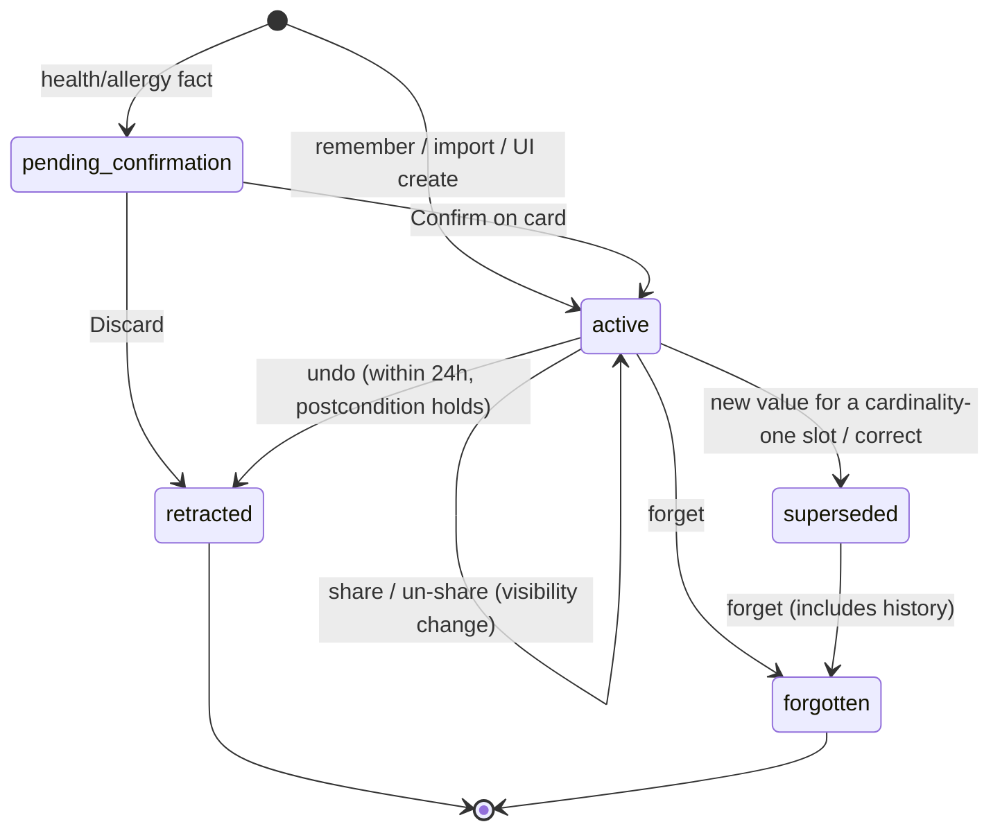

# Architecture

Baseline 2026-10-10. This specifies **planned** application behavior. Existing spike implementations and scoped validation are separate; production apps, contracts, migrations and voice runtime are not implemented. [Decisions](../adr/README.md), [stack](03-tech-stack.md) and [P0–P8](../plans/implementation-plan.md) define scope/status.

## 1. Context and drivers

Two adults need hands-occupied household capture, short spoken answers and persistent usable results. Home combines brief, conversation and one focused activity. Recent preserves work across topic changes and conversation expiry. English/Tamil/Tanglish evaluation begins in P0; full UI translation is deferred.

Privacy, provenance, explicit authority, reversible requested writes, approved suggestions, offline shopping and recovery constrain every modality. PWA only, responsive desktop, existing visual foundation and provider/budget restrictions remain binding.

## 2. Architecture principles

Backend services are the action authority. Models interpret/compose; Pipecat handles media. Household domain records, activities, presentations and transcripts are separate. An activity can hold a draft without storing a fact/task. Every visible/spoken success follows a receipt. Source visibility/deletion applies to all derivatives. Stale output cannot replace new context.

## 3. System context and topology

 ```mermaid
 flowchart LR
   Adult[Authenticated adult] --> Home[Installed PWA Home / Recent]
   Home -->|text / touch / signaling| App[TypeScript application turn service]
   Home <-->|foreground media| Voice[Python Pipecat service]
   Voice <-->|STT / TTS| Speech[Approved Sarvam streaming]
   Voice -->|final input / session context| App
   App -->|validated response stream| Voice
   App -->|authorized transaction| DB[(PostgreSQL / RLS)]
   App <-->|LLM / embeddings under policy| Gateway[Managed AI Gateway]
   DB --> Worker[TypeScript graphile-worker]
   Worker --> Push[Web Push / Inbox]
   Worker --> Backup[Encrypted R2 backup / forget journal]
```

Marketing nilumi.in is separate from app.nilumi.in and cannot access application cookies. staging-app.nilumi.in has separate database/provider settings. Existing staging.nilumi.in is the historical spike origin.

## 4. Containers and deployment

Planned application/API uses one Next.js standalone process with same-origin Hono handlers. Worker is always-on and uses PostgreSQL-native jobs. Python voice process connects with a narrow service identity; no direct household write credentials. Its hosting/media transport is gated in P1; SmallWebRTC is a local prototype choice. Do not infer public UDP/media support from Railway HTTP deployment. Authenticated media grants are short-lived and scoped to member/session/allowed provider configuration.

PostgreSQL roles isolate app, worker, maintenance and migrations. R2 contains encrypted recovery objects; decryption material is outside runtime infrastructure. Optional read-only calendar joins in P7. No general agent or document extraction service is deployed initially.

## 5. Code structure and boundaries

### 5.1 Monorepo

| Existing path | Actual responsibility |
|---|---|
| packages/ui | Tokens, fonts, theme/helpers, check scripts, static specimens; React components still to be built |
| spikes/s1 | Capture/playback, gateway, NLU and design-reference experiments; runnable evidence harness |
| spikes/s5 | Synthetic jobs, backup and recovery harness |
| docs | Product, decisions, contracts, plan, evidence and operations |

Planned paths, shown as text rather than links to nonexistent files: apps/web; apps/worker; services/voice; packages/contracts; packages/db; packages/domain; packages/ai; evals. P0 can use an isolated prototype area in this workspace; it cannot reuse family state or relax restrictions. P1 creates production boundaries, not a replacement repository.

### 5.2 Ownership

contracts owns versioned schemas; domain owns deterministic commands and revisions; db owns member-scoped transactions/RLS/migrations; ai owns role routing, minimization, cost reservations and grounded composition; web owns renderer/focus/PWA; voice owns audio framing/VAD/session transport; worker owns schedules and maintenance. UI imports domain projections/contracts, not database or provider keys. Python consumes JSON Schema; it does not duplicate business execution.

## 6. Turn pipeline

### 6.1 Sequence

 ```mermaid
 sequenceDiagram
   participant U as Home / Voice
   participant T as Turn service
   participant P as Policy and parser
   participant D as PostgreSQL
   participant R as Response coordinator
   U->>T: Input + active activity + turn sequence
   T->>P: Authenticate, scan secrets, reserve bounded cost
   P->>P: Parse and validate final affirmed intent
   P->>D: Authorized effect + operation + receipt (atomic)
   D-->>T: Actual command outcomes and current revisions
   T->>R: Grounded text + validated presentation + receipts
   R-->>U: Ordered typed events
   Note over U,R: Speech only validated sentences; late events discarded
```

### 6.2 Steps and rules

Capture final recognized text or typed input; touch creates the same typed action request. Session identity determines member/household. Validate activity ownership and visible references, minimize secrets before providers, reserve maximum cost before dispatch. Classify no more than five commands per turn, validate affirmed spans, dates and targets, then execute ordered commands independently. Effect+operation+content_refs+receipt commit atomically; no database transaction spans external generation.

Use withMemberTx for scoped reads/writes, transaction-local context and a restricted runtime role. Idempotency is actor-scoped; equal key and request hash returns the existing receipt, differing payload rejects. Never repeat already committed commands after crash/reconnect. Missing cost/routing evidence halts the AI role. Family routing/acknowledgement are rechecked at dispatch, including worker and voice stream renewal.

### 6.3 Clarifications and approvals

Ambiguous visible target/date needs a contextual choice, not model confidence. Clarification expires in five minutes and is attached to the active activity; it does not create Inbox noise. Pending health confirmation has no automatic expiry and is excluded from retrieval. Approval snapshots bind member/action/arguments/target revision/source refs/expiry. Approve rechecks authority and executes exactly once; edit produces a new proposal; reject closes it. Voice “yes” is valid only when bound to a specific current proposal.

### 6.4 Undo and interruption

Undo retracts a reversible operation with a receipt/history. Forget needs explicit irreversible confirmation. Interrupting/stopping audio cancels future speech, not an already committed operation. If a turn committed but the network dropped, resume returns its receipt and accurate presentation without repeating the write. Cancelling pending generation cannot pretend an effect was cancelled.

### 6.5 Continuing context

Every turn receives active activity, selected/visible item references and permitted recent dialogue. Ephemeral unanchored “that” context expires after 30 minutes. Durable activity references survive transcript expiry; reopening refreshes authorization/current data. A topic change creates or explicitly selects an activity and changes focus epoch. Voice sessions can span several activities but do not own their lifetime.

### 6.6 Trusted composition and broker

json-render patches are validated into nilumi-ui/1 presentations; actions resolve server-issued scoped references. Broker intersects member permission, resource visibility, current target version, input provenance and approval policy. The model cannot invent a capability or executable argument. Reject raw HTML, scripts, imports, unsupported nodes, oversized payloads, cross-member refs and invalid revision binds. Use deterministic text/known list view when generation fails.

### 6.7 Deferred runs

General runs, leases/fencing, delegation and uncertain external-effect reconciliation are extension points under ADR-043. No agent_runs/run_steps/run_events/state-transition or Vault migrations are required in P1. Brief assembly and routine drafts do not require an autonomous runtime.

### 6.8 Activity and presentation contracts

These are planned version1 wire sketches; implementation in P0/P1 publishes strict schemas, limits and cross-language fixtures. IDs are opaque strings. Actor/household and allowed actions are supplied by authenticated services, never trusted from client/model claims.

 ```ts
 type Activity = {
   schemaVersion: 1; id: string; householdId: string; ownerMemberId: string;
   kind: string; title: string; status: 'active' | 'archived'; revision: number;
   domainRefs: ResourceRef[]; currentPresentationId?: string;
   draft?: { text: string; provenance: 'generated' | 'user' };
   createdAt: string; updatedAt: string;
 };
 type ResourceRef = { kind: string; id: string; revision: number };
 type Presentation = {
   schemaVersion: 1; id: string; activityId: string; activityRevision: number;
   dataRefs: ResourceRef[]; catalogue: 'nilumi-ui/1'; spec: ValidatedSpec;
   sourceRefs: ResourceRef[]; generationTurnId: string;
   createdAt: string; expiresAt?: string;
 };
 type TurnContext = {
   schemaVersion: 1; activityId?: string; activityRevision?: number;
   clientContextId: string; focusEpoch: number; referencedItems: ResourceRef[];
   input: { modality: 'voice' | 'text' | 'touch'; text?: string; actionRef?: string };
   permittedDialogue: { turnId: string; text: string }[];
 };
 type ActionRequest = {
   schemaVersion: 1; turnId: string; activityId: string;
   idempotencyKey: string; actionRef: string; target?: ResourceRef; // absent for authorized creates
   desiredState?: { checked: boolean }; proposalId?: string;
 };
 type ActionReceipt = {
   schemaVersion: 1; id: string; idempotencyKey: string; requestHash: string;
   turnId: string; commandIndex: number;
   status: 'committed' | 'rejected' | 'conflict' | 'needs_confirmation';
   effect: 'changed' | 'no_op' | 'none';
   target?: ResourceRef; operationId?: string; undoRef?: string; reason?: string;
 };
 type VoiceSession = {
   schemaVersion: 1; id: string; memberId: string; expiresAt: string;
   state: 'connecting' | 'listening' | 'processing' | 'speaking' |
          'interrupted' | 'disconnected' | 'ended' | 'ai_paused';
   transport: string; connectionGeneration: number; activeTurnId?: string;
 };
 type ResponseEnvelope = {
   schemaVersion: 1; eventId: string; sequence: number; turnId: string;
   clientContextId: string; turnSequence: number; activityId: string; activityRevision: number;
   focusEpoch: number; payload: ResponsePayload;
 };
 type ResponsePayload =
   | { kind: 'text'; text: string; provisional: boolean }
   | { kind: 'receipt'; receipt: ActionReceipt }
   | { kind: 'presentation'; presentation: Presentation }
   | { kind: 'speech'; state: 'ready' | 'started' | 'stopped' | 'finished';
       segmentId: string; voiceSessionId: string; connectionGeneration: number }
   | { kind: 'clarification' | 'approval'; referenceId: string }
   | { kind: 'completed' | 'failed'; reason?: string };
```

ValidatedSpec is the bounded json-render adapter output, not an unvalidated model object. Presentation dataRefs pin every referenced data revision, not just activity revision. Revalidate member visibility on render/restore/action. Transient streaming patches are not persisted as valid presentations until complete validation. TurnContext permittedDialogue is assembled server-side; raw client context cannot widen access.


| Trusted component | Required semantics | Supporting controls |
|---|---|---|
| Checklist | Stable itemRef, label, desired checked state, quantity/unit, revision | Authorized check/uncheck/edit/remove, pending/conflict receipt |
| Table | Stable row refs, labelled columns and visible values | Approved sort/view controls; responsive card/text projection |
| Timeline | Stable event refs, absolute time/timezone, evidence revision | Inspect source; authorized schedule controls only after P5 |
| Text | Validated text and evidence refs; draft vs recorded distinction | Inspect/replay/correct where permitted |
| Simple diagram | Trusted nodes/edges/labels and linear text equivalent | Inspect refs; no executable diagram syntax or external resource load |

Initial planned renderer bounds are 64KiB per completed spec, 200 nodes and depth 6; a simple diagram has at most 20 nodes/40 edges. P0 tests and records adjustments before adoption; bounds are versioned contract configuration, not installed defaults. Large lists/tables use paging/projection rather than unlimited model payloads. Server resolves data/action references, emits permitted control labels and enforces capability/revision checks; diagrams cannot fetch model-supplied URLs.

### 6.9 Response ordering, focus and media

One coordinator emits receipts, validated sentences and validated presentations. Deduplicate eventId; reconnect from last authorized sequence. Within each authenticated client context (app session/viewport), active turnSequence/focusEpoch fences older output. Bind clientContextId to the session; another device's focus changes do not cancel this device's conversation. Cross-device domain changes still invalidate projections and target revisions. A committed older receipt remains available in its activity history, but cannot steal current focus or start old audio. Speech segments carry turn/activity/revision and connection generation; stop/flush on interruption, focus change, acknowledgement withdrawal, revocation or visibility change.

Keep keyed nodes/item IDs stable and buffer presentation replacement while a control is focused/being operated. Apply semantic data updates immediately without reordering the user's target; offer a deliberate view change when needed. Invalid/late output leaves current authorized layout or text usable. Ended transcript/audio lifecycle does not delete activities.

## 7. NLU contract

The following established schema/validation design is planned for the application and implemented only within the stated S3 spike scope. Shared production schema paths remain planned. This is the parser's candidate schema, not an executable ActionRequest. The turn service resolves visible targets, captures their revisions and actor-scoped idempotency, validates command-specific input/evidence, and then constructs authorized requests. Creates may have no existing target; approvals and drafts use their own strict schemas. Presentation-only requests never execute domain commands.
### 7.1 Output schema (Zod in `packages/contracts`, sent to the provider as a JSON Schema)
```ts
type NluResult = {
  language: "en" | "ta" | "mixed";
  commands: Command[];                    // 0..5, executed in order
  smalltalk_reply?: string;               // only when commands is empty
};

type Command =
  | { kind: "remember"; facts: FactCandidate[] }
  | { kind: "correct"; target: TargetRef; new_value: TypedValue;
      reason: "was_wrong" | "changed_in_world"; effective?: DateExpr;
      evidence: { start: number; end: number } }
  | { kind: "forget"; target: TargetRef }
  | { kind: "share"; target: TargetRef; evidence: { start: number; end: number } }
  | { kind: "unshare"; target: TargetRef }
  | { kind: "undo" }
  | { kind: "ask"; query: QueryPlan }
  | { kind: "inspect"; entity: EntityRef }
  | { kind: "list_add"; list: ListRef; items: { name: string; quantity?: number; unit?: string; note?: string }[] }
  | { kind: "list_set_checked"; list: ListRef; items: { id: string; checked: boolean; expected_version: number }[] }
  | { kind: "list_remove"; list: ListRef; items: string[] }
  | { kind: "list_read"; list: ListRef }
  | { kind: "task_create"; title: string; due?: DateExpr; assignees: MemberRef[]; remind_at?: DateExpr; recurrence?: string }
  | { kind: "reminder_create"; text: string; at: DateExpr; targets: MemberRef[]; recurrence?: string }
  | { kind: "task_complete"; target: TargetRef }
  | { kind: "task_list"; range?: DateExpr; assignee?: MemberRef }
  | { kind: "clarify_answer"; choice: string }
  | { kind: "unsupported"; reason: string };

type FactCandidate = {
  subject: EntityRef;
  predicate: string;                      // registry key, or "new:<snake_case>" (provisional)
  qualifier?: string;                     // role slot, e.g. "plumber" for service_provider
  object?: EntityRef;                     // entity-valued facts ("Ravi is our plumber")
  value?: TypedValue;                     // literal-valued facts
  valid_from?: DateExpr;                  // when it became true in the world, if stated ("from March")
  visibility_hint?: "household" | "shared" | "private";
  share_intent?: boolean;                 // true only when the evidence span contains an explicit share cue
  evidence: { start: number; end: number }; // exact character offsets into the transcript
  polarity: "affirmed" | "negated" | "hypothetical";
};

type EntityRef  = { existing_id?: string; mention: string; type_hint?: EntityType;
                    relation?: "self" | "spouse" | "child" | "children" | "household" };
type TargetRef  = { memory_id?: string; refers_to_last?: boolean; entity?: EntityRef; predicate?: string };
type TypedValue = { type: "text" | "date" | "datetime" | "number" | "money" | "phone" | "duration" | "boolean";
                    value: string; unit?: string; date?: DateExpr };
type DateExpr   = { phrase: string; resolved: string /* ISO 8601, household TZ */;
                    precision: "minute" | "day" | "month" | "year" | "approx" };
type QueryPlan  = { entities: EntityRef[]; predicates: string[]; time?: DateExpr;
                    answer_shape: "value" | "list" | "when" | "who" | "yes_no" | "summary";
                    include_history: boolean };
```

### 7.2 Validation after the LLM (deterministic)
1. **Schema validation** (Zod). On failure: one repair retry with the validation error, then a fallback reply.
2. **Evidence check**: each fact's `evidence` offsets must point at a transcript span that **contains the asserted value or entity mention** (normalized exact match), and the subject mention must be in the same clause. Deterministic cue rules (negation such as "not / no longer / never"; hypotheticals such as "if / maybe / might / should we") must agree with `polarity`. Only `affirmed` facts are written. Negated and hypothetical facts become a clarification or are ignored. Facts that fail validation are **shown as an "incomplete" card** ("I couldn't save: …"), never silently dropped. **Intent comes only from the member's own words:** every write command, share and visibility change must likewise cite a span of the current turn's transcript, or belong to the pending command the member is answering. Retrieved memories, calendar text, imported or forwarded text and earlier model output can only resolve references (step 6); they are never the evidence for a write.
3. **Share-cue validation**: `share_intent` or a `share` command is accepted only when the exact evidence span contains an explicit cue such as "share it with my wife", "tell my husband", "for both of us" or "let my wife know". The validator, not the LLM, decides that the cue exists. Without a verified cue, the LLM may only make facts **more private**, never less private.
4. **Health and allergy facts** (`allergic_to`, medication-like predicates) always require an explicit **Confirm** on the card before they become active. Answers about them always say "based on what's recorded", and the system never infers safety from the absence of a stored allergy.
5. **Registry check**: the predicate must exist and be compatible with the subject type and value type. `new:*` predicates are stored as **provisional** registry entries for admin review; they still work and are visibly marked.
6. **Reference checks**: `existing_id`s must be in the shortlist or context; `memory_id`s must be visible to the speaker (RLS). Sharing or un-sharing also verifies the actor is the owner.
7. **Date check**: recompute `resolved` from `phrase` with the pinned deterministic date adapter (§12); a mismatch triggers a clarification. Evaluate supported English/Tamil/Tanglish phrases explicitly. Any language normalization preserves original spans/occurred_at and needs fixtures; unsupported phrases clarify rather than accepting an unchecked model date. Chrono selection alone does not validate every language.
8. **Policy check**: visibility defaults (§8.2), member targeting (reminders for "us" → all adults), shared-memory adult-only reads and existence-leak rules (§15.2).

### 7.3 Prompt structure (designed for provider prompt caching)
```
[static, cacheable]  role + rules · predicate registry (keys, types, descriptions, aliases)
                     · command schema · ~25 few-shot examples · safety and sharing rules
[dynamic]            now · speaker + relations · active activity/item refs · permitted recent turns · pending clarification
                     · entity shortlist (id, type, canonical, aliases) · transcript
```
Prompts are planned under `packages/ai/prompts/*.ts` with a `PROMPT_VERSION`. The version, model ID and registry version are stored on every memory (`extractor`) and every trace. Cache minimums differ by provider; measure the fully serialized static prefix on the pinned model ([P4 evaluation](../plans/implementation-plan.md#p4)) and never assume cache hits in the latency or cost budget.

---

## 8. Memory model
### 8.1 Concepts
| Concept | Definition |
|---|---|
| **Source event** | An immutable record of an input (voice/text/UI/document import): who, when, the raw text, STT or extraction metadata. Changed only by redaction. |
| **Entity** | A thing the household talks about: person (members *and* external people), appliance, vehicle, place, organization, service provider, document, item, food, activity. Has aliases. |
| **Member** | A household person who can log in or be targeted (adult/child). Each member *is* an entity, plus a `members` row. |
| **Memory** | One assertion: **subject → predicate → (object entity \| typed value)**, with visibility, provenance, validity time and status. |
| **Predicate** | A registry entry defining meaning, value type, cardinality, allowed subject types and default visibility. |
| **Operation** | One applied change with its inverse (the undo unit). |
| **History** | An append-only log of every memory state change, including visibility changes. |

### 8.2 Who it's about, who said it, who can see it
| Field | Question it answers | Example: Nishanth says "My wife prefers less spicy food" |
|---|---|---|
| `subject_entity_id` | Who or what is it about? | Wife (member entity) |
| `asserted_by_member_id` | Who said it? | Nishanth |
| `visibility` | Who can see it? | `household` |
| `owner_member_id` | If private or shared, whose? | null for household; owner for `private` and `shared` |
| `shared_at` | When did a private memory become shared? | null unless explicitly shared |
| `object_entity_id` | Is the value another entity? | null (the value is the literal "low") |
| `qualifier` | Which slot of a role-like predicate? | null (for "Our plumber is Ravi": `service_provider` + qualifier `plumber`) |

| Visibility | Who can read | Who can edit, forget or change visibility | Owner semantics |
|---|---|---|---|
| `household` | All adults; children later by `audience` | Any adult may edit/forget; only the original asserter may restrict visibility | `owner_member_id` is null |
| `shared` | All adults, never children | **Only the owner** | `owner_member_id` is immutable; `shared_at` records the grant time |
| `private` | Owner only | Owner only | `owner_member_id` is required |

Restricting a household memory to private is an explicit original-asserter action with a warning that others may already have seen it. Set the new private owner and scrub other adults' derivatives/history projections; another adult cannot claim ownership through a visibility change.

**Default visibility rules** (deterministic; overridable on the card within that authority):
1. Category `note`, "for me", "remind me", "my private…" → `private` (owner = speaker).
2. The subject is the household, a shared asset, an external contact, a kid, or the spouse → `household`.
3. The subject is the speaker and the predicate is a preference/fact → registry `default_visibility` (household unless defined otherwise).
4. The LLM's `visibility_hint` may only make facts **more** private. It may make a fact less private (`private` → `shared`) only when an explicit share cue is verified deterministically in the evidence span (§7.2).
5. Memory data is never persisted in offline caches; only lists, tasks and the inbox are (§13.1), so share revocation is bounded by the next SSE invalidation, focus/refetch or app open.

### 8.3 Predicate registry and cardinality
Example entries (v1 ships ~40):

| key | memory_type | value_type | cardinality | subject types |
|---|---|---|---|---|
| `warranty_expires_on` | warranty | date | one | appliance, vehicle, item |
| `purchased_on` | purchase | date | one | appliance, vehicle, item |
| `serviced_on` | maintenance_event | date | **many** (events) | appliance, vehicle |
| `service_interval` | maintenance | duration | one | appliance, vehicle |
| `service_provider` | contact | entity | **one per qualifier** (`plumber`, `electrician`, `pediatrician`…) | household, appliance |
| `phone_number` | contact | phone | many | person, organization |
| `role_for_household` | contact | text ("plumber") | many | person |
| `stored_at` | location | text/entity | one | item |
| `prefers` / `dislikes` | preference | text | many | person |
| `allergic_to` | family_fact | text | many | person |
| `school` / `class_teacher` | family_fact | entity | one | person (child) |
| `birthday` / `anniversary` | event | date | one | person / household |
| `procedure` | procedure | text | many | appliance, household |
| `note` | note | text | many | any |

Rules:
- **Cardinality is owned by the registry and enforced by the database**: `memories(predicate_key, cardinality)` has a composite foreign key to `predicates(key, cardinality)`, so the copied column can't drift. Changing a predicate's cardinality is an explicit migration.
- **Cardinality `one`** is unique per subject + predicate + qualifier + visibility/owner. A new active value **supersedes** the old one in that slot. A shared fact keeps a separate slot from the household fact; sharing never silently changes the household record.
- **Target revisions are authoritative.** A correction binds the visible predecessor revision. After taking the slot lock, reject a changed target with a conflict and current permitted value; applying a replacement needs a fresh deliberate request. A new cardinality-one assertion resolves the current slot within the transaction and reports its actual predecessor. Never silently rebase a stale correction.
- **Supersession is serialized and ordered.** The writer takes `pg_advisory_xact_lock(hash(household, subject, predicate, qualifier, owner))`; this also covers the empty-slot case where two concurrent first writes race. Then it updates the predecessor, inserts the successor, and links them in one transaction.
- **Cardinality `many`** values are added. A near-duplicate (same subject+predicate, normalized value similarity ≥ 0.9) becomes a no-op ("Already known") under the reader's RLS context.
- **Contradiction on `one`** (a different value already exists and the user didn't say "change"): apply the supersede, and the card says "Updated: 15 Mar 2028 → 15 Apr 2028 [Undo]". For a shared fact colliding with a household fact, answers show both with attribution and the card offers an explicit "Make this the household value" action.
- **Event predicates** (`serviced_on`) are `many`. "Last serviced" is a query (max date), not a stored field.
- **Value shape invariant:** `value_type='entity'` ⇒ `object_entity_id` set and `value` null; otherwise `value` set and `object_entity_id` null (check constraint plus a trigger against the registry).

### 8.4 Time
- **Record time** (`created_at`, plus history timestamps): when the system learned or replaced something.
- **Valid time** (`valid_from`, `valid_to`): when the fact is true **in the world**. It is set only from what the user states ("from March", "until last week") or an explicit world change. **A correction never sets `valid_to`.**
- **Two kinds of replacement** (from `correct.reason` or the NLU's reading of "now / new / from now on" vs "wrong / I meant"):
  - `was_wrong` → predecessor `superseded`, history `corrected`, `valid_to` untouched (it was never true).
  - `changed_in_world` → predecessor `superseded`, `valid_to = effective date` (default: the turn time), history `superseded`.
- **Date values** carry `precision` (`day`/`month`/`year`/`approx`) and the original phrase, so "we bought it in 2020" is never shown as "1 Jan 2020".

### 8.5 Lifecycle


Only `active` memories are used for answers. `superseded` memories are used for history questions. `retracted` memories are invisible except in the admin trace. `forgotten` memories have no content left, and forget can't be undone.

### 8.6 Forget semantics
"Forget X" must mean **the system can no longer produce X**, for every member and every surface.

**Authorization:** household memories are forgettable by any adult. Private and shared memories are forgettable **only by the owner**; a non-owner request for a shared memory is refused without leaking extra detail. Vault documents later follow the same owner/visibility rule for `documents`, `document_chunks` and R2 originals (deferred Vault extension).

**Mechanism:** a narrowly privileged database function `forget_memory(memory_id, actor_member_id)` (`SECURITY DEFINER`, fixed `search_path`, EXECUTE granted only to `fa_app`). It first verifies authorization, then purges across members, because a household or shared fact's evidence may sit in the *other* spouse's surfaces after sharing. A **provenance map** (`content_refs`: which rows hold content derived from which memory or source event) tells it exactly where copies live. Each step:

| Store | Action |
|---|---|
| `memories` (+ its superseded chain unless the user says "only the latest") | `value`, `value_text`, `memory_text`, `evidence_span`, `evidence_refs` → **NULL**; `status=forgotten`. The FTS column recomputes to empty |
| `memory_history` | `old_value`/`new_value` → NULL; a content-free "forgotten by Y at T" row is kept |
| `memory_embeddings` | Rows deleted |
| `source_events.raw_text` | Redacted (`redaction='forgotten'`) if no other active memory depends on it; otherwise the forgotten span is masked |
| `turns` (`commands`, `cards`, `response_text`), `turn_commands.result`, `turn_traces.nlu_raw` | Content fields that reference the memory or its source event are scrubbed |
| `operations.inverse` | Inverses that could resurrect the content are voided (`status=expired`) |
| `conversations.pending` | Pending clarifications that mention it are cleared |
| `entities` / `entity_aliases` | An entity created by the forgotten fact with no other references is forgotten too |
| `inbox_items`, pending reminder occurrences | Scrubbed or cancelled if derived from it |
| Debug audio (if opted in) | Deleted |
| Clients | SSE invalidations and focus/reconnect refetches clear affected list/task/inbox cards; memory content was never offline-cached |

Then:
- The same database transaction inserts a **content-free tombstone** (memory ID, source event IDs, time) into `forget_tombstones` and enqueues a `journal_tombstone` graphile-worker job. The card says **"Forgotten"** when the DB redaction and outbox commit.
- The worker appends the tombstone to the off-platform R2 forget journal within seconds and sets `forget_tombstones.journaled_at`. The backup job first drains unjournaled tombstones and refuses to upload a dump unless every tombstone up to the dump snapshot is journaled. Every restore replays the journal before accepting traffic.
- A **forget audit** job searches all text columns for the forgotten value string; any hit fails the audit and alerts the admin.
- **Honest limits** (shown in Settings → Privacy): encrypted backups keep forgotten content until they expire (30 daily / 6 monthly), and copies already retained by AI providers under their own policies (§15.4) can't be erased by us.

### 8.7 Versioning and re-extraction
Every memory stores `extractor = {model, prompt_version, registry_version}`. Because source events are kept, an improved extractor can be **replayed offline** over past events to produce a *diff report* (new / changed / dropped facts). Changes are applied only after review. Memories the user has confirmed or edited are never replaced automatically.

### 8.8 Sharing (explicit, owner-only)
1. **Who can share:** only the owner of a private memory can share it. Household rows are already visible to adults; another adult can't share a private item they can't see.
2. **How sharing starts:** at capture time when the evidence span contains an explicit share cue verified by code (§7.2), or later through a card action / voice command that resolves to a visible owned memory.
3. **What `shared` means:** visibility becomes `shared`, `owner_member_id` remains immutable, `shared_at` is set, and all adults can read it. Children never read `shared` rows; later child access uses household `audience`.
4. **Owner rights:** only the owner can edit, forget or un-share a shared memory. Other adults can cite it, see it in answers and ask to make a separate household correction.
5. **Cardinality-one interaction:** a shared fact does **not** occupy the household cardinality-one slot. If a household value already exists, answers show both with attribution ("Household record: …; Nishanth's shared note: …"). Making it the household value is an explicit supersession.
6. **Referenced private entities:** if a shared memory points at an owner-private entity, the card asks to confirm that the entity's **name and type** become visible. The entity becomes `shared` as a safe projection; aliases and other memories stay private.
7. **History:** history snapshots visibility. The other adult sees history from the share time forward, never pre-share private values.
8. **Un-share:** visibility returns to `private`; the card warns it may already have been seen. Derived content in the other adult's turn outputs, activities, presentation versions, queued speech and inbox items is scrubbed through `content_refs`. Undo of a share is un-share.
9. **Forget and evals:** forget of a shared memory is owner-only. Privacy evals include share, un-share, cached/derived content scrubbing, forget by a non-owner, cardinality collisions and existence leaks of shared entities.

---

## 9. Data model

All application schemas below are planned, not existing Drizzle migrations. Timestamps are UTC timestamptz; Asia/Kolkata is applied at boundaries. Better Auth owns identity tables; members link to those identities. Every owned table requires household_id, unique(household_id,id) and composite parent references. Illustrative legacy single-column references below must be expanded before migration; schema CI rejects omissions. ID arrays/polymorphic refs require same-household integrity triggers.

### 9.1 Migration ownership

| Phase | Tables/contracts created when the capability ships |
|---|---|
| P1 | households, minimal member entities, members/relationships, identity mapping, privacy acknowledgement/membership, conversations, source/operation/content-reference skeleton, turns/commands/receipts, budgets/traces, recovery/tombstones and global registries |
| P2 | activities, activity_refs, presentations, presentation_refs, voice_sessions and stream metadata |
| P3 | lists/items, offline mutation receipts |
| P4 | extend identity entities for household memory; aliases, memories/history/embeddings, extensions to source_events/operations/content_refs and complete forget jobs |
| P5 | tasks, schedules/occurrences, deliveries/subscriptions, Inbox |
| P6 | daily_briefs/brief_items, approvals and bounded invocation receipts |
| P7 | calendar connections/cache and versioned export/import |

P1 creates the minimal person entities required by members.entity_id and relationships; P4 adds household entity resolution/aliases and memory fields without making identity depend on a later phase. Foundational source/operation/content-reference tables support early receipt and activity provenance; P4 extends them for memory. No production table is created solely because it appears in this design. Initial safety scaffolding does not implement later memory/notification capabilities. Resource grants, delegation, consent, autonomous run and extraction tables remain deferred.

### 9.2 Activities and presentations

 ```sql
 -- Planned minimum; apply RLS and integrity triggers with the migration.
 create table activities (
   id uuid primary key, household_id uuid not null, owner_member_id uuid not null,
   kind text not null, title text not null,
   status text not null check (status in ('active','archived')),
   revision bigint not null default 1, draft_content jsonb,
   created_at timestamptz not null, updated_at timestamptz not null,
   unique(household_id,id),
   foreign key(household_id,owner_member_id) references members(household_id,id)
 );
 create table presentations (
   id uuid primary key, household_id uuid not null, activity_id uuid not null,
   activity_revision bigint not null, catalogue_version text not null,
   validated_spec jsonb, generation_turn_id uuid not null,
   created_at timestamptz not null, expires_at timestamptz,
   unique(household_id,id),
   foreign key(household_id,activity_id) references activities(household_id,id)
 );
 -- activity_refs/presentation_refs register (household, activity/presentation,
 -- resource kind/id/revision) and enforce visible same-household targets.
 -- current presentation pointer must reference the same activity/household.
 -- voice_sessions store authenticated lifecycle/expiry, never raw audio.
```

content_refs indexes each dependency separately: a row derived from both a memory and its source has two references. Register other canonical resource/revision dependencies from the first phase that uses them; same-household/visibility checks and allowlisted scrub handlers are mandatory. Opaque references alone are not permission.

Personal workspace ownership does not change domain visibility. Persist current presentation and at most seven-day recovery versions; immediate scrubbing overrides retention. Activity titles, Recent summaries and every current/recovery draft/spec/text column register content_refs. A stale source revision refreshes projection before action/restore; a revoked source scrubs it without exposing hidden existence.

### 9.3 Domain schema sketches

Retained design sketches preserve typed domain/history/receipt requirements. They are not executable production migrations; follow the phase table and complete composite foreign keys, RLS and trigger enforcement first. list_items open/done are explicit desired-state representations; reopening clears completion attribution, increments version and does not create a duplicate row. Active deduplication includes checked items; removal is distinct.
 ```sql
-- Extensions (generic Postgres; no pg_cron or provider-only APIs)
create extension if not exists vector;
create extension if not exists pg_trgm;
create extension if not exists fuzzystrmatch;

-- Household & identity -------------------------------------------------------
create table households (
  id uuid primary key default uuidv7(),
  name text not null,
  timezone text not null default 'Asia/Kolkata',
  locale text not null default 'en-IN',
  settings jsonb not null default '{}',
  created_at timestamptz not null default now()
);

create table entities (
  id uuid primary key default uuidv7(),
  household_id uuid not null references households(id),
  entity_type text not null,              -- person|appliance|vehicle|place|organization|service_provider|document|item|food|activity|custom
  canonical_name text not null,
  description text,
  attributes jsonb not null default '{}',
  visibility text not null default 'household' check (visibility in ('household','shared','private')),
  owner_member_id uuid,                   -- required for private/shared projections
  shared_at timestamptz,
  status text not null default 'active',  -- active|merged|forgotten
  merged_into_id uuid references entities(id),
  source_event_id uuid,
  created_at timestamptz not null default now(),
  updated_at timestamptz not null default now(),
  check ((visibility = 'household' and owner_member_id is null and shared_at is null)
      or (visibility in ('shared','private') and owner_member_id is not null))
);

create table members (
  id uuid primary key default uuidv7(),
  household_id uuid not null references households(id),
  entity_id uuid not null unique references entities(id),
  user_id text unique,                    -- Better Auth user; null for kids without login
  kind text not null check (kind in ('adult','child')),   -- 'helper' later (ADR-034)
  is_admin boolean not null default false,               -- a capability, not a member kind
  display_name text not null,
  created_at timestamptz not null default now(),
  unique (household_id, id),              -- target of composite household foreign keys
  check (not is_admin or kind = 'adult')
);

create table member_relations (
  household_id uuid not null,
  member_id uuid not null,
  relation text not null,                 -- spouse|child|parent|sibling
  related_member_id uuid not null,
  primary key (member_id, relation, related_member_id),
  foreign key (household_id, member_id) references members(household_id, id),
  foreign key (household_id, related_member_id) references members(household_id, id)
);

-- Pilot privacy notice (§15.4, ADR-017). At most one active row per household. The household is
-- acknowledged only while the active row matches the current notice version and its covered
-- members equal the household's current adults. A server function records, withdraws and
-- supersedes rows; after a withdrawal only the adult who withdrew can record the next one.
create table privacy_acknowledgements (
  id uuid primary key default uuidv7(),
  household_id uuid not null references households(id),
  notice_version text not null,
  processor_inventory_hash text not null, -- exact approved processor/configuration snapshot
  recorded_by_member_id uuid not null,    -- an adult with the admin capability, or the last withdrawer
  recorded_at timestamptz not null default now(),
  status text not null default 'active' check (status in ('active','withdrawn','superseded')),
  ended_at timestamptz,
  withdrawn_by_member_id uuid,
  unique (household_id, id),
  foreign key (household_id, recorded_by_member_id) references members(household_id, id),
  foreign key (household_id, withdrawn_by_member_id) references members(household_id, id),
  check ((status = 'active') = (ended_at is null)),
  check ((status = 'withdrawn') = (withdrawn_by_member_id is not null))
);
create unique index privacy_acknowledgements_one_active
  on privacy_acknowledgements (household_id) where status = 'active';

create table privacy_acknowledgement_members (   -- the adults an acknowledgement covers
  household_id uuid not null,
  acknowledgement_id uuid not null,
  member_id uuid not null,                -- a trigger requires kind = 'adult'
  primary key (acknowledgement_id, member_id),
  foreign key (household_id, acknowledgement_id) references privacy_acknowledgements(household_id, id),
  foreign key (household_id, member_id) references members(household_id, id)
);

create table entity_aliases (
  id uuid primary key default uuidv7(),
  household_id uuid not null,
  entity_id uuid not null references entities(id),
  alias text not null,
  alias_norm text not null,
  alias_phonetic text,
  language text not null default 'en',
  source text not null,                   -- seed|user|nlu|clarification|stt_correction
  use_count int not null default 0,
  last_used_at timestamptz,
  unique (household_id, alias_norm, entity_id)
);
create index on entity_aliases using gin (alias_norm gin_trgm_ops);
create index on entity_aliases (household_id, alias_phonetic);

-- Knowledge -----------------------------------------------------------------
create table predicates (
  key text primary key,
  memory_type text not null,
  value_type text not null,               -- text|date|datetime|number|money|phone|duration|boolean|entity
  cardinality text not null check (cardinality in ('one','many')),
  subject_types text[] not null,
  default_visibility text not null default 'household' check (default_visibility in ('household','private')),
  description text not null,
  aliases text[] not null default '{}',
  status text not null default 'active',  -- active|provisional|deprecated
  registry_version int not null,
  unique (key, cardinality)
);

create table conversations (
  id uuid primary key default uuidv7(),
  household_id uuid not null,
  member_id uuid not null references members(id),
  channel text not null,                  -- pwa|ha|import
  pending jsonb,
  pending_expires_at timestamptz,
  last_turn_at timestamptz,
  created_at timestamptz not null default now()
);

create table source_events (
  id uuid primary key,                    -- = client turn_id (uuidv7)
  household_id uuid not null,
  member_id uuid not null references members(id),
  request_hash text not null,
  state text not null default 'received', -- received|transcribed|interpreted|executing|completed|failed
  conversation_id uuid references conversations(id),
  channel text not null,
  modality text not null check (modality in ('voice','text','ui','import','document')),
  raw_text text,
  redaction text,                         -- null|sensitive|forgotten|retention
  language text,
  stt jsonb,                              -- {provider, model, ms, confidence, audio_ms}
  extraction jsonb,                       -- later Vault imports: extractor, version, page refs
  occurred_at timestamptz not null,
  created_at timestamptz not null default now()
);

create table turn_commands (
  household_id uuid not null,
  source_event_id uuid not null references source_events(id),
  command_index smallint not null,
  kind text not null,
  status text not null check (status in ('pending','committed','failed','skipped')),
  operation_id uuid,
  result jsonb,
  committed_at timestamptz,
  primary key (source_event_id, command_index)
);

create table memories (
  id uuid primary key default uuidv7(),
  household_id uuid not null,
  subject_entity_id uuid not null references entities(id),
  predicate_key text not null,
  cardinality text not null,
  qualifier text not null default '',
  object_entity_id uuid references entities(id),
  value jsonb,
  value_text text,
  memory_text text,
  visibility text not null check (visibility in ('household','shared','private')),
  owner_member_id uuid references members(id),
  shared_at timestamptz,
  asserted_by_member_id uuid not null references members(id),
  valid_from timestamptz, valid_to timestamptz,
  status text not null check (status in ('pending_confirmation','active','superseded','retracted','forgotten')),
  superseded_by_id uuid references memories(id),
  replaced_reason text,                   -- was_wrong|changed_in_world
  importance smallint not null default 0,
  revision int not null default 1,
  source_event_id uuid not null references source_events(id),
  evidence_span text,
  evidence_refs jsonb not null default '[]', -- [{source_type:'memory'|'document', memory_id?, document_id?, chunk_id?, page?}]
  extractor jsonb not null,
  fts tsvector generated always as (
        setweight(to_tsvector('english', coalesce(memory_text,'')), 'A')
     || setweight(to_tsvector('simple',  coalesce(memory_text,'') || ' ' || coalesce(value_text,'')), 'B')
  ) stored,
  created_at timestamptz not null default now(),
  updated_at timestamptz not null default now(),
  foreign key (predicate_key, cardinality) references predicates(key, cardinality),
  check ((visibility = 'household' and owner_member_id is null and shared_at is null)
      or (visibility in ('shared','private') and owner_member_id is not null))
);
create index on memories using gin (fts);
create index on memories (household_id, subject_entity_id, predicate_key) where status = 'active';
create unique index memories_one_active_value on memories (
  household_id, subject_entity_id, predicate_key, qualifier, visibility,
  coalesce(owner_member_id, '00000000-0000-0000-0000-000000000000'::uuid)
) where status = 'active' and cardinality = 'one';

create table memory_embeddings (
  household_id uuid not null,
  memory_id uuid not null references memories(id) on delete cascade,
  config_id text not null,
  content_hash text not null,
  embedding halfvec not null,
  created_at timestamptz not null default now(),
  primary key (memory_id, config_id)
);

create table operations (
  id uuid primary key default uuidv7(),
  household_id uuid not null,
  member_id uuid not null,
  source_event_id uuid references source_events(id),
  kind text not null,
  inverse jsonb not null,
  expected jsonb not null,
  status text not null default 'applied', -- applied|undone|expired|conflict
  undo_expires_at timestamptz not null,
  created_at timestamptz not null default now()
);

create table memory_history (
  id uuid primary key default uuidv7(),
  household_id uuid not null,
  memory_id uuid not null references memories(id),
  operation_id uuid references operations(id),
  change_type text not null,              -- created|superseded|corrected|edited|visibility_changed|retracted|forgotten
  old_value jsonb, new_value jsonb,
  old_visibility text, new_visibility text,
  actor_member_id uuid not null,
  source_event_id uuid,
  created_at timestamptz not null default now()
);

create table content_refs (
  id uuid primary key default uuidv7(),
  household_id uuid not null,             -- set by server functions; a trigger checks the target row
  memory_id uuid,
  source_event_id uuid,
  resource_kind text, resource_id uuid, resource_revision bigint, -- other canonical refs, e.g. calendar events in P7
  table_name text not null,               -- turns|turn_commands|turn_traces|operations|conversations
                                          -- + activities|presentations and all recovery versions (P2)
                                          -- + inbox_items (P5), daily_briefs|brief_items|approvals|tool_invocations (P6)
  row_id text not null,
  check (num_nonnulls(memory_id, source_event_id, resource_id) = 1),
  check ((resource_id is not null) = (resource_kind is not null)),
  check ((resource_id is not null) = (resource_revision is not null)),
  unique nulls not distinct (household_id, table_name, row_id, memory_id, source_event_id, resource_kind, resource_id, resource_revision)
);

create table forget_tombstones (
  id uuid primary key default uuidv7(),
  household_id uuid not null,             -- journal and restore replay are per household
  memory_ids uuid[] not null,
  source_event_ids uuid[] not null,
  entity_ids uuid[] not null default '{}',
  actor_member_id uuid not null,
  created_at timestamptz not null default now(),
  journaled_at timestamptz                -- set once the worker appends to R2
);

-- Operational state ----------------------------------------------------------
-- MVP lists and tasks support household/private visibility. Add shared later only if a real use case needs it.
create table lists (
  id uuid primary key default uuidv7(),
  household_id uuid not null,
  kind text not null check (kind in ('shopping','todo','custom')),
  name text not null,
  visibility text not null default 'household' check (visibility in ('household','private')),
  owner_member_id uuid,
  check ((visibility = 'household' and owner_member_id is null)
      or (visibility = 'private' and owner_member_id is not null))
);

create table list_items (
  id uuid primary key default uuidv7(),
  household_id uuid not null,
  list_id uuid not null references lists(id),
  title text not null,
  name_norm text not null,
  quantity numeric, unit text, note text,
  status text not null check (status in ('open','done','removed')),
  added_by_member_id uuid not null,
  completed_by_member_id uuid, completed_at timestamptz,
  source_event_id uuid,
  version int not null default 1,
  created_at timestamptz not null default now(), updated_at timestamptz not null default now()
);
create unique index list_items_active_dedupe on list_items (list_id, name_norm) where status in ('open','done');

create table mutation_receipts (          -- offline list, task and inbox mutations only (§13.1); not approvals
  client_mutation_id uuid primary key,
  household_id uuid not null,
  member_id uuid not null,
  request_hash text not null,
  kind text not null,
  canonical_id uuid,
  response jsonb not null,
  created_at timestamptz not null default now()
);

create table tasks (
  id uuid primary key default uuidv7(),
  household_id uuid not null,
  title text not null, notes text,
  assignee_member_ids uuid[] not null,
  visibility text not null check (visibility in ('household','private')),
  owner_member_id uuid,
  due_at timestamptz, due_precision text,
  status text not null check (status in ('open','done','cancelled')),
  created_by_member_id uuid not null,
  completed_by_member_id uuid, completed_at timestamptz,
  source_event_id uuid,
  created_at timestamptz not null default now(), updated_at timestamptz not null default now()
);

create table reminder_schedules (
  id uuid primary key default uuidv7(),
  household_id uuid not null,
  task_id uuid references tasks(id),
  text text not null,
  dtstart timestamptz not null,
  tzid text not null default 'Asia/Kolkata',
  rrule text,
  target_member_ids uuid[] not null,
  created_by_member_id uuid not null,
  visibility text not null check (visibility in ('household','private')),
  owner_member_id uuid,
  status text not null check (status in ('active','paused','ended','cancelled')),
  revision int not null default 1,
  late_policy text not null default 'deliver_as_missed',
  source_event_id uuid,
  created_at timestamptz not null default now(), updated_at timestamptz not null default now()
);

create table reminder_occurrences (
  id uuid primary key default uuidv7(),
  household_id uuid not null,
  schedule_id uuid not null references reminder_schedules(id),
  schedule_revision int not null,
  scheduled_for timestamptz not null,
  snoozed_until timestamptz,
  status text not null check (status in ('scheduled','dispatching','sent','acknowledged','skipped','cancelled')),
  job_key text not null unique,
  scheduled_at timestamptz not null default now(),
  claimed_at timestamptz,
  sent_at timestamptz,
  unique (schedule_id, scheduled_for, schedule_revision)
);

create table notification_deliveries (
  id uuid primary key default uuidv7(),
  household_id uuid not null,
  occurrence_id uuid references reminder_occurrences(id),   -- reminder push; null for a brief push
  daily_brief_id uuid,                    -- Home brief push (§13.4); references daily_briefs below
  member_id uuid not null,
  push_subscription_id uuid,
  deliver_after timestamptz not null,
  dispatched_at timestamptz,
  accepted_at timestamptz,
  received_at timestamptz,
  acknowledged_at timestamptz,
  error text,
  unique (occurrence_id, member_id, push_subscription_id),
  check (num_nonnulls(occurrence_id, daily_brief_id) = 1)
);
create unique index notification_deliveries_brief_dedupe
  on notification_deliveries (daily_brief_id, member_id, push_subscription_id) where daily_brief_id is not null;

create table push_subscriptions (
  id uuid primary key default uuidv7(),
  household_id uuid not null,
  member_id uuid not null references members(id),
  endpoint text not null unique, p256dh text not null, auth text not null,
  user_agent text, platform text,
  last_success_at timestamptz, revoked_at timestamptz,
  created_at timestamptz not null default now()
);

create table inbox_items (
  id uuid primary key default uuidv7(),
  household_id uuid not null, member_id uuid not null,
  kind text not null,
  payload jsonb not null, read_at timestamptz,
  created_at timestamptz not null default now()
);

-- Observability, budgets and feedback ---------------------------------------
create table turns (
  id uuid primary key default uuidv7(),
  source_event_id uuid not null unique references source_events(id),
  conversation_id uuid not null references conversations(id),
  household_id uuid not null, member_id uuid not null,
  commands jsonb,
  cards jsonb,
  response_text text,
  evidence_refs jsonb not null default '[]',
  created_at timestamptz not null default now()
);

create table turn_traces (
  source_event_id uuid primary key references source_events(id),
  household_id uuid not null, member_id uuid not null,
  stages jsonb not null,
  nlu_raw jsonb, retrieval jsonb,
  models jsonb not null, prompt_versions jsonb not null,
  shadow jsonb,                           -- challenger comparisons; no live split
  tokens jsonb, cost_usd numeric(10,6),
  total_ms int, outcome text,
  created_at timestamptz not null default now()
);

create table budget_reservations (
  id uuid primary key default uuidv7(),
  household_id uuid not null,
  member_id uuid not null,
  source_event_id uuid references source_events(id),
  daily_brief_id uuid,                    -- the brief's optional summary call (§13.4)
  provider_role text not null,
  estimated_usd numeric(10,6) not null,
  actual_usd numeric(10,6),
  status text not null check (status in ('reserved','reconciled','released')),
  created_at timestamptz not null default now(), updated_at timestamptz not null default now(),
  check (num_nonnulls(source_event_id, daily_brief_id) <= 1)
);

create table feedback (
  id uuid primary key default uuidv7(),
  household_id uuid not null,
  source_event_id uuid not null references source_events(id),
  member_id uuid not null,
  rating text not null check (rating in ('correct','partial','wrong','should_not_remember')),
  failure_tag text,
  note text,
  created_at timestamptz not null default now()
);

-- Reserved for deferred Family Records Vault; not created in the MVP:
-- documents, document_pages, document_extractions, document_chunks.
-- They reuse visibility/owner semantics, R2 keys under households/{household_id}/...,
-- source_type evidence refs, and the shared sensitive detector in mask mode.
```

**Database locale:** create the database with an ICU or `en_US.UTF-8` locale (not `C`). Whether `pg_trgm` and FTS tokenize Tamil (including vowel signs) acceptably is **planned for verification**, under the production locale in P4; delivery validation is assigned to [G-MEMORY](../plans/implementation-plan.md#validation-register).

**Planned additions: Home brief, approvals and bounded action invocations (P6), optional calendar (P7).** Abridged like the DDL above. Policies are listed in §15.2. Every table carries `household_id` from the session or job, never the client ([ADR-048](../adr/adr-048.md)). Calendar implementation uses a staged gate: eligible scopes/consent/library review permits an isolated connection migration/test; sync/disconnect/fallback acceptance then closes G-CALENDAR before enabling the integration for family use. Calendar tables are created in P7 only ([ADR-045](../adr/adr-045.md)).

```sql
-- Google Calendar (§13.5) ------------------------------------------------------
-- RLS: owner only. No family text in connection metadata. OAuth tokens stay in Better Auth's `account` row,
-- encrypted at rest, and are read only by server code by account ID + owning user.
create table connections (
  id uuid primary key default uuidv7(),
  household_id uuid not null,
  member_id uuid not null references members(id),   -- owner; adults only
  provider text not null check (provider in ('google_calendar')),
  account_id text,                        -- Better Auth account; null after disconnect
  granted_scopes text[] not null,         -- must be exactly calendar.events.readonly
  calendar_id text not null default 'primary',
  status text not null check (status in ('active','reconnect_required','disconnecting','disconnected')),
  sync_generation int not null default 1, -- bumped on disconnect and reconnect; fences in-flight syncs
  refresh_lease_until timestamptz,        -- serializes token refresh per account
  last_synced_at timestamptz,
  last_error text,                        -- category only: expired|revoked|scope_missing|transient
  created_at timestamptz not null default now(), updated_at timestamptz not null default now(),
  unique (member_id, provider)            -- re-linking reuses the row
);

-- RLS: owner only, with no shared or household projection. Not memories; excluded from
-- retrieval, the NLU shortlist, keyterms and export. Event text is untrusted data.
-- Rows are replaced on every window sync and deleted on disconnect or reconnect_required.
create table calendar_events_cache (
  id uuid primary key default uuidv7(),
  household_id uuid not null,
  connection_id uuid not null references connections(id),
  owner_member_id uuid not null references members(id),
  sync_generation int not null,           -- rows from an older generation are never read
  google_event_id text not null,          -- instance ID (singleEvents=true)
  recurring_event_id text,
  title text,                             -- event summary; description and attendees are not stored
  location text,
  is_all_day boolean not null,
  starts_at timestamptz, ends_at timestamptz,   -- timed events
  start_date date, end_date date,               -- all-day: date-only, end exclusive, household time zone
  event_tz text,                          -- the event's own time zone, for display
  status text not null check (status in ('confirmed','tentative')),   -- cancelled instances are dropped
  fetched_at timestamptz not null,
  unique (connection_id, google_event_id),
  check ((is_all_day and start_date is not null and end_date is not null and starts_at is null and ends_at is null)
      or (not is_all_day and starts_at is not null and ends_at is not null and start_date is null and end_date is null))
);

-- Approvals (§6.6) ---------------------------------------------------------------
-- RLS: actor only; other members cannot see that a proposal exists.
-- Family text in args: content_refs; forget, un-share or revoke expires a pending proposal
-- and scrubs args of decided ones.
create table approvals (
  id uuid primary key default uuidv7(),
  household_id uuid not null,
  actor_member_id uuid not null references members(id),   -- the only member who can see or decide it
  initiator_kind text not null check (initiator_kind in ('member','routine','schedule')),
  initiator_id uuid,                      -- e.g. daily_briefs.id; no deferred run dependency
  tool_name text not null,
  tool_version int not null,
  effect_class text not null check (effect_class in ('reversible_internal_write','irreversible_internal_write')),
                                          -- P6: internal writes only
  args jsonb not null,                    -- validated against the tool schema; executed verbatim
  args_hash text not null,
  target_table text, target_id uuid, target_revision int, -- null when the action creates a record
  policy_version text not null,
  status text not null default 'pending'
    check (status in ('pending','executed','failed','rejected','expired','superseded','stale')),
  supersedes_id uuid references approvals(id),            -- set when created by an edit
  expires_at timestamptz not null,
  decided_at timestamptz,
  decision_note text,                     -- reason category for stale or expired; no family text
  created_at timestamptz not null default now()
);
-- A trigger allows only status, decided_at and decision_note to change, and status only from 'pending'.
-- Receipt: one tool_invocations row per consumed approval (approval_id unique).
-- Successful internal effect, receipt and executed state commit atomically. After a rolled-back
-- failure, a separate authorized transaction records a failed receipt/state with no domain effect;
-- any deliberate retry needs a new proposal, not reuse of the consumed approval.

-- Tool invocations (§6.6, §6.7) -------------------------------------------------
-- Created P6 with approvals; holds approval receipts. RLS: actor only.
-- Family text in args and receipt: content_refs. Only approved internal effects in P6.
-- Deferred runs/external effects add their own schema when selected; no reserved columns now.
create table tool_invocations (
  id uuid primary key default uuidv7(),
  household_id uuid not null,
  actor_member_id uuid not null references members(id),
  approval_id uuid not null unique references approvals(id), -- an approval is consumed once
  tool_name text not null, tool_version int not null,
  effect_class text not null,
  policy_version text not null,
  policy_decision text not null check (policy_decision in ('allow','require_approval','deny')),
  args jsonb not null,                    -- family text: content_refs
  idempotency_key text not null,          -- actor-scoped, resolved before dispatch
  status text not null check (status in ('succeeded','failed')),
  receipt jsonb,                          -- family text: content_refs
  created_at timestamptz not null default now(), updated_at timestamptz not null default now(),
  unique (household_id, actor_member_id, idempotency_key)
);

-- Home brief (§13.4) ------------------------------------------------------------
-- RLS: the brief's member only, for both tables. Assembled under that member's own context.
-- Family text (summary_text, brief_items.ui): content_refs; scrubbed on forget, un-share or revoke.
create table daily_briefs (
  id uuid primary key default uuidv7(),
  household_id uuid not null,
  member_id uuid not null references members(id),
  local_date date not null,               -- household date (Asia/Kolkata)
  status text not null check (status in ('assembling','ready')),
  revision int not null default 1,        -- bumped on regeneration or scrub
  summary_text text,                      -- optional single LLM line; null when skipped or scrubbed
  summary_language text,                  -- en|ta|tanglish
  calendar_state text not null check (calendar_state in ('not_connected','fresh','stale','reconnect_required')),
  calendar_synced_at timestamptz,
  push_due_at timestamptz,                -- member's chosen time, moved out of quiet hours
  assembled_at timestamptz,
  created_at timestamptz not null default now(), updated_at timestamptz not null default now(),
  unique (member_id, local_date)          -- one brief per member per local date
);

create table brief_items (
  id uuid primary key default uuidv7(),
  household_id uuid not null,
  daily_brief_id uuid not null references daily_briefs(id) on delete cascade,
  member_id uuid not null,                -- same member as the brief
  section text not null check (section in ('attention','today','tomorrow','ahead')),
  kind text not null,                     -- reminder|task|list|calendar_event|approval|renewal|bill|warranty
  source_kind text not null,              -- evidence link: reminder_occurrence|task|list|memory|calendar_event|approval
  source_id uuid not null,
  source_revision int,                    -- source version seen at assembly
  position int not null,
  ui jsonb not null,                      -- nilumi-ui/1 card; composed by the server from source data
  approval_id uuid references approvals(id),   -- optional internal-action proposal
  created_at timestamptz not null default now(),
  unique (daily_brief_id, source_kind, source_id)
);
-- Scrubbing deletes the affected items, clears summary_text and bumps the brief revision.
```

## 10. Retrieval and grounded answers
### 10.1 Stages
| Stage | What | Why |
|---|---|---|
| **A. Structured lookup** | Resolve the `QueryPlan` entities (§11) and predicates, then fetch `active` memories for (entity, predicate, qualifier). RLS makes household rows, the caller's private rows and adult-visible shared rows visible. For `include_history`, fetch the `changed_in_world` chain that the caller may read. For "next due", compute it from interval + last event. | Deterministic and exact for dates, contacts, warranties and preferences. Always ranked first. |
| **B. Hybrid search** | One SQL query fusing FTS rank, best alias similarity per memory, and vector cosine distance with Reciprocal Rank Fusion (k = 60). RLS scopes it automatically. **RRF is used only for ordering.** | Paraphrases ("who fixes leaking taps?" → plumber Ravi), model numbers, error codes. |
| **C. Merge and select** | Union A + B, deduplicate, apply a small recency/importance boost, and keep **≤ 8 evidence items**. If both household and shared values answer a cardinality-one question, keep both. | Small, precise context = faster and fewer hallucinations; shared facts don't silently overwrite household facts. |
| **D. Answerability gate** | Decides whether the evidence *answers this question*, not merely whether something related exists. Answerable when **(a)** a structured hit covers the requested predicate (and time, if asked), or **(b)** a hybrid hit has a raw cosine similarity ≥ τ_vec **and** its predicate or memory type is compatible with the `answer_shape`, or an FTS/alias hit matches the requested attribute. Not answerable → deterministic template. | "Unknown beats invented", enforced in code. |
| **E. Answer** | **Deterministic first:** `value`/`when`/`who`/`yes_no` answers from a single structured hit are templated, with no LLM. If a household and a shared value both apply, the template shows attribution ("Household record: …; Nishanth's shared note: …"). **Synthesis** uses one LLM call over the numbered evidence pack. Output is buffered **per sentence**; each sentence must cite `[n]` markers that refer to provided evidence and contain its key values. | Grounding is checked *before* the user sees or hears it, so streaming audio can't spread an unsupported claim. |

### 10.2 Hybrid query (illustrative)
```sql
with q as (
  select $1::halfvec as v,
         websearch_to_tsquery('english', $2) || websearch_to_tsquery('simple', $2) as tq,
         $3::text as raw
),
fts as (
  select m.id, row_number() over (order by ts_rank_cd(m.fts, q.tq) desc, m.id) as r
  from memories m, q
  where m.status = 'active' and m.fts @@ q.tq
),
vec as (
  select m.id, row_number() over (order by e.embedding <=> q.v, m.id) as r
  from memory_embeddings e join memories m on m.id = e.memory_id, q
  where m.status = 'active' and e.config_id = $4
),
alias as (
  select m.id, row_number() over (order by word_similarity(a.alias_norm, q.raw) desc, m.id) as r
  from memories m
  join entities ent on ent.id = m.subject_entity_id
  join entity_aliases a on a.entity_id = ent.id, q
  where m.status = 'active' and word_similarity(a.alias_norm, q.raw) >= 0.6
)
select id, sum(score) as rrf_score
from (
  select id, 1.0/(60+r) score from fts
  union all select id, 1.0/(60+r) from vec
  union all select id, 1.0/(60+r) from alias
) s
group by id
order by rrf_score desc
limit 12;
```
All table reads above run under the caller's RLS context, including `shared` rows visible to adults.

### 10.3 Evidence pack format (data, never instructions)
```json
{
  "items": [
    {"n": 1, "source_type": "memory", "memory_id": "…", "visibility": "household", "text": "The washing machine warranty expires on 15 Mar 2028.", "attribution": "household"},
    {"n": 2, "source_type": "memory", "memory_id": "…", "visibility": "shared", "text": "Nishanth's note says the shop offered an extended warranty.", "attribution": "shared by Nishanth"}
  ],
  "rules": "Use only these items as evidence. If they do not answer, say you do not know."
}
```
Document chunks later use the same shape with `source_type: "document"`, `document_id`, `chunk_id` and page refs (deferred Vault extension).

### 10.4 "What do you remember about X?" (inspect)
Purely deterministic: resolve X → fetch active memories for the entity (+ aliases, + last updated) → the screen shows the entity page, grouped by household, shared and private visibility. Speech summarizes the top 3 by importance and recency through a template. No LLM is needed.

---

## 11. Identity, references and entity resolution

### 11.1 Identity per channel
| Channel | Identity source | Private reads |
|---|---|---|
| PWA | Better Auth email-code session cookie → `member_id`; optional WebAuthn step-up for sensitive actions | Allowed for the owner |
| Home Assistant (later) | Device → member mapping. Shared devices map to a `household` context | **Not allowed** on shared devices (household-only context). "Check your phone for private items." |
| Import / UI | Session member | Owner |
| Forwarded-text capture (deferred channel candidate) | Session cookie from the installed PWA (Android Web Share Target), or a member-bound device token for an iOS Shortcut. The token can only create inbox items and is revocable in Settings → Devices | None: the token reads nothing |

### 11.2 Speaker-relative references (resolved before entity lookup)
| Mention | Resolution |
|---|---|
| I / me / my (as subject) | Speaker's member entity |
| my wife / my husband | `member_relations(speaker, 'spouse')` |
| our son / my daughter / the kids | `member_relations(speaker, 'child')` (+ name disambiguation) |
| we / us / our (as subject or target) | Household (for subjects), all adults (for reminder targets) |
| that / it (in a correction, share, un-share or forget) | Last memory referenced in the conversation's previous ≤ 3 turns |

### 11.3 Entity resolution cascade
1. **Relational** reference (above) → done.
2. **NLU-provided `existing_id`** from the shortlist → validated (exists, visible, type-compatible).
3. **Exact normalized alias** match.
4. **Fuzzy**: `word_similarity(alias_norm, mention) ≥ 0.6`, **or** phonetic equality (`alias_phonetic`) for person and brand names. This catches STT variants like "Aquagard" or "Ravee".
5. **Semantic**: embedding similarity against entity profile text ("water filter" → purifier).
6. **No match** → create a new entity (provenance-linked). The card shows "New: *Aquaguard* (appliance) [Change]".

**Ambiguity:** two or more candidates within a 0.1 score margin → clarification ("The Bosch washing machine or the LG one?").
**Alias learning:** clarification answers, card edits and admin merges add aliases (`source` recorded). Aliases feed the STT keyterms (§14.3), so recognition improves as the household uses it.

### 11.4 Shortlist for NLU
Before the NLU call, the transcript's n-grams are matched (trigram + phonetic, ~5 ms in Postgres, **RLS-scoped**, so another member's private entities never appear) to produce ≤ 20 candidate entities. These are given to the LLM with IDs, so the LLM *chooses* among real entities instead of inventing names. Members and their relations are always included. Shared safe-projection entities are visible to adults, but their private aliases and other private memories are not.

---

## 12. Dates, times and recurrence

- **Household timezone:** `Asia/Kolkata`. All relative expressions are resolved against the **turn's `occurred_at`** in that timezone.
- **Dual resolution:** the LLM returns `{phrase, resolved, precision}`. The server re-parses `phrase` with **chrono-node `en.GB`** (day-first, matching Indian convention: "3/4" = 3 April). A disagreement leads to a clarification showing both options.
- **Vague parts of day** (household settings, editable): morning 09:00 · afternoon 14:00 · evening 18:30 · tonight 20:30 · weekend = Saturday 10:00. Cards always show the concrete resolved time.
- **Edge rules:** "next Saturday" said on a Thursday = the coming Saturday; said on a Saturday = +7 days. A resolved time already in the past (e.g. "remind me at 7" at 19:30) → the next occurrence, with a clarification for reminders.
- **Precision is stored** (`day`/`month`/`year`/`approx`) and respected in answers ("in 2020", not "1 Jan 2020").
- **Recurrence:** RFC 5545 RRULE strings (`rrule` library) for reminders and tasks. Maintenance intervals are ISO 8601 durations (`P6M`) on `service_interval`; "next due" = latest `serviced_on` + interval (§10.1).

---

## 13. Lists, tasks, reminders and brief

### 13.1 Lists and offline mutations

Add normalizes/deduplicates within the active list, keeping quantity/unit and provenance. Check/uncheck uses list_set_checked(itemId,desiredChecked,expectedVersion,idempotencyKey). Equal desired state can return an authorized no-op receipt; differing stale revision returns conflict/current authorized projection. Do not toggle or assume open→done is the only operation. Removes retain history; Undo reverts the recorded effect where versions permit.

Offline queue contains only approved list/task/Inbox operations. Queue stable target IDs, desired state, expected revisions and idempotency, not durable bearer action grants. On reconnect authenticate and resolve fresh scoped action references; retain the original request identity and never replay a superseded proposal. Authorized same-state outcomes carry committed/no_op receipts and do not create an Undo effect. Partition by member/device/household, retain original idempotency and expected revision, order per target, and surface conflicts. Never silently merge away an uncheck or replay an action against another account. HTTP success updates the local projection from the receipt; SSE invalidates/refetches through authorization. Test two phones with opposite edits, removal/Undo and process restart.

### 13.2 Tasks and reminders

Resolve times deterministically, create schedule/occurrence/job transactionally. Edits bump schedule revision and invalidate stale queued sends. Per-recipient Done/Snooze affects that recipient; completing a household task closes all related work according to creator authority. Recurrence stores explicit rule/precision. Quiet hours default 22:00–07:00 IST, per member. Worker dispatch gate is≥200 occurrences, all≤60s and no stale sends; push receipt is separately observed.

### 13.3 Notifications and Inbox

Inbox exists even on push failure. Generic preview for private reminders/briefs; configurable household text. Deep links carry opaque resource/activity identity; resolve under session before restoring Home. Deleted or invisible targets show a generic unavailable result. Revoked subscriptions and expired sessions cannot access content.

### 13.4 Home brief and suggestions

Assemble deterministically per member/local date from available authorized records, initially without unavailable later domains. Default 07:30 IST, at most one brief/push, skip push if already viewed today, respect quiet hours. Optional single LLM summary is evidence-gated/reserved; failure leaves deterministic items. Lookahead 30 days for renewals; proposals expire end of local day, target revisions checked on approval. No spontaneous writes.

### 13.5 Optional calendar

P7 imports the adult's own primary calendar read-only into a private cache. Verify OAuth/scopes/token lifetime before use. Stale/expired/disconnected connection leaves Home useful. Disconnect cancels sync and scrubs token/cache/brief/activity/presentation references. Events are not automatically memories/tasks.

## 14. Voice subsystem

### 14.1 Capture and lifecycle

Tap once opens authenticated foreground media. Permission denied/unavailable yields text fallback and clear retry. Pipecat endpointing emits final recognized input; partials are visible as provisional only. Pinned VAD and audio/sample settings need P0 device tests. Identity comes from session, not voice biometrics.

### 14.2 STT and authoritative turns

Python submits final text with voiceSessionId, connectionGeneration, input ID and active-context reference to the turn service. Server validates the grant, member, expiry, policy and idempotency; duplicate finals return the same turn. Pipecat has no independent household tool loop or long-lived private context store.

### 14.3 Language and keyterms

Test English/Tamil/Tanglish noise, names, numbers and language switching. Authorized visible aliases alone can bias STT, within pinned provider limits. Unsupported biasing is recorded rather than assumed from REST evidence. Full Tamil interface localization is deferred; fonts and mixed-script rendering are required now.

### 14.4 Output and interruption

Speak only validated receipt/evidence text. Keep visible text/presentation if playback fails; Replay requires a gesture and current authorization. Mute stops output without ending conversation; End releases mic/media. Barge-in flushes old audio and fences late segments. Background releases/suspends media; foreground reconnects explicitly with refreshed grant and current activity, without duplicate actions/autoplay replay.

## 15. Privacy and security

### 15.1 Identity

Invite-only email-code adults, optional step-up,90-day sliding sessions, self-service revoke; no admin takeover. Bootstrap script/invitations have no signin token. Admin views remain member-scoped. Device revoke stops turns/voice/media at next contact and clears local member data; no promise of remote wipe offline.

### 15.2 Row-level security

fa_owner is migration-only; fa_app is nonowner/no BYPASSRLS/no queue privilege; fa_worker can operate queues and binds member context for scoped work; fa_maint holds narrowly loaded maintenance-only BYPASSRLS/CREATEDB permissions. Never put owner credentials in the web/voice runtime.

Every scoped transaction begins with transaction-local set_config for app.household_id/app.member_id. Missing context fails closed; pooled connections cannot carry prior identity. FORCE RLS applies to owned tables. Reads require same household and household/shared-adult/owner visibility; writes require same household and owner where private/shared. Activity/presentation policy is owner-only plus authorized underlying refs. Shared history starts at share time; private aliases remain private; safe entity projections reveal only approved name/type.

Test queries, joins, counts, autocomplete, caches, generated components, speech and SSE for existence leaks; admin capability does not bypass them. Composite foreign keys, membership-array triggers and content-reference checks enforce same-household integrity. No client-supplied household/member claim is authoritative.

### 15.3 Sensitive ingress

Scan voice final text, typed input, imports and background content before persistence and downstream LLM/embedding/TTS dispatch. Streaming STT necessarily receives captured audio before text can be screened; this processor boundary and deletion limits must be disclosed in the current notice and covered by acknowledgement. Stop capture/providers on withdrawal; do not claim secrets can be removed from already transmitted audio. Refuse credentials, OTPs, financial/government identifiers or mask where the permitted source workflow requires it. Redact every copy and log; rejection itself must not echo secret values. Source provenance/affirmed spans constrain writes; generated drafts do not become facts automatically.

### 15.4 Data minimization and provider retention

ADR-017/022 govern exact-adult/current-notice acknowledgement, withdrawal veto, routing/no-training/store controls and restricted pilot exception. Inactive policy blocks all LLM/embedding/STT/TTS calls and stream renewal, including queued jobs; close provider streams and flush output promptly. Existing read-only/manual functions remain available. New processors/voice transport need approval; production privacy/legal gate precedes wider users. Nilumi cannot erase provider-retained copies.

### 15.5 Offline privacy

Persist only approved list/task/Inbox projections. Never cache arbitrary json-render specs, private memory/calendar responses or transcript-derived Home screens. Reconstruct offline layouts from permitted records. Approved Inbox/task projections do not include raw saved-request bodies, pending health evidence, memory spans, calendar text or generated summaries; use generic status/opaque references for those entries. A category allowlist is not permission to cache every column. Service worker bypasses private APIs; caches/queues partition by member/household/device and wipe on logout/switch/revocation contact. Revoked/unshared/forgotten source events evict affected projections before repaint.

### 15.6 Retention and export

Memory-backed sources last with live memory; no-memory source/turn bodies 30 days, trace text 30 days, metrics one year. Audio absent by default, debug opt-in seven days only. Activities/current presentation persist independently until explicit delete/source removal; archive hides an activity without purging its retained content; recovery versions seven days, immediate scrubbing overrides. Archive hides; delete removes owned draft/spec; forget redacts domain and derivatives. Export includes authorized domain records, owned activities/drafts/current presentations and provenance, not another adult's private content. Imported presentations must revalidate refs/catalogue rather than restoring stale action grants.

## 16. Observability and evaluation

Track content-free IDs/revisions, recognition/final input timing, endpointing, parse/execute/compose, first visible result, first audio, complete turn, interruption, stale discard, reconnect and actual provider costs. Sensitive content never enters normal telemetry. Speech traces can diagnose failures without storing audio by default.

Preserve product floors: structural≥90% held-out, retrieval top5≥90%, answers≥85%, abstention≥95%, privacy 100%, pilot hallucinations≤2%. Models require absolute floors and bounded regressions, offline then shadow. Extend corpus with multi-turn references, mixed-language speech, approval/Undo and stale focus. Device results record sample size, noise/network, failures, dates and exact pinned build.

## 17. Reliability and operations

### 17.1 Failure handling

Retry only bounded eligible uncommitted work. Network/generation/speech failure leaves honest current receipts and last authorized presentation. Provider policy/quota/unknown cost is terminal; no bypass/fallback. Session loss pauses media, preserves activity and resumes receipts after auth. Disconnect cannot convert a pending proposal into success.

### 17.2 Backups and restore drill

Nightly 02:30 IST: drain journal, snapshot, scratch restore test, age encrypt with public key, upload/checksum R2. Keep 30 daily/six monthly. Restore to isolated scratch, decrypt using human material, replay tombstones to journal watermark, revalidate memberships/presentation refs/queues, rotate/revoke sessions and suppress old notifications/audio, run integrity/privacy checks before traffic. RPO≤24h/RTO≤2h; manual quarterly drill. [Runbook](../operations/s5/15-s5-recovery-runbook.md) retains existing spike procedures and planned production requirements.

Production recovery extends the existing content-free forget journal with versioned lifecycle entries: activity/presentation deletion from P2, unshare/visibility restriction from P4, and device/member revocation from the phase that implements it. Include affected opaque IDs, scope, sequence and revision without private text. Commit an outbox atomically, drain through a snapshot watermark before publishing backup, and replay the latest available restrictive entries before traffic. This prevents an older backup from restoring a deleted draft, withdrawn share or revoked session. Restore cannot recreate executable grants or active provider sessions; missing or ambiguous lifecycle evidence keeps affected access disabled for reconciliation. These are planned application extensions, not changes to the S5 harness.

### 17.3 Deployment and recovery

Separate origins/databases/keys, reviewed migrations/backups, rollback compatibility and content-free health checks. P1 verifies Python media hosting and scaling before family sessions. P8 rehearses total host loss, provider outage, AI pause, push failure and stale service-worker update. Preserve current spike infrastructure and accepted-control evidence during application construction.

### 17.4 Cost guardrails

Reserve worst-case model call/stream segment cost before transport, cap duration/characters/concurrency, settle actual known usage and retain unknown reservations. At 80% shorten/limit optional AI; at 100% stop provider use with manual lists/tasks/Inbox available. All STT/TTS costs count, including billed silent frames. Gateway soft limits supplement hard PostgreSQL accounting. [Cost scenarios](03-tech-stack.md#5-continuous-session-cost-model).

## 18. Latency budget

Report end-of-speech→final recognition→visible result→first audio→completion, separately from tap/clip release and provider-only latency. Include endpointing/network/player buffer and interruptions. Existing release-to-card1.5s/3s and questionfirstaudio2.5s/4.5s targets remain reference targets; do not claim the old700ms TTS threshold establishes full-turn experience. P0 measures both installed phones/languages before declaring acceptable sessions.

## 19. Planned API catalogue

These routes/interfaces are documentation designs, not implemented application endpoints. Existing spike routes keep their current behavior.

| Interface | Planned API | Authority and behavior |
|---|---|---|
| Activity | GET/POST /v1/activities; GET/PATCH/DELETE /v1/activities/:id | Member-owned create/restore/archive/delete; expected revision; deletion differs from domain forget |
| Presentation | POST /v1/activities/:id/presentations; GET current presentation | Generation request changes layout only, verifies data revisions/visibility/catalogue |
| Turn context | POST /v1/turns | Final voice/text/touch input, active activity and context refs; server constructs permitted context |
| Action | POST /v1/actions | Scoped actionRef/expectedRevision/desiredState/idempotency; actual receipt |
| Response stream | GET /v1/turns/:id/events | Typed ordered envelope, resume cursor, current-member authorization and focus fencing |
| Voice session | POST/DELETE /v1/voice-sessions; authenticated signaling | Short-lived media grant, connection generation, pause/end/revoke/expiry |
| Invalidation | GET /v1/events | Member-filtered IDs/kinds only; authorized refetch |
| Evidence | GET /v1/evidence/:ref | Current visibility, source provenance and correction/forget controls |
| Proposals | POST /v1/approvals/:id/approve, /edit, /reject | Single-member exact snapshot/revision/expiry checks |
| Supporting services | identity/devices/privacy, lists, memory, tasks, Inbox, Admin, calendar/export | All use shared auth, receipts, contracts and Home deep-link restoration |

Errors distinguish unauthorized/unavailable, conflict, clarification, policy/AI pause, quota, invalid presentation and retryable transport; never disclose a hidden target exists. SSE and media sessions recheck expiry/revoke/acknowledgement, not just initial connection.

## 20. Deferred capability extension points

Shared displays/room voice need device identity, privacy-visible screens and consent. Vault needs extraction/masking/provenance/deletion and cost proof. Helpers/children need scoped grants, consent, legal/provider policy and privacy evaluation. Bounded runs need broker approval, leases/fencing, budget and uncertain-effect reconciliation. External effects/additional channels need eligible processors, explicit effect authorization and reconciliation. None supplies an alternative numbered implementation schedule or mandatory initial migration.

## 21. Decision and coverage navigation

[ADR catalogue](../adr/README.md) owns choices; [flows](28-application-flows.md) own scenario behavior; [detailed plan coverage](../plans/implementation-plan.md#coverage-map) binds journeys/scenarios/contracts to ordered work packages and evidence gates.
