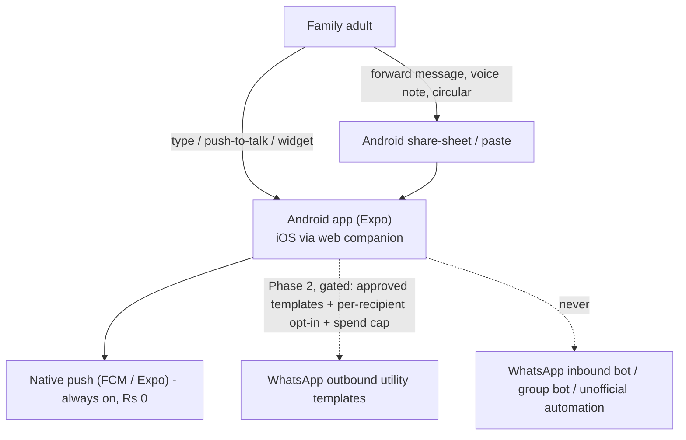
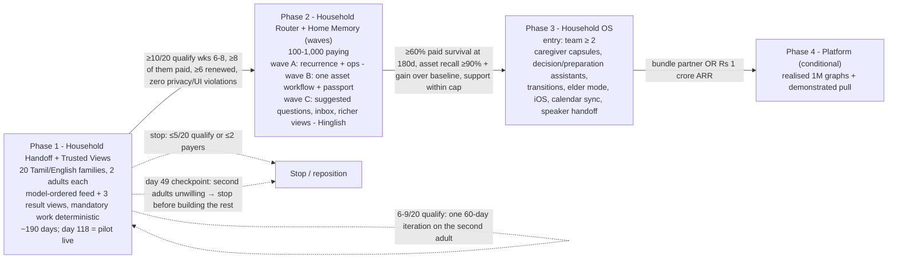
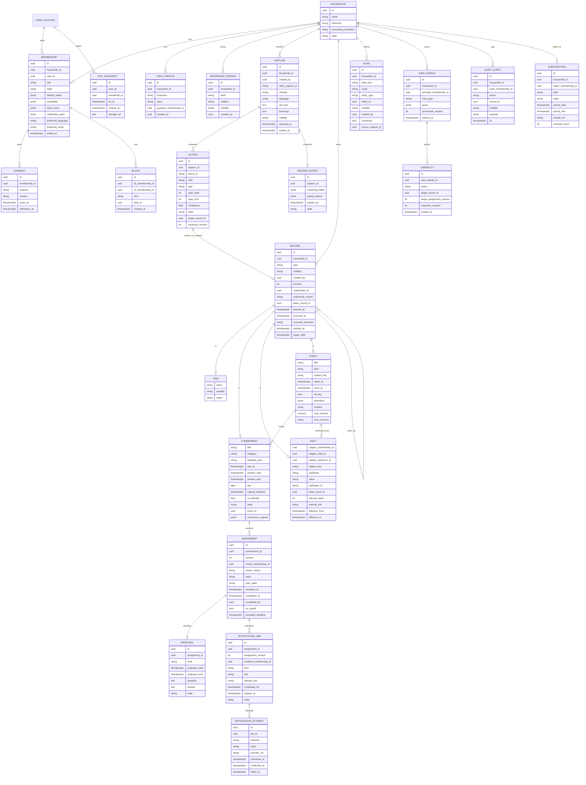
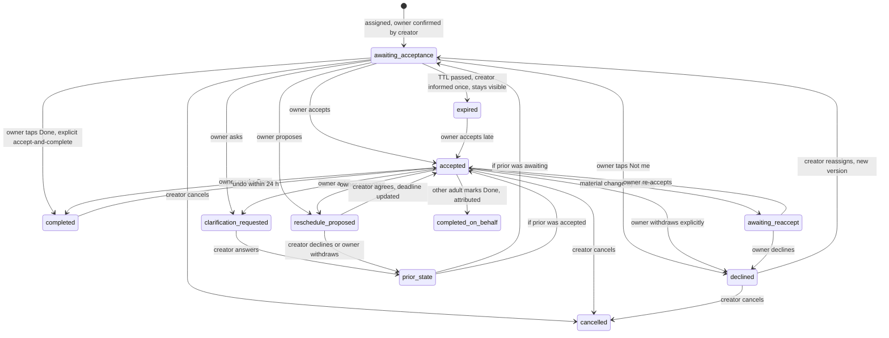

# Nilumi — Product Plan
## The household's trusted memory and follow-through layer — for Indian families

> **One-line definition.** Nilumi is the household's trusted, living memory and follow-through layer. Any adult speaks or forwards something once — in English or Tamil/Tanglish — and Nilumi shows exactly what it understood, remembers it with evidence, presents the right interactive view for the question, and **helps one named adult accept it, be reminded, and close it, with unaccepted or unfinished work always visible** — without the coordinating parent chasing and without turning family life into project management.

---

## 1. Document control and how to read this plan

| Field | Value |
|---|---|
| Product | Nilumi — shared household assistant for Indian families |
| Document | Complete product plan (strategy, requirements, Phase 1 specification, roadmap, business model) |
| Version | 3.0 — standalone consolidated edition |
| Date | 11 October 2026 |
| Status | Baseline for Phase 1 build and pilot |
| Owner | Founder (solo technical founder) |
| Founder constraint | Solo, nights-and-weekends (~10–15 hrs/week), bootstrapped |
| Source of truth | **This document alone.** It is self-contained and supersedes all earlier versions and notes. |

**Evidence labels used throughout.** **Fact** = publicly documented and checked at the date above · **ESTIMATE** = calculated or assumed number, to be validated · **JUDGEMENT** = reasoned product/strategy call · **Hypothesis** = a belief the pilot or a later phase must test · **Bounded finding** = true for what was reviewed, not proof of absence. Competitor capabilities are the vendors' public descriptions, not independent proof of quality.

**Tags used in requirement tables.** **P1** = must ship for the Phase 1 pilot · **P2 / P3 / P4** = later phases (Phase 2 is split into waves A, B, C) · **Never** = out of scope · **Test** = which admission criteria (1–6, §5.3) a feature meets, or **infra** for identity, consent, billing, privacy, legal and operational hygiene that is exempt · **DF1–DF6 / X1–X12** = flagship differentiators and exploration items (§5.2) · **FD-1…FD-3** = key founder decisions (§20) · **UJ0–UJ9** = Phase 1 user journeys (§11.3).

**Document map.**

| Part | Sections |
|---|---|
| Why | 2 Executive summary · 3 Problem · 4 Market and competition |
| What and for whom | 5 Vision, thesis and strategy · 6 Target users · 7 Positioning · 8 Product principles |
| When | 9 Roadmap and phases |
| Requirements | 10 Feature requirements catalogue · 11 Phase 1 MVP specification · 12 Architecture, non-functional requirements and quality · 13 Privacy, security and compliance |
| Proof | 14 Success metrics and pilot plan |
| Later | 15 Later phases (2–4) |
| Business | 16 Pricing and unit economics · 17 Go-to-market · 18 Operations and capacity |
| Governance | 19 Risks · 20 Key decisions and trade-offs · 21 Open questions · 22 Glossary |

---

## 2. Executive summary

**What Nilumi is.** A phone-native household assistant for Indian families that turns anything one adult says or forwards — in English or Tamil/Tanglish — into confirmed, evidence-backed household memory and into commitments that **one named adult accepts, is reminded about and closes**, without the coordinating parent having to chase.

**The problem.** In most Indian homes one adult — usually the mother — carries the household's anticipation and monitoring work. Indian women spend 289 min/day on unpaid domestic work vs 88 min for men (Time Use Survey 2024). Information is scattered across WhatsApp, speech, notes and reminders; coordination happens by forwarding and chasing. Shared lists and calendars share *data*, not *responsibility*: Apple and Google document that shared reminders and family calendars do not notify the other member.

**The opportunity.** Capture, shared lists and household memory are now commodity and largely free (Google Keep, Apple Reminders, WhatsApp events, Meta AI, Alexa+ in India). What is unsolved — especially on a phone, without hardware, in Indian languages — is **closed-loop transfer of responsibility** between adults, combined with **correctable, permission-safe household memory** and **India-specific recurring workflows** (school, domestic help, elders, services). Nilumi competes on the dependable *combination* and execution of these, not on any single feature.

**How we win (strategy).**
- Android-first app with native push; WhatsApp used only as **share-sheet ingress** (forwarded messages, voice notes, circulars) — never as the primary interface.
- English + Tamil/Tanglish first (founder access), Hinglish in Phase 2.
- One named owner per commitment; acceptance, reminders by the recipient's preferences, visible until closed; trust receipts for every action.
- Evidence-or-abstain answers with citations; deterministic, complete "needs my response" work; model-chosen views only from a trusted catalogue, bound server-side.
- Private by construction (database-enforced visibility); no humans in the loop, no hardware, no payments, no health content in Phase 1.
- One household subscription at **₹299/month all-in**, flat trial → paid; run as a micro-SaaS that may become acquirable.

**Phase 1 — the bet we test first.** A 20-family paid pilot (two consenting adults each; Chennai, Coimbatore, Bengaluru). ≈ 190-day plan: research, build and release gate to day 91, recruitment to day 105, two-week baseline diary, **pilot live ≈ day 118**, paid period from ≈ day 146, **decision ≈ day 190**. ≈ 280 founder hours (peak ≈ 14 h/week), cash ceiling ₹1.5 lakh.

**Phase 1 continue gate.** ≥ 10 of 20 enrolled families have ≥ 3 unchased, accepted-and-completed handoffs from the coordinator to the second adult in **each** of product weeks 6–8 · ≥ 8 of those families paid · ≥ 6 of those renewed · support ≤ 3 founder h/week and falling · zero privacy violations · zero unauthorised view bindings/actions. Stop at ≤ 5/20 or ≤ 2 payers; iterate once at 6–9/20.

**Economics (ESTIMATE).** Tech cost ₹70–95 per household per month; direct-UPI contribution ₹99–127/month at ₹299 after GST, payment fees and support. Realistic solo outcome: ~1,000 paying households ≈ ₹36 lakh gross ARR; the binding constraints are founder support hours and second-adult adoption, not model cost.

**Roadmap.** Phase 1 Household Handoff + Trusted Views (20 families) → Phase 2 Household Router + Home Memory (100–1,000 paying, in waves: recurrence and Hinglish; one asset workflow and passport; richer memory and views) → Phase 3 Household OS (team ≥ 2; caregiver capsules, elder mode, iOS, calendar sync) → Phase 4 consent-based household-context platform (conditional).

**Top risks.** The second adult does not engage · free tools are "good enough" · Tanglish extraction and date errors break trust · generated UI hides work or leaks private existence · solo-founder support capacity · Meta platform discretion · thin economics.

**Classification.** A **product** — not a feature, and not (yet) a platform (§5.4).

---

## 3. Problem

### 3.1 The household mental load and the "default parent"

The pattern the founder observed — one adult is the keeper of household knowledge, information is scattered across WhatsApp, speech, notes and reminders, and coordination happens by forwarding — is measured and structural, not anecdotal.

**India (Fact).**
- Time Use Survey 2024: women spend **289 min/day** on unpaid domestic services vs **88 min** for men (3.3×); caregiving 137 vs 75 min. The gap barely moved since 2019 (299 vs 97). Employed women additionally work 341 min/day.
- PLFS 2025: **44.4%** of women outside the labour force cite child-care/home-making as the reason. Urban female labour-force participation is only **28%** (2023-24) but rising (+2.6 pp year on year) — dual-income coordination is a growing problem.
- NFHS-5: 89% of married women participate in household decisions while ~31% had paid work in the prior year — the *decision* burden is high even where income is not.
- Nuclearisation: average household size 4.8 (Census 2011) → 4.4 (NFHS-5); yet **~68% of Indians aged 60+ co-reside with their children** (LASI), so "nuclear" households routinely carry an elder's appointment and refill logistics.
- There is **no large-sample Indian survey quantifying mental load** — an evidence gap the pilot partly addresses.

**Global comparators (Fact).** 64% of mothers in US two-parent homes do more of the children's schedule management, even in dual-full-time couples (Pew, 2015). 86% of working mothers handle the majority of family responsibilities (Modern Family Index, 2017). Cognitive household labour = **anticipate → identify options → decide → monitor**; women perform most anticipation and monitoring even in egalitarian-identifying couples (Daminger, 2019).

### 3.2 The unsolved gap: shared data is not shared accountability

- Apple Reminders shares lists but "reminder notifications someone sets are not shared automatically"; Google Keep reminders stay individual; Google Calendar's family calendar sends no default notification when another member creates or edits an event (vendor help pages; Fact).
- Alexa+ can route a reminder to a person only with Visual-ID hardware (Fact).
- **Design implication (JUDGEMENT):** the value is in **redistributing anticipation and monitoring** across adults — route, obtain acceptance, follow up and close — not merely store. A design that makes the keeper the sole data-entry clerk for a smarter list fails before it ships. *A reminder without acceptance is not delegation; acceptance without completion is not closure.*
- **Strongest counter-argument (JUDGEMENT):** reluctance to share responsibility may be *relational*, not informational. If a partner ignores a spouse, a polite notification may change nothing. The pilot must detect this early rather than promise to repair it.

### 3.3 India-specific recurring jobs

| Job | Evidence (Fact unless marked) | Example interaction | Boundary |
|---|---|---|---|
| School and tuition handoffs | WhatsApp is the primary school–parent channel; fees are term-wise; ~31% of urban students take tuition | Forwarded circular → dated commitment for the school-prep parent | No scraping of school groups; no invented instructions |
| Recurring service follow-ups | Society apps handle the society side, not the household action | "Plumber Saturday; Karthik will be home" → dated prep task | Do not rebuild society apps |
| Domestic-help coordination | ~28 M registered domestic workers; ESTIMATE 25–40% of top-metro households employ help | "Cook won't come tomorrow" → adjust plan, remind whoever is home | No payroll, attendance surveillance or payments |
| Co-resident elders | ~68% of 60+ co-reside; ~24% have multimorbidity | Quarterly check-up; refill *pickup* routed to whoever is free | No dosing/adherence/medical advice |
| Tiffin and meal logistics | Preference memory the cook's instructions depend on | "Paati doesn't eat spicy"; who packs tomorrow's tiffin | Not a recipe generator |
| Quick-commerce lists | Quick commerce is the leading urban shopping shift (Blinkit ~27 M monthly transacting customers) | "Paal mudinjiduchu" → shared list; copy to a quick-commerce app | No cart APIs or autonomous buying in early phases |
| Festivals | Engagement peaks at Deepavali, Pongal, Navaratri | Short-lived festival collection | Seasonal alone cannot sustain monthly retention |
| Home assets and services | Appliances, vehicles, warranties, service visits recur for years | "Purifier serviced today, ₹1,800; filter in six months" | No budgeting, ledger or equipment-health inference |

**Why India favours this product (Fact):** nuclearisation; the unpaid-work gap; rising urban female participation; 44% of Indian internet users already use AI features; Indian in-app purchase revenue exceeded $1 bn in 2025 and grows ~33–35% a year.
**Why India is harder (Fact):** premium AI is being given away (Gemini Pro via Jio, Perplexity Pro via Airtel, ChatGPT Go free for a year, Alexa+ with Prime); per-download revenue is tiny, so pricing must be per household; UPI AutoPay sees ~20 M mandate revocations/month (74% for insufficient funds); Alexa+ now owns the Hinglish-voice narrative.

---

## 4. Market and competition

### 4.1 Named competitors (vendors' public descriptions; checked 11 Oct 2026)

| Product | What it offers | Price | India | Lesson for Nilumi |
|---|---|---|---|---|
| **Nori** | Family AI: voice, chat, photos, forwarded email; persistent family preferences and routines; assigned chores and reminders; proactive notice → suggest → confirm → act; optional hub (US/CA). Claims 200,000+ families | Free core; US$7.99/mo; **₹799/mo** in India | Listed; negligible Indian uptake; no Indian languages | A household-priced family-AI category exists — but English-only, US workflows, priced 2–4× above Indian tolerance |
| **Home Run** | Voice/chat, cross-domain family plans, chore assignments and follow-up, documents, meals, expenses, shared family context | Paid | Not India-focused | "Connected plans across tasks, documents and calendars" is not uniquely ours |
| **Ohai** | Household manager by text/voice/email/docs; **human assistants** for complex documents; shared circles; "assign tasks and Ohai texts the right person"; calendar sync. ~36 employees, ~US$6 M+ funding | US$9.99–39.99/mo | Not available | Routing to the right person sells in the US — delivered with a team and humans in the loop |
| **Pratyek** | India-focused WhatsApp household assistant + shared "Memory" dashboard; maid attendance/salary, milk, warranties, school fees; 9 languages + Hinglish; cannot join existing family groups | Paid; amount, traction and reliability unverified | Yes | Indian-language household records and Q&A are not uniquely ours; WhatsApp dependency is a policy exposure |
| **Alexa+** | Generative Alexa; **India Early Access since 16 Sep 2026** with English, Hindi, Hinglish code-switching; household memory; person-targeted reminders need Visual-ID hardware; contextual "Dynamic Tab" on tablets | Free in Early Access, then with Prime; ₹2,000/mo standalone | **Yes** | Hinglish household memory ships free inside Prime — but device- and ecosystem-bound |
| **Gemini for Home** | Replaces Google Assistant on Nest; explicit "Saved information"; shared family calendar/lists | Free; US Premium US$10/20 | **Not in India** | Household memory is table stakes for Big Tech voice; Google's India absence is a window (JUDGEMENT: 12–18 months) |
| **Milo** (closed 12 Jan 2026) | SMS + humans-in-the-loop "Family AI"; US$15 → US$40/mo | — | No | Families paid for the useful core; reliability collapsed when scope widened. Scope discipline + reliability is the whole game |

### 4.2 Wider landscape

| Group | Products and evidence (Fact) |
|---|---|
| Family organisers | Cozi, FamilyWall, TimeTree, Jam, Hearth, Skylight, chore apps, AnyList/Bring!/Out of Milk. Tab-based; the user picks the list; routing weak; no Indic languages. Prices in India from ₹269/mo to ₹3,999/yr |
| Big-tech "good enough" | Apple Reminders and Google Keep/Calendar share data but not reminders/notifications; WhatsApp itself has group events with reminders, @all, polls — free, human-triggered |
| General AI with memory | ChatGPT Shared Projects (project-only shared context, no household routing); Claude projects; Gemini Personal Intelligence (single-user, India since Apr 2026); **Meta AI in WhatsApp** — free in groups, Hindi/Romanised Hindi, memory 1:1 only, proactive tasks "forthcoming" for WhatsApp |
| India-specific | Pratyek; Grihini (staff salary/attendance; Hindi/English voice); Ghar Kharcha (shared khata); MyGate (4 M+ households) and NoBrokerHood (society operations); quick-commerce apps (100 M+ installs each) without shared family lists |
| Graveyard | **Yohana** (US$249/mo human concierge) ended US Sep 2025, Japan Jan 2026 — had not demonstrated scaling and monetisation · **Milo** closed Jan 2026 on reliability · **Maple** announced sunset on 31 Dec 2026 **with all data deleted** — the continuity fear families have about small apps · Picniic/OurHome delisted |

### 4.3 Comparison matrix

| Product | Interaction | Shared memory | Routes to a member with acceptance | Dynamic UI | Price | India | Biggest weakness |
|---|---|---|---|---|---|---|---|
| Nori | Chat/voice/photos; hub | Explicit family prefs | Assigned reminders; suggest → confirm → act | Fixed views | ₹799/mo | Listed; no Indic | Price; US workflows |
| Ohai | SMS, voice, email + humans | Shared circles | **Yes** (texts the right person) | Fixed tabs | US$9.99–39.99 | No | Human cost; US-only |
| Alexa+ | Echo voice, app | Household facts + per-person ID | Hardware-dependent | Dynamic Tab | Free w/ Prime | **Yes, Hinglish** | Device-bound |
| Gemini for Home | Nest voice, Home app | Saved information | Unverified | NL automations | Free / Premium | No | Not in India |
| Pratyek | WhatsApp + dashboard | Claimed shared records | Claimed | Records | Unverified | Yes | Unverified; policy exposure |
| Cozi / FamilyWall / TimeTree | Tabbed apps | Shared records | Weak | None | ₹269–3,999 | Yes | User does the organising |
| Apple / Google native | Native apps | Shared data | **No** | None | Free | Yes | No routing |
| Meta AI in WhatsApp | @ in groups | No group memory | No | None | Free | Yes | No shared state |
| **Nilumi (target)** | Phone voice/text + share-sheet | Evidence-backed, correctable, permission-safe | **Yes — one owner, acceptance, closure, receipts** | Trusted catalogue views bound server-side | ₹299/mo | **Tamil/Tanglish + English; Hinglish P2** | Must prove second-adult adoption |

### 4.4 What the landscape means

1. **Every constituent feature already exists somewhere** — memory, extraction from messy input, targeted reminders. The opportunity is the **combination working dependably with less supervision**, in India, on a phone.
2. **Shared data ≠ shared accountability** — the one gap the incumbents document against themselves.
3. **Breadth with humans in the loop died or reset** (Milo, Yohana); narrow, software-only products survive.
4. **Reliability complaints are universal** (lost lists, wrong speaker, inconsistent memory). Trust is earned by not losing data and not getting dates wrong.
5. **India is no longer empty** — Alexa+ Hinglish, Nori listed, Pratyek native — but none is phone-native, hardware-free, Indic *and* routing-capable with acceptance and closure.
6. **Monetisation patterns:** one household price, per-adult tiers, bundling into Prime, whole-home premium. In India, premium AI is being given away through telco and Prime bundles.

**Gap ranking (JUDGEMENT).** (1) Closed-loop transfer of responsibility between adults · (2) trustworthy shared context with provenance and selective visibility · (3) the Indian household operations layer (help, vendors, school fees, elder logistics, festivals) · (4) turning school/society WhatsApp noise into actions (felt strongly, but policy-limited to share/forward capture) · (5) phone-native Indic voice-note capture (required surface, not a moat) · (6) list → quick-commerce handoff · (7) queryable shared memory (table stakes) · (8) generative/dynamic UI (users don't ask for it; it must earn its place through safety and speed). Gaps 1–3 together are the business.

### 4.5 Market size (all ESTIMATE; household is the purchasing unit)

| Measure | Estimate | Notes |
|---|---|---|
| **TAM** | 47–50 M Tier-1/2 urban households → **₹16,900–17,900 crore/yr** at ₹299 × 12 | A spending ceiling, not demand. All-urban upper bound 105–120 M households |
| **SAM** | **~0.6–4 M households, central ~2 M** (≈ ₹700 crore/yr at ₹299) | Filters: affluent Tier-1/2 → dual-income nuclear → child and/or co-resident elder → **Hinglish-comfortable** → recurring pain → both adults digital. Filters are correlated; ranges are wide |
| **Category SOM (3 years, all suppliers)** | 100k–250k paying households | At 3–5% adoption of core households; requires a bundle partner (telco, Prime, society app) |
| **Nilumi SOM (3 years, solo, bootstrapped)** | **300–3,000 paying households; central ~1,000** (≈ ₹36 lakh gross ARR) | Binding constraint: founder support hours and second-adult adoption. Reaching 5k–15k needs support automation (< 2 min/household/month) or more than nights-and-weekends. **Zero remains possible** |
| Global English sanity check | Early, small, real category everywhere | Global expansion does not repair poor retention; keep an English UI so the option stays open |

The Tamil/Tanglish beachhead is a subset of a different language filter and is **not estimated** (§4.6 row 7).

### 4.6 Evidence and judgement, separated

| # | Statement | Status |
|---|---|---|
| 1 | Indian women spend 289 min/day on unpaid domestic work vs 88 for men (TUS 2024); the gap is large and barely moved since 2019; 44% of women outside the labour force cite home-making (PLFS 2025). | **Fact** (§3.1) |
| 2 | Capture and shared lists are commodity and mostly free (Keep, Reminders, WhatsApp events, Meta AI in groups, Alexa+ India since 16 Sep 2026). Nori, Home Run, Ohai and Pratyek advertise family memory, extraction and delegation. | **Fact** (§4.1–§4.2) |
| 3 | Apple and Google document that shared lists/family calendars do *not* share reminders or notify the other member. **In the reviewed public descriptions, no India-available product was found to combine** phone-native, hardware-free Tamil/Hinglish cross-member routing with acceptance and completion, evidence-backed correctable memory, and permission-safe generated views; **head-to-head testing is pending** and absence from a landing page is not proof of absence. | **Bounded finding** |
| 4 | WhatsApp as the primary interface is a single point of failure; share-sheet ingress is fine; outbound templates remain policy-conditional. | **Fact + JUDGEMENT** (§4.7) |
| 5 | Tech cost ₹70–95/family/month (modelled workload, §16.1) vs a ₹299 price works only with no concierge operations in the product; support and incidents still cost human time. Milo and Yohana died on human-assisted breadth. | **ESTIMATE + Fact** |
| 6 | Generative UI is an industry direction; its household benefit (speed, learnability, retention) is **unproven** — published comparisons of generated vs text interfaces excluded generation speed and did not measure learnability. The product-specific edge is permission-aware binding, action safety, family context and voice/UI continuity. | **Hypothesis** |
| 7 | Tamil/Tanglish-first is an **access-led launch filter**, not an evidence-led market claim. Its addressable size is **unestimated**; it must not be derived from the SAM in §4.5 (which was filtered for Hinglish comfort) or from the statistic that 57% of urban internet users prefer Indic content. Sarvam documents Tamil and code-mix support; household Tanglish accuracy is **not established** and is a pilot measurement. | **JUDGEMENT** |

### 4.7 Channel constraints: WhatsApp, voice and devices

**WhatsApp cannot be the primary interface (Fact, Meta policy as of Oct 2026).**
1. WhatsApp Business Solution Terms (new accounts from 15 Oct 2025; existing accounts from 15 Jan 2026) prohibit AI providers where AI is "the primary (rather than incidental or ancillary) functionality … as determined by Meta in its sole discretion". India has **no** regulator-created exception (EU, Italy and Brazil interventions do not apply).
2. A separate clause forbids sharing information from one customer's chat with another customer — which is what shared household memory does.
3. The Groups API needs Official Business Account status, creates only business-managed groups of ≤ 8, and **cannot join an existing family group**.
4. From **1 Oct 2026** service replies are chargeable (~₹0.115 per utility message); outside the 24-hour window only approved templates may be sent; new business portfolios start at 250 unique recipients/day.
5. Meta AI already works free in Indian WhatsApp groups and is extending proactive tasks — a competitor on the same channel.

**Channel cost per family per month (ESTIMATE):** native app + push ₹0 · app + WhatsApp outbound utility templates only (2 adults × 120 reminders) ≈ ₹14–35 · WhatsApp-primary conversational ₹165+ for two adults plus provider fees and high policy exposure · SMS ₹22–30 + GST · RCS ≈ ₹30 (coverage unverified) · Telegram ₹0 but requires migrating the family.

**Decision (JUDGEMENT):** "WhatsApp-friendly" is achievable; "WhatsApp-native" is not. Build Android-first with native push; WhatsApp is **ingress** via the Android share-sheet; outbound templates are an isolated, optional Phase 2 module behind the gate list in §15.1; no inbound or group bot ever.



**Modality (JUDGEMENT).** Separate input modality from distribution: **chat-first truth, voice-enabled capture, app-owned state** ("voice-in, glance-out"). The habit to borrow is the WhatsApp voice note, not a smart speaker (the Indian smart-speaker base is an unverified 13–20 M units vs 650–750 M smartphones). Spoken replies, wake words and ambient listening are out of early phases. Android dominates Indian mobile traffic, but mixed-device couples are tested deliberately so the adult carrying the load is never excluded. Removing up-front categorisation does not remove stable navigation: users never choose "task vs note" before speaking, but always know where yesterday's commitment lives.

### 4.8 Willingness to pay

- **What households pay today (Fact):** Google One ~₹130/mo, OTT ₹149–299/mo, Prime ₹1,499/yr, society-app upsells; US parents pay US$8–40/mo for Nori/Ohai-type products. Nori at ₹799/mo has negligible Indian uptake — too high. Paid domestic help and quick-commerce fees show households buy *relief*; they do not prove willingness to maintain another tool.
- **Price judgement:** ₹99–149 feels frictionless but is uneconomic once support is counted; **₹299 is the viability test**; ₹500+ competes with "free via Jio/Airtel/Prime".
- **Counter-evidence:** the free stack is good enough for most households; Meta AI is free in groups; Alexa+ is free with Prime; UPI AutoPay leakage is high.
- **It is her pain, and she cannot buy the other adult's cooperation** — so the pilot measures payment *by households whose second adult actually engages* (§14.1). Price objections are not feature requests.

---

## 5. Vision, thesis and strategy

**Vision.** Every Indian household has a trusted, living memory and follow-through layer: say it once, and the right adult accepts it, is reminded and closes it — with evidence, privacy and calm.

### 5.1 Differentiation thesis

**Nilumi should become the household's trusted, living intelligence and follow-through layer — not another family dashboard, calendar, task list or chat assistant.** Nori, Home Run, Ohai and Pratyek already advertise voice capture, family memory, extraction from emails/photos, shared calendars, task delegation and (Pratyek) Indian-language household records. Nilumi's opportunity is **measurably better execution and combination** of specific workflows: evidence-backed memory the family can correct, two-sided delegation that closes without nagging, permission-safe views generated for the question asked, and calm, source-backed proactivity. **Never publish an "only app that can…" claim without a current head-to-head test.**

### 5.2 Differentiator register

**Flagship differentiators (define the product's personality).** Each ships as a deliberately thin slice first.

| ID | Differentiator | User problem | Signature behaviour | Product-specific edge | First slice / phase |
|---|---|---|---|---|---|
| **DF1** | **Conversation becomes the interface (trusted generative UI)** | Assistants answer in text; family apps force tabs | "Show everything our home needs this week, grouped by who is handling it" → an interactive grouped board with complete/reschedule actions | Permission-aware data binding, action safety, family context, voice/UI continuity — not novelty | P1: model-ordered feed below deterministic panels + 3 result views (F1–F6); P2 richer views (F8) |
| **DF2** | **Grounded household Q&A and intelligent follow-up questions** | "What does the house know?" — and is it right? | "Aarav's shoe size?" → "UK 1 (said by Divya, 3 Sep)"; honest abstention; one necessary clarifying question | Claim-level citations; answerability within authorised recorded evidence; no existence leaks | P1: grounded answers + clarification (C2, C13, D3, D11); P2 suggested questions (D12) |
| **DF3** | **Living household knowledge graph and object passports (Home Assets)** | Appliance, vehicle, warranty and service history is lost | "Last time the purifier was serviced?" → timeline with cost, provider and next-service estimate | Typed asset/event/provider graph built from natural capture, correctable and permission-aware | P1 seed via service events (G9); P2 wave B one asset workflow + passport (N1–N8) |
| **DF4** | **Commitments, delegation and follow-through without nagging** | The coordinator remembers, assigns, reminds and checks | "Karthik-ku Tuesday saayangalam petrol pottu sollu" → owner accepts from the push, is reminded on his terms, closes it | Two-sided handoff: one owner, acceptance, proposals, receipts, no scoring | P1 core (E1–E7, E13–E16, E20) |
| **DF5** | **Self-correcting, explainable, user-owned memory** | Memory goes stale or wrong; nobody knows why the app believes something | "Warranty ends July, not June" → correction vs change confirmed; "why do you think…?" shows evidence; forget propagates | Temporal records with provenance; correction vs real-world change; account-owned exit | P1 thin (D9, D14–D17, A12); P2 contradiction inbox, merges (D13, N7) |
| **DF6** | **Calm household intelligence — daily pulse, weekly reset, thoughtful suggestions** | Notification fatigue or constant checking | A personal morning pulse of what needs *me*; an opt-in weekly review of recorded obligations | Deterministic, sourced, repeat-suppressed; suggestions are proposals | P1 pulse + review (E4, E5, E19); P2 changes-since, interval suggestions (E17, E18) |

**Exploration backlog (X-items).**

| ID | Idea | Example | Phase in this plan |
|---|---|---|---|
| **X1** | Private-aware ambient voice and device handoff | "What's on our schedule?" is safe on a room speaker; "show my private note" continues on the authenticated phone | P3+ (B14) |
| **X2** | Caregiver handover capsules | A parent approves a 48-hour briefing of care instructions, contacts and tasks for a grandparent/caregiver | P3 (A11) |
| **X3** | Multimodal "capture once" | Speak while photographing a warranty receipt; dates, provider and cost filed to the asset | P2 wave B (B7) |
| **X4** | Tamil/Tanglish natural interaction and entity resolution | Mid-sentence Tamil-English speech resolves the right member, aliases, dates and task | P1 people / P2 assets (C9, C10) |
| **X5** | Household decision assistant | "Which weekend is less busy for an outing?" → comparison and proposal, never calendar changes | P3 (G10) |
| **X6** | Contextual preparation generator | "We leave for the wedding Friday" → editable checklist from confirmed facts and a user-selected template | P3 (G11) |
| **X7** | Household change journal / time travel | "What changed with our car this year?" → source-backed timeline | P2 wave C (N5) |
| **X8** | Maintenance intelligence, not black-box prediction | Next service from recorded last date + recorded interval, labelled estimate | P2 wave B (N6, E18) |
| **X9** | Respectful load-sharing insights | Couple-approved view of unassigned work, **without scoring people** | Exploratory only, outside the roadmap |
| **X10** | Family transitions / continuity packages | Moving home, new baby, school admission → editable, source-aware workspace | P3 (G12) |
| **X11** | Explainable action receipts | "Did you remind her?" → scheduled / submitted / delivered-or-unknown / accepted, separately | P1 foundational (E6, E7, E13, E15) |
| **X12** | Low-friction capture from existing tools | Share a message or voice note *to* Nilumi → a safe proposal, never an automatic action | P1 (B3) |

### 5.3 Feature admission test and default decisions

A *discretionary* capability earns a place only if it meets **at least two** of: (1) removes household work; (2) gets more useful over time through corrected, permission-aware history; (3) serves multiple people safely; (4) closes the loop with an observable, confirmed outcome; (5) adapts the interaction to the situation; (6) is hard to reproduce well because several reliable capabilities must work together. **Identity, consent, billing, privacy, legal and operational hygiene rows are infrastructure and are exempt** (marked *infra*). Each Phase 1 flagship carries an adoption record (§11.0).

**Evidence-backed defaults** (adjustable only to preserve the experiment): Android-first + native push · chat-first truth, voice-enabled capture, no speaker/TTS in Phase 1 · one named owner per commitment · ₹299/month household price (all-in, GST-inclusive) tested first · flat trial→paid, no freemium, for the first ~1,000 families · no WhatsApp inbound/group bot · no humans in the loop, no hardware, no payments/payroll, no child logins, no health content in Phase 1 · a *product*, run as a micro-SaaS that may become acquirable.

### 5.4 Product classification: a product, not a feature, not (yet) a platform

- **Not a feature.** "Turn a sentence into a list item" is a feature — and already exists inside Alexa+, Gemini, Nori and Meta AI. Nilumi's job is a **contract between household members**: membership, visibility, ownership, acceptance, routing, follow-up and completion across people who share no device, account or routine. That needs its own data model, trust boundary (database authorisation before any model) and notification semantics. *Caveat:* if families value only grocery extraction, the evidence downgrades it to a feature.
- **A product.** A paying category exists (Nori, Ohai, Hearth, Skylight) with distinct interaction models and prices; India has an unserved variant with its own workflows.
- **Not yet a platform.** Nobody builds on household context today; there is no third-party ecosystem or network effect; the household graph only becomes valuable to others at scale and with consent infrastructure.
- **What must be true to become a platform (Phase 4 conditions):** (1) ≥ 1 M Indian households actively maintaining a household graph — beyond the category ceiling without a bundle, so a distribution deal is a prerequisite; (2) quick-commerce, pharmacies, schools and society apps demonstrably want to read/write household context **and** consumers consent; (3) a consent and audit layer that makes a household-context API DPDP-defensible; (4) Big Tech stays device-bound or absent in India long enough; (5) an operating team.
- **Operating stance:** a micro-SaaS that may become acquirable; classification follows behaviour, not the "household operating system" label.

---

## 6. Target users and personas (Phase 1 cohort)

**Beachhead (Phase 1–2):** urban, English + Tamil/Tanglish-comfortable, **couple-led dual-income households** in Chennai, Coimbatore and Bengaluru with a school-age child **and/or** a co-resident elder; often with part-time domestic help. **Both adults must be willing participants.** Bengaluru Tamil couples are recruited as a language-defined community, not assumed from city population. Hindi/Hinglish households join in Phase 2. WTP figures are **ESTIMATE** hypotheses.

| Persona | Role | Design consequence |
|---|---|---|
| **P1 Divya & Karthik** (Chennai; PM + engineer; daughter Aarav 6; cook + maid; Tanglish at home) | Primary buyer (Divya) and must-use second adult (Karthik); WTP ₹199–399 | Couple onboarding; Karthik is notification-first; Tanglish voice must resolve names, times and *naalaikku* |
| **P2 Meena & Suresh** (Coimbatore; two school kids; co-resident father-in-law; RO purifier, two-wheeler, car) | Highest pain/WTP (₹299–499); elder logistics; appliance/vehicle history | Phase 2 elder logistics (with its own consent/visibility rules) and Home Assets; strict health boundary |
| **P3 Anand & Nithya** (Bengaluru; Tamil couple; infant; shift work) | **Ancillary stress-test household (max 2 of 20)** — outside the child/elder eligibility rule | Quiet hours; time windows; Phase 2 "who's home" routing |
| **P4 Karthik** — the second adult | Not a segment; the **retention condition** | One-tap accept/decline/propose/done from push; only his items in his pulse; polite; never scored |
| **P5 Kamala Paati & Thatha** — co-resident elders | Referenced people in P1 (no login); users in P3 | Reference-only people in the alias contract; Phase 3 elder mode |
| **Control: Prime/Echo household** | Sceptical comparison | If they cannot name incremental value over Alexa+, that is a signal |

---

## 7. Positioning, messages and claims to avoid

**Primary positioning:** *Nilumi is the household's trusted memory and follow-through assistant. Speak naturally, get the right interactive view, and let your family remember and coordinate together — without losing individual privacy.*

**Messages to test (conditional on demonstrated results):** (1) **"Your home remembers."** (2) **"Say it once. Follow through together."** (3) **"Ask naturally. See exactly what we understood."** Tamil: *"Oru vaati sollunga — veedu nyabagam vechukkum."*

**Marketing** sells the coordination outcome; **notices, store listings and platform reviews describe AI use accurately** (language models interpret input and choose views); positioning discipline is not policy cover.

**Claims to avoid (binding):** "first AI family assistant" · "only assistant with long-term memory" · "only Tamil household assistant" · "never forgets" · "guaranteed notifications" · "knows everything about your family" · "fully autonomous household manager" · "always listening" · relationship scoring, covert workload monitoring, emotion diagnosis, passive audio recording, automatic disclosure of a spouse's private data · implicit medical, financial or child-care decisions derived from unverified notes · "guarantees" that a partner will cooperate.

**Not:** a to-do app, note app, calendar, chatbot, smart speaker, payroll tool, finance app, health app, emergency service.

---

## 8. Product principles (the "household member" test)

| # | Principle | In the product | Forbidden |
|---|---|---|---|
| P1 | **Say it once** | Any adult, any modality, English or Tamil/Tanglish. No tab to choose. | Forms, categories, "create task" as the primary path |
| P2 | **One adult owns it** | Exactly one named, active adult owner; accept / decline / propose another time / ask / done; a deadline (time, window or day); **visible until closed** — notification expiry never hides unfinished work | "Shared" commitments nobody owns; silent multi-owner responsibility |
| P3 | **Redistribute, don't digitise** | The non-keeper is nudged by *his* preferences and acts from the notification. If a handoff misses its deadline the originator may receive **one opt-in informational alert** — information, not reassignment, not proof that monitoring moved. No third adult is ever selected automatically. | Making the keeper the data-entry clerk; default spouse escalation; performance scoring |
| P4 | **Receipts, not magic** | Every action shows a **trust receipt** — *Heard → Understood → Saved → Scheduled → Delivered → Accepted → Done* — with *not applicable* / *delivery unknown* / *pending (offline)* states, source, Undo/Edit | "Done" before commit; "delivered" from provider acceptance; silent inference of dates, recipients, deletions |
| P5 | **Evidence or abstain** | Every factual claim maps to records the viewer may read; `answerability` is **full / partial / unknown within authorised recorded evidence** ("recorded spending", "latest known"); conflicts are shown as attributed values | Invented facts; "full" meaning real-world completeness; inferred health, school or financial rules |
| P6 | **Mandatory work is deterministic; the rest may be emergent** | "Needs my response", pending confirmations and Due now are computed from the database on every request, complete and fresh, and occupy fixed slots regardless of any model, cache or budget; the remaining feed and every result view may be chosen by the model from a trusted catalogue, bound server-side | Generated navigation that can hide, filter or stale mandatory work; executable or arbitrary UI; model-manufactured handles or actions |
| P7 | **Private by construction** | Authorisation is enforced in the database — on records, sources, aliases, audit payloads, exports, caches, view bindings, suggested questions and notifications — before anything reaches a model, card or push. Private facts never leak by **existence**, count, label, group order or error message. | "Parents only" as a prompt; provenance or aliases that leak a private fact |
| P8 | **Not a scoreboard — and not a weapon** | No fairness scores, "who did more", inferred laziness, covert monitoring or automatic escalation; recipients can **pause** inbound handoffs from a member, **mute** a task and **report** content without notifying the other member | Turning coordination into surveillance, blame or harassment |
| P9 | **Correctable, user-owned memory** | Correction is distinguished from real-world change (confirmed when ambiguous); contradictions are shown; "why do you think…" shows the exact evidence; "forget" propagates within stated limits; **an adult's private memory remains theirs after leaving** | Silent overwrites; destructive merges; stranded private memory; "never forgets" marketing |
| P10 | **Portable** | Versioned export, exit snapshot and erasure, with defined retention windows and disclosed limits (downloaded copies cannot be recalled) | Hostage data (Maple has *announced* a sunset with data deletion for 31 Dec 2026) |
| P11 | **Boring where possible** | Deterministic code decides *who* and *when*; small models propose *what* and *which view*; Postgres decides *who may see* | Autonomous multi-agent "household OS" |
| P12 | **Calm by default** | A daily personal pulse and an optional weekly reset instead of a notification stream; suggestions are proposals requiring permission; quiet modes; a question never creates work without confirmation | Notification fatigue; auto-editing household state; "needs maintenance" without a recorded interval |

---

## 9. Roadmap and phases

The roadmap is gated: each phase starts only when the previous phase's exit gate holds. The feature catalogue (§10) is tagged by phase; §11 specifies Phase 1 in full; §15 covers Phases 2–4.

### 9.1 Phase overview

| Phase | Name | Scale | Objective | Entry condition | Exit gate (all must hold; see §14.1 decision table) |
|---|---|---|---|---|---|
| **1** | **MVP — Household Handoff + Trusted Views** | 20-family paid pilot (2 adults each; Tamil/Tanglish + English) | Prove the non-keeper reliably accepts and closes coordinator-originated commitments without chasing; that generated views and grounded answers are used instead of navigation with zero unauthorised bindings; that *those* families pay ₹299 and renew | — | **≥ 10/20** enrolled families qualify (§14.1) in **each** of product weeks 6–8 · **≥ 8** of the finally-qualifying households paid · **≥ 6** of those renewed a genuine second paid period · support ≤ 3 founder hrs/week and falling · **zero** privacy violations · **zero** unauthorised view bindings/actions in the adversarial suite · surface gates (§11.10) met |
| **2** | **Household Router + Home Memory** (admitted in **waves**, §15.1) | 100–1,000 paying | Recurring Indian jobs re-engage monthly; **one asset workflow → passport** proves depth; suggested questions and the contradiction inbox make memory self-correcting; Hinglish households; public Android beta behind a flat paywall | Phase 1 gate · founder-hours capacity plan (§18.1) · wave gates | **≥ 60%** of month-1 payers still paying at 180 days (annual entitlements reported separately) · ≥ 50% of retained households handoff-qualifying in a rolling 4-week window · correction rate < 10% (edits ÷ saved actions) · **Home Assets: pre-registered recall test ≥ 90% correct with citations on naturally aged ≥ 3-month facts AND a pre-declared gain over an authorised-record keyword baseline** · realised contribution ≥ ₹110/household · CAC ≤ ₹400 (phase gate) · support within the §18.1 cap |
| **3** | **Household OS** | 1k–10k paying | Caregiver capsules, decision/preparation assistants, transitions, elder mode, iOS native, calendar sync, speaker↔phone handoff, B2B2C | **Operating team ≥ 2** · Phase 2 gate | A bundle/distribution partner **or** ₹1 crore+ ARR · ≥ 50% contribution margin after support · DPDP consent/audit layer proven in production |
| **4** | **Platform (conditional)** | 100k+ | Consent-based household-context API | **Realised** ≥ 1 M actively maintained household graphs · demonstrated two-sided pull in a small consented partner experiment · operating team | — |



### 9.2 Signature demonstrations as acceptance journeys

| Demo | Journey (see §11.3) | Fully passes in | Tests |
|---|---|---|---|
| **A — The house remembers a real-world event** | UJ4 → P2 passport/timeline recall | Capture, attribution, proposal **P1**; asset timeline, cost card, long-horizon recall **P2 wave B** | DF1 DF2 DF3 DF5 DF6 |
| **B — One spouse delegates without becoming a manager** | UJ3 | **P1** | DF1 DF4 DF6 X11 |
| **C — Questions create a useful, changing UI** | UJ5 / UJ6 → P2 vehicle change journal with derived follow-ups | View selection and grounded answer **P1**; journal, derived follow-ups, invoice gaps **P2 wave C** | DF1 DF2 DF3 DF5 X7 |
| **D — Shared space respects private information** | UJ9 privacy model (phone) → P3 speaker handoff and caregiver capsule | Privacy model **P1**; speaker and capsule **P3** | DF1 DF2 X1 X2 |

---

## 10. Feature requirements catalogue (final product, phase-tagged)

Tags: **P1** = must ship for the pilot · **P2 / P3 / P4** = later phases · **Never** = out of scope. **Test** = admission criteria met (§5.3) or *infra*. **Source** = flagship differentiator (**DF1–DF6**) or exploration item (**X1–X12**), both defined in §5.2. The catalogue is the authoritative requirement list; §11–§15 reference it rather than restating it.

### 10.1 Identity, household, consent, recovery

| ID | Feature | Phase | Test | Notes |
|---|---|---|---|---|
| A1 | Adult sign-in (phone OTP; Google optional); authenticated principal ↔ member mapping; optional verified **email recovery factor** set at onboarding | P1 | infra | Phone hash is identity data, not authority |
| A2 | Create household; single-use, 7-day, revocable invitations; membership states (`invited`, `active`, `left`, `revoked`); invitation attempts to a declining number capped (1 per 30 days) | P1 | infra | Pilot: exactly 2 active adults; up to 6 in P2 |
| A3 | Roles: **Admin**, **Adult**, **Child profile** (no principal), **Reference person** (no principal; e.g., elder, cook — may be a fact subject, never an owner), **Elder** (P3), **Caregiver-limited** (P3) | P1 core | infra | Access matrix §11.4 |
| A4 | Purpose-specific consent records per adult, incl. AI-processing disclosure; separate consent for optional channels and for **optional research analytics** | P1 | infra | — |
| A5 | Member profile: structured default-duty mapping per category; availability tags; language and script preference; notification/quiet/digest preferences | P1 | infra | — |
| A6 | Leave / revoke with immediate effect on live access (sessions, cached actions, capabilities, queued deliveries); **account-owned exit rights** (A12) | P1 | infra | — |
| A7 | Export (versioned JSON + Markdown) and delete (7-day grace) per retention matrix; admin export excludes others' `self` records; any adult may export the shared context they can read | P1 | infra | §13.1 |
| A8 | Additional adults (3–6) with pooled-claim semantics; caregiver; multi-household | P2 / P3 | 3 | — |
| A9 | Household "constitution" card | P2 | 1,3 | — |
| A10 | Child-data pathway: guardian link, consent record, minimisation (nickname, class), withdrawal, adulthood transition, no behaviour inference; verification mechanics per final Rules | P1 core → P2 mechanics | infra | §13.2 |
| A11 | **Caregiver handover capsule** (X2): time-bound, revocable grant of selected care records/tasks; audit; current-vs-stale; disclosed that downloaded copies cannot be recalled | P3 | 3,4,6 | — |
| A12 | **Exit and separation rights:** after membership ends (left or revoked) the person keeps, via their *account* for 90 days, export + erase of their own `self` records and a read-only **exit snapshot** of `household` records as they stood at exit; no live access. A sole admin may leave by designating a successor; if the other adult declines within 7 days the household is **suspended** (no new captures/reminders), both receive exit snapshots, and it is deleted after 30 days unless someone accepts admin | P1 | infra | — |
| A13 | **Account recovery:** OTP to registered number; number change via old-number OTP or the email factor + 48 h cooling-off, with a content-free "recovery occurred" notice to the other adult; re-authentication for destructive actions; recovery restores the account only, never another member's private access; sole-admin inactivity ≥ 14 days lets the other adult request admin under the A12 suspension rules | P1 | infra | — |

### 10.2 Capture

| ID | Feature | Phase | Test | Notes |
|---|---|---|---|---|
| B1 | In-app text: English, Tamil script, Romanised Tamil (Tanglish); **display script follows the member's preference** | P1 | 1,5 | — |
| B2 | Push-to-talk voice (English / Tamil / Tanglish) with **editable transcript**; ≤ 30 s synchronous, 30 s–2 min batch path with a "processing" state, > 2 min rejected with guidance | P1 | 1,5 | STT provider **provisional** pending bake-off (§12.1) |
| B3 | **Android share-sheet** for text and WhatsApp voice notes — device-tested (X12); first-run sharing walkthrough | P1 | 1,5 | Tap count provisional |
| B4 | Paste capture | P1 | 1 | — |
| B5 | Widget / lock-screen quick capture | P2 | 1,5 | — |
| B6 | Telegram bot | P2-opt | 5 | — |
| B7 | **Multimodal "capture once"** (X3): receipt/warranty photo → one reviewable service fact with image-region provenance and masking | P2 wave B | 1,2,6 | No image input in P1 |
| B8 | **Hindi / Hinglish** capture (then Telugu, Kannada, Malayalam per demand) | P2 wave A | 5 | — |
| B9 | Email forwarding | P3 | 1 | — |
| B10 | Calendar import (read-only) | P3 | 1 | — |
| B11 | Elder voice mode (large UI, spoken Tamil brief) | P3 | 5 | — |
| B12 | iOS native | P3 | 5 | P1–P2: responsive web/PWA; iOS web actions are tap-to-open |
| B13 | WhatsApp inbound bot / joining family groups / unofficial automation | **Never** | — | Re-evaluate quarterly |
| B14 | **Room speaker ↔ authenticated phone handoff** (X1) | P3+ | 3,5,6 | Separately validated device/runtime |
| B15 | **Offline mode (bounded):** local drafts and visibly pending actions; no Saved/Scheduled receipt before server acknowledgement; stale-read banner with cache age; cache expiry 24 h; account-scoped cache; reconnect conflicts resolved by revision with a visible receipt; expired actions rejected; revocation blocks future server access immediately but **cannot erase downloaded copies instantly** (disclosed) | P1 | infra | — |

### 10.3 Understanding (intent → structure → view)

| ID | Feature | Phase | Test | Source |
|---|---|---|---|---|
| C1 | Multi-action extraction into **Item**, **Commitment**, **Fact**, **Event** via the mutation contract (§11.6) | P1 | 1,5 | DF4 |
| C2 | Confidence-gated **confirm card**; **one necessary question at a time** (≤ 3 options) with a persisted pending-intent (identity, remaining fields, 24 h expiry) that **resumes with revalidation**; undo | P1 | 1,5 | DF2 |
| C3 | Temporal resolver (§11.7): Asia/Kolkata, day-first, **clause-level** reporting-time / occurred-time / due-time resolution, time-of-day **windows** as confirmed product defaults, source-date anchoring, past-due handling, calendar-month intervals | P1 | 1 | DF4 |
| C4 | Owner ladder: explicit active adult (via confirmed alias) → structured default-duty → **clarify**. Reference persons, children, "us", unknown names and ex-members never become owners. Fact-based inference → P2 with one-time confirmation | P1 / P2 | 3,4 | DF4 |
| C5 | Idempotency: client capture ID + action IDs + server uniqueness; semantic duplicate *suggestions* | P1 | 4 | — |
| C6 | Unknown types → **proposed facts** | P1 | 2 | — |
| C7 | Recurrence (series/occurrence identity, exceptions, edit-one/future, month-end, stop); **P1 receipt offers a confirmed one-off** | P2 wave A | 1,2 | — |
| C8 | Collections | P2 wave C | 1 | — |
| C9 | **Alias contract** (§11.5): confirmed household nicknames; reference persons vs assignable adults; requester-relative kinship ("en husband"); collision clarification; original spelling preserved; phonetic resemblance never authorises assignment or merge; alias visibility inherits its source | P1 (people) / P2 (assets) | 2,6 | X4 |
| C10 | Regional-input normalisation with original text preserved | P1 (Tamil) / P2 | 5 | X4 |
| C11 | Event–Commitment linkage | P1 | 4 | DF4 |
| C12 | **View-intent selection** from the trusted catalogue; never manufactures handles, actions, URLs or code | P1 | 5,6 | DF1 |
| C13 | **Answerability** (full / partial / unknown within authorised recorded evidence) and a bounded query grammar (subject, type, date range, status, simple sum/count/latest) | P1 (simple) / P2 (multi-hop) | 2,5 | DF2 |
| C14 | **Conversational reference** ("adhu mudinjiduchu") binds only to the record last acted on in the current authenticated session on this device within 10 min; otherwise the target is shown and confirmed | P1 | 5 | DF1 |

### 10.4 Shared, correctable household memory

| ID | Feature | Phase | Test | Source |
|---|---|---|---|---|
| D1 | Records with **action-scoped provenance**; mixed captures stay creator-private unless shared | P1 | 2,3 | DF5 |
| D2 | Visibility: `household` (default), `self`; authorised-recipient lists for later roles | P1 | 3 | — |
| D3 | **Grounded search/ask** with claim-level citations; no existence leaks; conflicting P1 facts shown as both attributed values | P1 | 2,3,5 | DF2 |
| D4 | Lifecycle ops (§11.8): correct, reschedule, propose, reassign, cancel, undo/reopen, snooze-vs-reschedule — attributed, revision-checked, propagating | P1 | 4 | DF5 |
| D5 | Audit log inheriting record visibility | P1 | 3 | — |
| D6 | Semantic recall (pgvector) | P2 | 2 | Only if lexical fails |
| D7 | People & vendors directory | P2 wave B | 2 | DF3 |
| D8 | Document vault; health docs behind authorised-recipient consent | P3 | 2,3 | — |
| D9 | Memory review with forget | P1 (per-record) / P2 (surface) | 2 | DF5 |
| D10 | Nightly consolidation | P2 | 2 | — |
| D11 | **Grounded answer contract** (§11.10): claims each with evidence refs; answerability; `missing_context`; suggested view; one follow-up that **never contacts anyone or creates work without confirmation** | P1 | 2,5 | DF2 |
| D12 | **Dynamic suggested questions** — P2, **one selected asset only**; each with question type, evidence basis and answerability label; revalidated on tap and permission change; bounded panel, never a stream | P2 wave C | 2,5 | DF2 |
| D13 | **Contradiction inbox** | P2 wave C | 2,3 | DF5 |
| D14 | **Correction vs change**: `supersede_reason ∈ {correction, change}`; **confirmed on the card when ambiguous** (dates, providers), never derived from the verb alone; corrections retract (visible only in "why?" as *retracted*), changes retain history | P1 | 2 | DF5 |
| D15 | **"Why do you think…?"** evidence view | P1 | 2,5 | DF5 |
| D16 | **Forget propagation** with shared-source dependency rules (§13.1) | P1 | 2,3 | DF5 |
| D17 | Temporal fields: immutable `learned_at`; `occurred_at` + `occurred_precision ∈ {exact, day, month, year, unknown}`; fact `effective_from/to`; `basis_record_id` linking dependent commitments to their factual basis | P1 | 2 | DF3 |

### 10.5 Delegation, routing and notifications (the core)

| ID | Feature | Phase | Test | Source |
|---|---|---|---|---|
| E1 | Handoff lifecycle per the **transition table** (§11.8): accept / decline / propose another time / ask / done from the push; Done-on-first-push = explicit accept-and-complete | P1 | 3,4 | DF4 |
| E2 | Reminders by **recipient** preferences and quiet hours (creator cannot override) | P1 | 3 | DF4 |
| E3 | **Deadline alert to originator** — opt-in, informational, once | P1 | 3 | DF4 |
| E4 | **Daily personal pulse** (time per member; default 07:00): up to 3 items needing *my* response + up to 2 household items; every item sourced; repeat-suppressed | P1 | 1,3,5 | DF6 |
| E5 | **Weekly reset** (opt-in; default Sun 18:00): a **deterministic review of existing recorded obligations** — unresolved, upcoming 7 days, open shopping — each resolvable with existing actions; "conflicts" are limited to overlapping *recorded* commitments; no inferred planning | P1 | 1,4,5 | DF6 |
| E6 | Two state machines (transport vs responsibility) | P1 | 4 | X11 |
| E7 | Deterministic scheduler: transactional outbox; `dedupe_key = assignment_id:version:kind:slot`; deadline-aware retry/TTL; stale-job cancellation; rights re-check at dispatch and execution; volume caps | P1 | 4 | X11 |
| E8 | WhatsApp outbound utility templates — **policy-conditional; full gate list in §15.1** | P2 | 5 | — |
| E9 | Recurring reminders | P2 wave A | 1 | — |
| E10 | "Who's home" routing | P2 wave A | 3 | — |
| E11 | Low-noise shared-item notices | P2 | 3 | — |
| E12 | SMS/RCS critical fallback | P3 | 5 | Not emergency-grade |
| E13 | **Needs my response + Due now** views (§11.10) — complete, fresh, DB-computed; work with notifications disabled; last-sync and pending indicators | P1 | 4 | X11 |
| E14 | Notification permission status, token health, per-recipient preview richness, device removal | P1 | infra | — |
| E15 | **Trust receipts** with *not applicable* (facts), *delivery unknown* (no device confirmation) and *pending (offline)* states; "Did you remind him?" answers each state separately | P1 | 4,5 | X11 |
| E16 | **Status query** — side-effect-free `status_read` (no push, badge or auto-nudge); logged for the effort guardrail | P1 | 3,4 | DF4 |
| E17 | Changes since last check | P2 wave C | 1,5 | DF6 |
| E18 | Interval-based suggestions from a recorded interval, labelled estimate, proposal only | P2 wave B | 1,2 | DF6 / X8 |
| E19 | Quiet modes (digest-only) | P1 | 3 | DF6 |
| E20 | **Anti-harassment controls:** recipient can pause inbound handoffs from a member (originator sees "paused", no reason), mute a task, report content (reported member not notified); caps: ≤ 10 open handoffs per recipient from one originator, ≤ 3 reassignments per task; no automatic mediation or third-adult escalation | P1 | infra | — |

### 10.6 Surfaces — trusted generative UI (founder decision FD-1: Phase 1)

| ID | Feature | Phase | Test | Source |
|---|---|---|---|---|
| F1 | **Model-ordered home feed** below the deterministic mandatory panels (§11.10): validated card names, bindings and actions; fixed-precedence fallback; per-viewer cache keyed by permission version + revisions; regeneration debounced ≥ 10 min, ≤ 4/day/viewer; data refreshed immediately on change even when layout is not regenerated | P1 | 5,6 | DF1 |
| F2 | Card set v1: mandatory panels `NeedsMyResponse` (incl. `Confirm` items), `DueNow`; optional cards `Today`, `SomeoneNeedsTo`, `Shopping`, `Upcoming`, `PeopleAndPreferences` (feed or search) | P1 | 5 | — |
| F3 | Stable shell: capture bar, search/ask, settings, flag-this-answer; member switcher is a view filter | P1 | 5 | — |
| F4 | **Three result views**: `answer-card`, `grouped-list` (board; by owner/day/category), `timeline` — source chips, "known records" banner, server-issued capabilities only | P1 | 5,6 | DF1 |
| F5 | `clarify-form` (one necessary question, ≤ 3 options, resumes intent) | P1 | 5 | DF2 |
| F6 | **Two pre-registered experiments** (§11.10): household-randomised feed arms; paired counterbalanced view-vs-text tasks; directional, not statistical | P1 | 6 | DF1 |
| F7 | Web companion (responsive; iOS Home-Screen web push; tap-to-open actions) | P1 | 5 | — |
| F8 | Card set v2 and views (`AssetPassport`, `FeesAndDeadlines`, `HelpAndVendors`, `ElderCare`, `Collection`; `comparison-table`, `category-breakdown`, `assignment-proposal`) | P2 | 5,6 | DF1 / DF3 |
| F9 | Spoken brief / elder surface | P3 | 5 | — |
| F10 | **Accessibility baseline (P1):** Tamil glyph shaping and mixed-script names; font scaling without clipped actions; labelled controls; screen-reader order and focus retention when the feed re-orders; ≥ 44 px targets; contrast; reduced motion; readable dates/currency; UI language vs input/answer language declared | P1 | infra | — |

### 10.7 India-specific workflows

| ID | Feature | Phase | Test | Notes |
|---|---|---|---|---|
| G1 | School & tuition — generic capture P1; structured P2 wave A | P1 / P2 | 1,4 | — |
| G2 | Domestic-help coordination | P2 wave A | 1,3 | No payroll/attendance/payments |
| G3 | Elder logistics (check-ups, refill *pickups*) — **admitted only with its own consent/visibility rules for sensitive logistics**, independent of the P3 vault | P2 wave B | 1,3 | No dosing/adherence/medical advice |
| G4 | Vendors & dues | P2 wave B | 1,2 | — |
| G5 | Festival collections (Deepavali, Pongal, Navaratri) | P2 wave C | 1 | — |
| G6 | Quick-commerce hand-off → deep links P3 | P2 / P3 | 1 | Copy of the shopping card available in P1 |
| G7 | Society notices → tasks | P2 wave A | 1 | — |
| G8 | Tiffin/meal coordination via facts | P1 / P2 | 1,3 | Not recipes |
| G9 | **Service-event seed** (§11.5): service event with canonical cost, provisional subject key, attributed **non-medical** recommendation with interval value/unit/anchor, *proposed* follow-up labelled estimate | P1 | 1,2,4 | Demo A seed |
| G10 | Household decision assistant (X5) — one weekend comparison from recorded shared availability | P3 | 3,5 | — |
| G11 | Preparation generator (X6) — one editable checklist from a user-selected template and confirmed facts | P3 | 1,5 | — |
| G12 | Transitions (X10) — one grounded transition workspace first; "emergency prep" never implies monitoring | P3 | 1,6 | — |

### 10.8 Home Assets and the household knowledge graph (DF3) — Phase 2, waves

| ID | Feature | Wave | Test | Notes |
|---|---|---|---|---|
| N1 | **Asset entity** (kind, label, aliases, location, purchase, invoice/warranty refs, warranty end, providers); migrated from P1 `subject_key` **with user confirmation, without retyping** | B | 2,6 | Typed entity-relation model |
| N2 | **Service/repair events** linked to assets (from P1 `EVENT.kind=service`) | B | 2 | — |
| N3 | **Passport card + timeline** for **one asset workflow first** (purifier/AC class) | B | 2,5 | — |
| N4 | Cross-record questions (multi-hop) | C | 2,5,6 | — |
| N5 | Change journal / time travel (X7) with redaction after forget/unshare | C | 2,5 | — |
| N6 | Maintenance intelligence (X8): recorded last date + recorded interval, labelled estimate | B | 1,2 | — |
| N7 | Aliases, merges (reversible), contradictions, source-specific visibility for assets | C | 2,3 | — |
| N8 | Recorded costs on service events; totals labelled "recorded"; gap prompts; **no budgeting, ledger, bank linking or equipment-health inference** | B | 2 | — |

### 10.9 Commerce and billing

| ID | Feature | Phase | Notes |
|---|---|---|---|
| H1 | **₹299/month household plan, GST-inclusive, displayed all-in**; UPI link; entitlement states (§16.2); cancellation and refund terms stated; non-payment pauses *future* reminders with 7-day warning, retains read/export/correct/erase | P1 | — |
| H2 | 14-day trial → flat paywall | P2 | — |
| H3 | Annual ₹2,499–2,999 after 2–3 paid months (= ₹208–250 gross/month; lower contribution — see §16.1) | P2 | — |
| H4 | UPI AutoPay with grace/retry; refunds; involuntary-churn diagnostics | P2 | — |
| H5 | Store billing where policy requires; checkout decision in the device spike | P2 (decision P1) | — |
| H6 | Referral credits (counted in CAC) | P3 | — |
| H7 | B2B2C sponsorship | P3 | — |
| H8 | Global English option | P3 | — |
| H9 | Ads, affiliates, data monetisation | **Never** | — |

### 10.10 Trust, privacy, safety

| ID | Feature | Phase | Notes |
|---|---|---|---|
| I1 | **Access matrix** (§11.4) via RLS + write checks + tenant-scoped FKs; worker re-checks | P1 | — |
| I2 | **Processor / data-flow register**; Sarvam as *candidate* India-resident path; no silent failover under `india_only` | P1 | — |
| I3 | Raw audio deleted on confirmed transcription; 24 h hard expiry; no vendor training where substantiated | P1 | — |
| I4 | Export/delete per retention matrix; versioned export contract | P1 | — |
| I5 | Child profiles: no principal, minimisation, guardian link, consent record | P1 | — |
| I6 | **Health/sensitive content refused at capture in P1** (receipt shown; refusal is best-effort — automated detection cannot guarantee no sensitive input reaches transcription, which is disclosed); recommendations stored as attributed facts are **non-medical service recommendations only**; P2 elder logistics needs its own consent/visibility rules; P3 authorised-recipient health flow | P1 / P2 / P3 | — |
| I7 | Generic lock-screen preview; per-recipient rich-preview opt-in; opaque action IDs | P1 | — |
| I8 | DPDP readiness per **stage-gated** compliance checklist (§13.2); breach runbook | P1 start | — |
| I9 | No fairness scores / covert monitoring / automatic third-party escalation | P1 rule | — |
| I10 | Forwarded/imported text is **data** | P1 | — |
| I11 | Security basics; revoked-session and revoked-capability tests | P1 | — |
| I12 | **View/answer safety**: bindings resolved server-side under the requester's authorisation; missing and forbidden are **indistinguishable** to the client; private existence/counts/labels/order never leak | P1 | — |
| I13 | **AI-output reporting (Play):** "flag this answer/view" on every generated answer and view; triage within 72 h; safety testing documented before any applicable Play-distributed build; policy applicability reconfirmed at distribution review | P1 | — |
| I14 | **Analytics consent:** necessary reliability telemetry (no content) separated from **optional research analytics** (A/B arm, chase-checks, roles, completion timings) with its own consent, fields, retention and withdrawal that does not disable coordination; no automatic raw transcript upload to support | P1 | — |

### 10.11 Operations, quality, cost, service

| ID | Feature | Phase | Notes |
|---|---|---|---|
| J1 | **Eval protocol** (§12.2): extraction (pre- and post-correction), Q&A grounding, view-intent safety, Tanglish speech | P1 | — |
| J2 | Model/schema/catalogue version pinning; provider adapter | P1 | — |
| J3 | Per-family cost telemetry; **single alarm at > ₹120/month**; per-intent p50/p95 latency and tokens | P1 | — |
| J4 | Founder intervention log; weekly support-hours metric; absolute cap (§18.1) | P1 | — |
| J5 | Pilot instrumentation per §14.1 | P1 | — |
| J6 | Incident/status process; backup + restore test (no resurrection) | P1 | — |
| J7 | Self-service help | P2 | — |
| J8 | Cost controls: small-model routing, budgeted regeneration, per-family budgets with budget-limit UX | P1 | — |
| J9 | **Real-device spike** with the full checklist (§12.1) | P1 (days 1–21) | — |
| J10 | Provisional SLOs with percentiles | P1 | — |
| J11 | **Pilot service terms:** supported devices/channels; non-emergency use; support window (evenings/weekends) and honest response target (next support window); incident/status route; what works during outages and non-payment; exit/export-notice policy; internal SLOs are not an SLA | P1 | — |

### 10.12 Integrations, platform, exploratory

| ID | Feature | Phase |
|---|---|---|
| K1 | Google/Apple calendar two-way sync | P3 |
| K2 | Quick-commerce deep links / cart APIs | P3 |
| K3–K5 | Society-app, school and pharmacy partners | P3 |
| K6 | Small consented partner-integration experiment | P3 |
| L1–L2 | Household-context API, partner SDK, governance | P4 |
| X9 | **Respectful load-sharing insights** — *exploratory only, outside the roadmap*; even couple consent does not make incomplete logs a fairness measure | Exploratory |

### 10.13 Explicit non-goals

Hardware hub · humans-in-the-loop concierge · payroll/payments/marketplace · medication dosing/adherence · personal finance/budgeting/bank linking · meal planning/recipes · general chatbot features · gamified chores/fairness scores · WhatsApp inbound/group bot · ads/affiliates · emergency or safety-critical reminders · "always listening" · multi-household data sharing without per-record consent · auto-inventing relationships or requirements from missing records · automatic mediation of household conflict.

---

## 11. Phase 1 — MVP "Household Handoff + Trusted Views" (specification)


### 11.0 Adoption-record index (Phase 1 flagships)

| Flagship | User job | Demo journey | Baseline comparator (pilot task) | Smallest slice | Privacy/consent | Trust | Evaluation | Gate (expand / hold / abandon) |
|---|---|---|---|---|---|---|---|---|
| **DF4 Two-sided delegation** | Stop the coordinator chasing | UJ3 | Same handoff via the family's WhatsApp chat + phone reminder: time to set up, chases, completion | One owner, accept/decline/propose/ask/done, recipient-preference reminders | Owner-only actions; opt-in originator alert; pause/mute/report | Transition table; receipts; status_read side-effect-free | §14.1 primary metric; chases; effort vs baseline | Expand on ≥ 10/20; hold 6–9; abandon ≤ 5 |
| **DF1 Trusted views + ordered feed** | Answer/act without navigating | UJ5 | Same question answered as plain text; same feed in fixed order | 3 result views + ordered optional cards below deterministic mandatory panels | Server-issued handles/capabilities; existence safety | Fallback; zero unauthorised bindings | §11.10 gates; two experiments | Views stay (FD-1); ordering reverts on its own rule |
| **DF2 Grounded answers + clarification** | Trust what the house "knows" | UJ6 | Scrolling the family chat / asking the spouse | Claim-level citations; answerability; one necessary question at a time | Private existence never alters answers | Abstention; conflicts shown | Q&A set (§12.2) | Hold suggestions (P2) until answers pass |
| **DF5-thin Correctable memory** | Fix the house's memory without losing history | UJ7 | Editing a note/ list manually | Correction vs change (confirmed when ambiguous); why?; forget | Visibility inherits on supersession | Retracted assertions only in why? | Correction/change fixtures | Expand inbox/merges in P2 wave C |
| **DF6-thin Pulse + reset** | Know what needs me without checking | UJ8 | Checking the chat/list each morning | Deterministic pulse; deterministic weekly review of existing obligations | Only `household` records in shared lines | Repeat suppression; quiet modes | Useful-action rate; mute rate | Add deltas/intervals in P2 only if used unprompted |
| **X11 Receipts** | Know what actually happened | UJ3 | "Did you get my message?" | Heard→…→Done with N/A, unknown, pending states | Opaque action IDs | Never "done" before commit | Receipt accuracy audit | Foundational; no abandon |

### 11.1 Objective and scope

Prove, with 20 Tamil/English-speaking families (two consenting adults each) paying real money, that **the non-keeper adult reliably accepts and completes coordinator-originated commitments without chasing**, that **generated views and grounded answers are used in place of navigation with zero unauthorised bindings**, and that the families who get that value pay ₹299 and renew.

**In scope:** A1–A7, A10 core, A12–A13, B1–B4, B15, C1–C6, C9 (people), C10 (Tamil), C11–C14, D1–D5, D9 (per-record), D11, D14–D17, E1–E7, E13–E16, E19–E20, F1–F7, F10, G1 (generic), G8, G9, H1, I1–I14, J1–J6, J8–J11.
**Deferred:** images, Telegram, WhatsApp outbound, collections, consolidation, suggested questions, contradiction inbox, Home Assets, Hinglish, recurrence, fact-based inference, 3–6 adults, quick-commerce share, festival parsing, inferred conflict detection.

### 11.2 The six MVP capabilities

1. **Two-adult household** — sign-in, invitation, consent, default duties, recovery, exit rights, export/delete.
2. **Natural capture** — type or speak in English / Tamil / Tanglish with an editable transcript; tested share-sheet for WhatsApp text and voice notes; paste; bounded offline drafts.
3. **Intent → structure → view** — mutation contract; one necessary question at a time with resume; recipient/date/deletion always confirmed; model proposes which trusted view answers the request.
4. **Shared, correctable memory with grounded answers** — provenance, claim-level citations, answerability, correction-vs-change, why?, forget.
5. **Closed-loop delegation with receipts** — transition table, recipient-preference reminders, windows, status query, deadline alert (opt-in), receipts, pulse, weekly review, Needs-my-response/Due now, anti-harassment controls.
6. **Trusted generative surfaces** — deterministic mandatory panels, model-ordered optional cards, three result views, clarification form, fixed fallback.

### 11.3 Core user journeys (acceptance criteria; today is Sun 11 Oct 2026)

**UJ0 — First run (each adult independently).** Install → sign-in → consent screens (what is shared, private vs household, non-emergency limits, AI processing, optional research analytics) → language and display script → notification permission with an honest fallback ("without notifications you'll use Due now") → quiet hours and pulse time → only the essential default duties (shopping, school) → iOS: Home-Screen install walkthrough → first real handoff created by one adult and accepted by the other. **AC:** invitation that never activates is visible to the inviter with resend/cancel; each adult can state in their own words what the other adult can see; onboarding handoffs are **excluded** from qualifying metrics.

**UJ1 — Say it once (Tanglish voice).** Divya: *"Naalaikku Aarav oda PTM naalu manikku, Karthik poraan. Paal mudinjiduchu."* Transcript (script per her preference) → receipt *Heard → Understood* → confirm card: **Event** PTM — *Mon 12 Oct 2026, 4:00 pm* (PM inferred from "school" and shown); **Commitment** "attend PTM" — owner Karthik, timed deadline Mon 12 Oct 4:00 pm, linked to the event; **Item** *paal*. One tap → *Saved → Scheduled*. Karthik's preview: "You have a household handoff." **AC:** no save without the confirm step; one transaction group with a partial-save receipt on failure; Tamil names resolve via confirmed aliases.

**UJ2 — Forward from WhatsApp (text).** *"Dear parents, Friday is colour day — send children in yellow."* → capture source "WhatsApp (shared)", anchor Sun 11 Oct → **Commitment** "send Aarav in yellow" — *Fri 16 Oct 2026, all-day (morning reminder)* — owner = default-duty for school prep; card flags "forwarded — is Fri 16 Oct right?". **AC:** share → confirm in ≤ 3 taps on the tested matrix; forwarded text cannot mutate anything.

**UJ3 — Demo B: delegation without becoming a manager.** Divya: *"Karthik-ku Tuesday saayangalam petrol pottu sollu."* → **Commitment** "fill petrol" — owner Karthik — **window Tue 13 Oct 17:00–21:00** (product default window; confirmed). Karthik: *Accept / Not me / Propose another time / Ask / Done*. If he proposes Wednesday evening, Divya confirms; until then the Tuesday window stays effective and his acceptance (if any) is preserved. Divya asks *"petrol status enna?"* → side-effect-free status answer. Not done by window end → one informational alert to Divya (opt-in). **AC:** every transition in §11.8 reachable from push on the Android matrix; iOS web opens an authenticated screen; on-behalf completion attributed and excluded from the owner-completed metric; "Did you remind him?" answers *scheduled / submitted / delivery unknown or delivered / accepted* separately.

**UJ4 — Demo A seed: the house remembers a service.** Suresh: *"Purifier service pannitaanga innaiku, ₹1,800 kuduthom. Aaru maasathula filter maathanum-nu sonnaanga."* Clause-level resolution: clause 1 → **service event**, occurred Sun 11 Oct 2026 (precision: day), subject key *purifier* (confirmed; if two purifiers exist, one question); clause 2 → canonical cost ₹1,800 **on the event**; clause 3 → reported speech containing a **future** obligation → **attributed non-medical recommendation** (interval 6, unit calendar-months, anchor = event date) and a **proposed commitment** "change purifier filter" — *Sun 11 Apr 2027* (calendar-month rule; month-end clamping), labelled **estimate**, owner → clarify. Result view: `timeline` for the subject with source chips and "recorded events only". **AC:** no commitment without owner confirmation; no separate cost fact; recommendation stored as attributed, not asserted; months later *"last time enna pannom?"* answers with source and date.

**UJ5 — Demo C-lite: questions create the view.** Karthik: *"Intha week veetukku enna enna pannanum, yaar pannuraanga-nu kaattu."* → view intent `grouped-list` (owner, this-week, active) → server issues a `VIEW_HANDLE` and capabilities (`commitment.complete`, `commitment.reschedule_propose`) scoped to the listed records and versions. Divya's `self` items are absent **and do not alter counts or group order**. Tapping *Done* calls the same audited service as voice; *"adhu mudinjiduchu"* within 10 minutes on this device resolves to that record, otherwise the target is shown and confirmed. **AC:** zero unauthorised bindings/actions; invalid payload → text + fixed cards; p90 within §12.1 SLO.

**UJ6 — Grounded ask with abstention.** *"Aarav oda shoe size enna?"* → "UK 1 (said by Divya, 3 Sep)" with the record cited. Unknown → "I don't have that — ask Divya?" (creates a handoff **only** on confirmation). *"Car-ku intha varusham evlo selavu?"* → "**Recorded** service payments this year: 2, totalling ₹3,200 — older visits may not be recorded" (answerability: partial; computation deterministic server-side). Conflicting facts → both attributed values shown.

**UJ7 — Correction vs change.** *"Sorry, warranty July-la mudiyum, June illa."* → card asks "Correcting a mistake, or did the date change?" → *correction*: June retracted (visible only under why? as retracted), July recorded; dependent reminder re-planned via `basis_record_id`. *"Munnadi Kumar service pannaar, ippo Ravi."* → *change*: Kumar retained with `effective_to`, Ravi current. *"Yen July-nu nenaikkira?"* → exact source shown.

**UJ8 — Pulse and weekly review.** Pulse at the member's chosen time: ≤ 3 items needing *my* response + ≤ 2 household items, each sourced; suppressed if unchanged since last pulse. Weekly review (opt-in): deterministic list of unresolved, upcoming-7-days and open shopping with existing actions; "among recorded commitments, two overlap on Saturday 5–7 pm".

**UJ9 — Exit and separation.** Divya revokes Karthik: his live access, capabilities and queued deliveries stop immediately; he is offered (via his account, 90 days) export/erase of his `self` records and a read-only exit snapshot of household records as of revocation; he cannot see later changes. Sole-admin leave: successor designated or household suspended per A12. **AC:** revoked session fails a cached action and a cached handle; the exit snapshot contains no later records.

### 11.4 Access matrix (normative)

Principal = authenticated user with an **active** membership (except A12 account-level exit rights). Workers (scheduler, pulse, export, view binder) re-check membership at execution.

| Action | Admin | Adult | Child / Reference person | Left / revoked (account-level) |
|---|---|---|---|---|
| Read `household` records, action-scoped sources, audit, views bound to them | ✔ | ✔ | — (no principal) | exit snapshot only (read-only, 90 days) |
| Read / edit / forget own `self` records | own | own | — | own, via account (90 days) |
| Create record | ✔ | ✔ | — | ✖ |
| Edit / reschedule / cancel `household` record | ✔ (attributed) | ✔ (attributed) | — | ✖ |
| Share `self` → `household` | own | own | — | ✖ |
| Assign / reassign owner (active adult only; ≤ 3 reassignments per task) | ✔ | ✔ | — | ✖ |
| Accept / decline / propose / ask | if owner | if owner | — | ✖ |
| Complete | owner; others on-behalf (attributed) | same | — | ✖ |
| Status read (side-effect-free) | ✔ | ✔ | — | ✖ |
| Pause inbound from a member / mute / report | ✔ | ✔ | — | ✖ |
| Invite adult | ✔ | P2 | — | ✖ |
| Revoke adult / change role | ✔ (not self if sole) | ✖ | — | ✖ |
| Leave household | ✔ (successor or suspension) | ✔ | — | — |
| Manage child profiles | ✔ | ✔ if guardian | — | ✖ |
| Billing / entitlement | ✔ | view | — | ✖ |
| Export household / accessible shared context / own-authored | ✔ (excl. others' `self`) | accessible shared + own | — | exit snapshot |
| Delete household (7-day grace; both notified) | ✔ | ✖ | — | ✖ |
| Account recovery | own account only | own account only | — | own account only |

Rules: tenant-scoped FKs; write checks mirror read RLS; `self` readability requires `created_by = principal AND (membership.active OR account-level exit window)`; member switcher filters views only; view handles and capabilities are principal-scoped and expire; **missing and forbidden are indistinguishable** in responses; revoked sessions, cached actions and cached handles must fail in release tests.

### 11.5 Data model (authoritative records; Postgres + RLS)



**Contracts.**
- **Deadline kind:** `deadline_kind ∈ {timed, window, all_day}` with exactly one valid shape (`due_at` | `window_start < window_end` | `day`); **effective deadline** = `due_at` | `window_end` | end of `day` (recipient-local). `original_deadline` is immutable; `ASSIGNMENT.accepted_deadline` records what the owner accepted; extensions after a miss never create retrospective success.
- **Assignment versions:** owner change → new version (acceptance reset; old jobs cancelled). Material change (> 1 h, crossing a day, or window moved) → `awaiting_reaccept`. `prior_state` lets a rejected proposal restore the preceding responsibility state.
- **Temporal memory:** `learned_at` immutable; `occurred_at` + `occurred_precision`; facts carry `effective_from/to`; `supersede_reason` recorded only after confirmation when ambiguous; replacement records inherit visibility; `basis_record_id` links a dependent commitment to the fact/event it was derived from (re-plan on correction).
- **Service seed (G9):** `EVENT.kind = service` with `subject_key` (provisional stable key created on first confirmed mention; never auto-merged by label), **canonical `cost_amount` + `cost_currency` on the event** (no separate cost fact); recommendation = `FACT` with `basis_event_id`, `attributed_to`, `interval_value`, `interval_unit`; P2 migrates `subject_key → ASSET` with user confirmation, **without retyping**.
- **Alias contract (C9):** aliases are confirmed household metadata or inherit the visibility of their source capture; `entity_type ∈ {membership, child, reference_person, asset(P2)}`; only `membership` entities are assignable; requester-relative kinship resolved per requester; collisions ("two Paatis") clarify; phonetic resemblance never authorises assignment or merge; alias edits attributed and reversible.
- **View handles and capabilities:** per principal, per permission version, ≤ 15 min; a `CAPABILITY` names action, exact target, assignment version, expected revision, expiry and carries an idempotency key; execution re-validates current state — stale → refresh + reconfirm, never silent retargeting.
- **Mixed captures:** `CAPTURE.visibility` governs the full source; each `ACTION` has its own span; shared records expose only their span.
- **Blocks:** `kind ∈ {pause_inbound, mute_task, report}`; reports are visible to support only.

### 11.6 Mutation contract (normative field matrix; server-validated)

The model returns **proposals**; the server derives `household_id`, `actor`, `capture_id` from the authenticated request and ignores model-supplied identity. Unknown properties are rejected.

| Verb | Allowed types | Required fields | Optional fields | Server effect |
|---|---|---|---|---|
| `create` | item | `name` | `quantity` | insert after confirm card |
| `create` | commitment | `title`, `category`, exactly one of `due_raw` / `window_raw` / `day_raw`, `owner_label` **or** `needs_clarification:[owner]` | `linked_action_id`, `recurrence_raw`, `is_estimate` | insert + assignment v1 after confirm |
| `create` | event | `title`, `starts_raw` or `occurred_raw` | `kind`, `subject_key_hint`, `cost_amount`, `cost_currency`, `attendee_labels`, `location` | insert; `kind=service` applies the seed contract |
| `create` | fact | `subject_label`, `predicate`, `value` | `attributed_to`, `basis_action_id`, `interval_value`, `interval_unit`, `effective_from_raw` | insert; medical content → refusal receipt |
| `update` | item, commitment, event, fact | `target{query or id}`, changed fields | — | resolve to one editable record; `supersede_reason` **asked** if ambiguous |
| `correct` | fact, event, commitment | `target`, changed fields | — | as update with `supersede_reason = correction` (still shown on card) |
| `complete` | commitment | `target` | — | lifecycle action via registry (owner or on-behalf) |
| `cancel` | commitment, event | `target` | — | lifecycle action; creator/any adult, attributed |
| `ask` | fact, commitment, event | `question`, `subject_label` or `target` | `date_range` | **read-only**; never writes, shares or notifies; "ask a member" is a separate confirmed handoff |
| `status` | commitment | `target` | — | read-only `status_read` |

Common fields on every action: `action_id`, `confidence`, `source_span [start,end]` (must lie inside the capture), `visibility ∈ {household, self}`, `needs_clarification[]`. **`view_intent`** (one per response): `{ "view": "answer-card | grouped-list | timeline | clarify-form", "group_by": "owner | day | category | null", "filter": { "date_range": "today | this-week | next-7-days | this-month | custom", "status": "active | done | all" } }` — a hint only; it carries no data, handles or actions. Deletion is never a model verb. Each accepted action group and its outbox jobs commit in **one transaction**; uniqueness on `(household_id, client_capture_id, action_id)`. Forwarded content can never produce `update/correct/complete/cancel` on records it did not create, change visibility or permissions, invoke tools or fetch URLs. Adversarial fixtures (forwarded instructions, fabricated IDs, cross-household targets, hidden-fact probes) are in the release gate.

**Action registry (single source for voice, chat, cards, notifications):** `item.tick` · `commitment.accept` · `commitment.decline` · `commitment.complete` · `commitment.complete_on_behalf` · `commitment.reschedule_propose` (owner) · `commitment.reschedule` (creator/any adult; triggers re-accept) · `commitment.cancel` · `commitment.ask` · `commitment.answer` · `commitment.reassign` · `reminder.snooze` (moves the next reminder only; never the deadline) · `fact.correct` · `fact.forget` · `status.read`.

### 11.7 Date, time and window policy (English + Tamil; product defaults, not universal semantics)

| Input | Rule |
|---|---|
| Timezone / format | Asia/Kolkata; day-first; absolute date **always echoed** |
| **Clause-level resolution** | Each clause gets its own *reporting time* (when it was said), *occurred time* (when the thing happened) and *due time* (when something must happen). Reported speech (*-nu sonnaanga*, "they said") sets reporting attribution only; an embedded future obligation ("change in six months") still becomes a **proposed** commitment after confirmation. Past-tense event clauses become events/facts, not commitments |
| *naalaikku* / *naalanikku* / *nethu* / *innaiku* | tomorrow / day after / yesterday / today, relative to the **capture anchor** (never to the reporting tense) |
| Time-of-day words → **windows** (confirmed defaults) | *kaalaila* 06:00–11:00 · *madhyanam* 12:00–16:00 · *saayangalam* 17:00–21:00 · *raathiri* 21:00–23:00; English morning/afternoon/evening/night likewise; overnight windows ask |
| Clock without AM/PM (*naalu manikku*, "4 baje") | Infer from context (school, office, dinner) **and show it**; no context → ask |
| Weekday / *adutha vellikizhamai* | This coming occurrence; if today is that weekday or the day before → ask "Fri 16 Oct or Fri 23 Oct?" |
| Forwarded text | Anchor = capture time; card flags the forwarded origin; never invent the original timestamp |
| Missing time | `all_day` with default 08:00 reminder |
| Past-due on creation | Allowed; overdue flag; no past reminders |
| Contradictions, approximate dates ("around Pongal") | Ask; approximate → `occurred_precision = month` or ask |
| Festival names | **P2**; P1 asks for an absolute date |
| Recurring wish (*ella Monday-um*) | **P1 receipt:** offer a confirmed one-off |
| Relative intervals ("filter in 6 months") | **Calendar-month arithmetic**: anchor + N months, same day-of-month, clamped to month end (31 Oct + 6 → 30 Apr); leap years follow the calendar; anchor = event occurred date; result labelled **estimate**; owner clarified before creation. *11 Oct 2026 + 6 months = Sun 11 Apr 2027* |
| Native-speaker validation | Tamil-script and Roman variants, negation, reported future speech, "next" weekday ambiguity and approximate dates are validated by native speakers before the release gate |

### 11.8 Handoff lifecycle — transition table and diagram

**Transition table (normative; actor × state × action → next state).** "Creator" = originator or any active adult for shared records (attributed); "Owner" = current assignment owner.

| Current state | Owner may | Creator / adult may | Notes |
|---|---|---|---|
| `awaiting_acceptance` | accept → `accepted` · done → `completed` (accept-and-complete) · decline → `declined` · ask → `clarification_requested` · propose → `reschedule_proposed` (prior_state = awaiting) | reschedule → stays `awaiting_acceptance` (new deadline) · reassign → new version · cancel → `cancelled` | TTL: effective deadline + 24 h → `expired` (creator informed once; **item remains visible in Needs-my-response of the creator** until resolved) |
| `accepted` | done → `completed` · ask → `clarification_requested` (prior_state = accepted) · propose → `reschedule_proposed` (prior_state = accepted) · withdraw → `declined` (explicit) | material change → `awaiting_reaccept` · minor change → stays `accepted` · reassign → new version · cancel → `cancelled` · on-behalf done → `completed_on_behalf` | overdue flag when effective deadline passes (still `accepted`) |
| `clarification_requested` | — (waiting) | answer → restores `prior_state` · cancel → `cancelled` | question/answer stored on PROPOSAL (kind = question) |
| `reschedule_proposed` | withdraw proposal → restores `prior_state` | agree → `accepted` with new deadline (acceptance implied by the proposer) · decline proposal → restores `prior_state` (original deadline unchanged) · cancel → `cancelled` | the active deadline stays effective while a proposal is pending |
| `awaiting_reaccept` | re-accept → `accepted` · decline → `declined` · propose → `reschedule_proposed` | cancel → `cancelled` · reassign → new version | — |
| `declined` | — | reassign → new version `awaiting_acceptance` · cancel → `cancelled` · ask again (counts as **chasing**) | visible to creator until resolved |
| `completed` / `completed_on_behalf` | undo within 24 h → `accepted` (attributed) | undo within 24 h → `accepted` | late completion recorded as late |
| `expired` | accept late → `accepted` | reassign / cancel | never hidden from the creator's Needs-my-response |
| any open state | — | member exit/revocation: owner leaves → `awaiting_acceptance` **unassigned** flagged to creator; creator leaves → ownership of the record passes to the remaining adult | — |

**Snooze** (`reminder.snooze`) moves only the next reminder (≤ 3 times, ≤ 24 h total) and never the deadline. **Linked events:** rescheduling the event proposes the same change to its commitment (material-change rules apply); cancelling the event cancels the commitment.



**Notification attempt (transport):** `queued → provider_submitted → delivery_confirmed (only where the channel reports device delivery) → acknowledged (observation only)`, with `failed → queued (retry while before expires_at) | expired`, `queued → cancelled` on obsolescence. Receipts render transport and responsibility states separately; *delivery unknown* when the channel cannot confirm.

### 11.9 Routing and scheduling rules (deterministic)

1. **Owner ladder (P1):** explicit active adult via confirmed alias → structured default-duty for the category → **clarify**. Reference persons, children, "us", unknown names and ex-members never become owners.
2. **Handoff notice:** at assignment, to the owner, by the owner's channel/quiet-hour preferences.
3. **Reminder schedule by state and deadline kind** (effective deadline *E*): `awaiting_acceptance` → nudge at *E* − 2 h ("still unaccepted") and at *E*; `accepted` timed → *E* − 2 h and *E*; `accepted` window → `window_start` and *E* − 30 min; `accepted` all-day → 08:00 recipient-local; `awaiting_reaccept` / `reschedule_proposed` / `clarification_requested` → one notice at creation to the waiting party and one at *E* − 2 h; created within 2 h of *E* or past-due → one immediate notice only; `overdue` → nothing further to the owner (visible in Needs-my-response), one opt-in informational alert to the originator at *E* + 30 min.
4. **Quiet hours:** per recipient; deferred alerts **coalesce** into one at window end; the creator cannot override; near-deadline delivery inside quiet hours only if the recipient opted in; deferred past *E* → labelled "may be late".
5. **TTL:** reminders expire at *E* + 24 h; unaccepted handoffs → `expired` at *E* + 24 h (creator informed once; never hidden). On reconnection, expired reminders appear in Due now as history, not as current pushes.
6. **Volume cap:** ≤ 6 pushes/day per recipient; excess coalesces into pulse/review; quiet mode = digest only; per-originator open-handoff cap (E20).
7. **Dedupe key:** `assignment_id:version:kind:slot`; delivery at-least-once; client suppresses by key; invalidated on approved change or reopen.
8. **Rights re-check** at dispatch and at action execution (capability validation).
9. **Not supported:** emergency, safety-critical or time-guaranteed reminders — stated in onboarding and service terms.

### 11.10 Trusted generative surfaces (FD-1 with safeguards)

**Deterministic mandatory panels (P6).** `NeedsMyResponse` is a DB-computed projection on every request: pending `Confirm` proposals I created · handoffs where I am owner in `awaiting_acceptance` / `awaiting_reaccept` / `expired` · handoffs where I am creator in `clarification_requested` / `reschedule_proposed` / `declined` / `expired` · my `accepted` items that are overdue. `DueNow` = my accepted items with *E* within the next 24 h or overdue. Both are **complete, fresh, permission-filtered**, with "show all N" overflow, rendered in slots 1–2 **independent of any model output, cache or regeneration budget**, and recomputed on reconnect.

**Model-ordered optional cards (F1).** Below the mandatory panels, the model returns an ordered list of `{card, binding_query, title_hint, group_by}` from `{Today, SomeoneNeedsTo, Shopping, Upcoming, PeopleAndPreferences}`; the server validates names, bindings and actions, resolves data under the viewer's authorisation and renders. Invalid/partial output, timeout, cap exhaustion or outage → **fixed fallback order** `Today → SomeoneNeedsTo → Shopping → Upcoming → PeopleAndPreferences`. Layout cached per viewer + permission version + relevant revisions; **data inside cards is always current even when the layout is cached**; regeneration debounced ≥ 10 min, ≤ 4/day/viewer; pins override model order; empty/loading/error states defined; no generated URLs, code or action bindings.

**Result views (F4/F5).** Catalogue v1: `answer-card`, `grouped-list`, `timeline`, `clarify-form`. The model supplies **view intent only** (§11.6). The server issues a `VIEW_HANDLE` and `CAPABILITY` rows (exact target, version, revision, expiry, idempotency key); the client invokes capabilities, which call the registry's audited domain services. Streaming shows progressive states; unsupported payloads fall back to text + fixed cards. **Existence safety:** private records never influence counts, labels, group order, `missing_context` text, follow-ups or handle errors (missing ≡ forbidden).

**Grounded answer contract (D11).**
```json
{ "answerability": "partial",
  "scope": "recorded service payments, car, 2026",
  "claims": [ { "text": "2 recorded service payments", "evidence_refs": ["rec_1", "rec_2"] },
              { "text": "totalling ₹3,200", "evidence_refs": ["rec_1", "rec_2"], "computed": "sum" } ],
  "missing_context": "Older visits may not be recorded.",
  "suggested_view": "timeline",
  "follow_up": { "text": "Add the earlier visits?", "requires_confirmation": true } }
```
`full` = every requested field present **within authorised recorded evidence**; `partial` otherwise; `unknown` → honest abstention and optional confirmed "ask <member>". Computations (sum, count, latest) are deterministic server-side with units; each claim maps to evidence the viewer may read; conflicting facts are shown as attributed values; language uses "recorded" / "latest known".

**Experiments (F6; pre-registered before activation; directional with 20 households).**
- *E1 Feed:* household-randomised arms (10 model-ordered vs 10 fixed-order), blocked by baseline coordinator effort; primary endpoint **find-and-finish time** for the less-frequent adult on scheduled task opportunities (from app open, including generation time); guardrails: error rate, abandoned tasks, reported confusion; household-level analysis; dropouts retained.
- *E2 Views:* within-household, counterbalanced, paired tasks: generated view vs text-only answer for the same scenario (3–5 journeys); endpoints: resolution without further navigation, time, errors.
- **Decisions (decoupled, pre-declared):** *Feed ordering* defaults back to fixed precedence in Phase 2 if it misses a ≥ 15% median find-and-finish improvement, is inconclusive, or harms any guardrail — **regardless of E2**. *Result views remain* (FD-1); if model selection misses ≥ 85% appropriateness, a deterministic default selector with manual choice replaces it. **Immediate disable-and-investigate** on any unauthorised binding/action or hidden mandatory work, not a week-8 wait.

**Surface release gates (reproducible).** Reported with numerator, denominator and exclusions: (a) *adversarial suite* — seeded two-household mixed-visibility data, forged/expired handles, revoked member, role/assignment changes, stale capabilities, hidden-fact probes → **0 unauthorised bindings or actions**, and every injected fault falls back safely; (b) *user-impact fallback rate* on representative supported requests (incl. timeouts, cap exhaustion, cold cache) **< 5%**, injected faults excluded; (c) *view appropriateness* ≥ 85% on a 100-request labelled set with a fixed rubric, reported per language and view; (d) latency per §12.1.

---

## 12. Architecture, non-functional requirements and quality

### 12.1 Architecture, stack, device spike and SLOs

| Layer | Choice | Why |
|---|---|---|
| Client | Expo/React Native (Android first) + responsive web/PWA companion | Shared UI; Indian Android share; mixed-device couples |
| Backend | Supabase (Mumbai): Postgres + RLS + Auth + Storage; Workers/functions for extraction, view binding, dispatch, pulse (location verified) | Boring, cheap, region-appropriate |
| STT | **Provisional:** Sarvam Saaras v4 Tamil (`translit` for Roman display, `codemix` for Tamil script — chosen per member's `preferred_script`); OpenAI transcribe fallback unless `india_only`; both evaluated under the same consent/residency conditions | Tanglish; India-resident candidate |
| LLM | Cheapest competent tier chosen on the Tanglish eval set; escalation ≤ 20%; Sarvam-105B as Indic/residency candidate | Structured outputs; cost floor |
| Memory | Typed records + Postgres FTS + `ALIAS`; pgvector P2 | Database is the authority |
| Scheduling | DB outbox + cron dispatcher; FCM/Expo | Deterministic |
| Surfaces | Own small catalogue renderer; model emits view intent / card order only; server issues handles and capabilities; A2UI-style compatibility evaluated, not adopted | P6, cost |
| Observability | Per-family cost telemetry; per-intent p50/p95 and tokens; correction analytics; support log | Business-model controls |

**Device spike checklist (J9, days 1–21):** Android share-target for WhatsApp text and voice note (tap count, OEM variants); push with app killed; OEM battery restrictions (Xiaomi/Vivo/Oppo/Samsung); notifications disabled path; inline actions from push; iOS Home-Screen install, permission prompt, push receipt and tap-to-open action; stale/offline action rejection; long voice-note size; Tamil glyph rendering; checkout/distribution policy decision. Output: supported-device matrix published in service terms.

**Provisional SLOs (p90, supported matrix, Wi-Fi/4G; finalised after the spike):** capture acknowledged ≤ 1 s · transcript ≤ 4 s for ≤ 15 s audio · proposal card ≤ 6 s · result view first paint ≤ 4 s, complete ≤ 8 s · outbox dispatch ≤ 30 s · provider submission ≤ 60 s. Client receipt is not an SLO.

### 12.2 Evaluation protocol and release gate

- **Extraction set:** 200 → 500 utterances; English / Tamil script / Tanglish strata (min 60 each); ambiguity, relative dates, windows, forwards (incl. stale), duplicates, negation, correction-vs-change, reported future speech, multi-action, unauthorised recall, prompt injection, health content; held-out speakers/names/date patterns. **Metrics reported separately:** pre-correction proposal accuracy (type + fields) · **consequential-error rate** (wrong recipient/date/target/amount *proposed*, whether or not caught) · abstention/clarification rate · correction burden (edits per saved action) · capture abandonment · post-confirmation success. **Gate:** consequential-error ≤ 2%; abstention ≤ 25% overall / ≤ 40% per stratum; zero silent wrong-recipient/date saves; zero successful injection/cross-household/fabricated-ID cases.
- **Speech set:** 150 consented voice notes (Chennai/Coimbatore/Bengaluru speakers; noise; spelling variants); **raw STT** entity/quantity/date/window accuracy reported separately from text-only extraction and end-to-end post-correction success; gate: raw member-resolution ≥ 85% and post-confirmation ≥ 95%; abandonment < 10%; long-audio path verified.
- **Q&A set:** 150 questions (changed, missing, conflicting, forgotten, private facts); correctness ≥ 90% on answerable; **claim-level citation correctness ≥ 95%**; abstention ≥ 95% on unanswerable; existence leaks = 0; stale-source tests.
- **Surface suite:** §11.10 gates (a)–(d).
- **Privacy/permission suite:** revoked session/capability, private/shared source, paired-world, forget propagation, restore-no-resurrection, exit snapshot — all pass.
- Confidence gates only clarification; recipient/date/deletion confirmation never bypassed. Regression sets retained; rollback/disable rule defined. Passing is evidence about the sets, not a production guarantee.

### 12.3 Capabilities to solve deeply (engineering edge → acceptance)

| Capability | Distinguishing outcome | Acceptance | First gate |
|---|---|---|---|
| Deterministic mandatory work + safe generative surfaces | Required work can never be hidden, filtered or stale; model chooses only presentation of the rest | §11.10 suites (a)–(d); paired-world tests | P1 release |
| Grounded dynamic Q&A | Claim-level citations; answerability within recorded evidence; questions (P2) only from authorised evidence | Q&A set; existence leaks = 0 | P1 answers / P2 questions |
| One necessary question at a time | Suspend, persist, resume with revalidation | Clarification turns; interruption/cross-device fixtures | P1 |
| Temporal household memory | Correction vs change confirmed; precision-aware dates; retracted assertions visible only in why? | Fixtures: correction / change / late-learned / unknown date / forget | P1 |
| Cross-member access boundaries | Household vs private correct in UI, views, notifications, search, pulse, aliases, exports, exit snapshots | Zero leaks in the adversarial suite | P1 (release-blocking) |
| Action/notification receipts | Never "done" before commit or "delivered" from provider acceptance; N/A, unknown, pending states | Duplicate requests, stale jobs, push failures, concurrent edits, offline | P1 |
| Voice-to-action continuity | Spoken request, view, capability, follow-up voice update the same record within a bounded context | Session/device/time-bound reference tests | P1 |
| Multilingual entity resolution | Tamil/English/romanised aliases resolve the same person (P1) and asset (P2); phonetic resemblance never authorises | Two-Paati, similar-name, private-alias fixtures | P1 people / P2 assets |
| Retrieval with incomplete data | "Recorded" totals; gap prompts; no pretended completeness | Numerical consistency tests | P1 |
| Proactive relevance with consent | Pulse/review help without auto-editing or excess pushes | Useful-action rate; mute rate | P1 review / P2 intervals |
| Forgetting, revocation, exit | Data stops appearing everywhere derived; exit snapshots respect visibility; downloaded copies disclosed | Seed → share → query → forget/revoke/exit → search/pulse/export/restore tests | P1 |
| Cost/latency control | Fast trivial commands; heavier reasoning only when needed; budgeted generation | Per-intent p50/p95, tokens, successful-command ratio | P1 |

**Critical principle:** a technically impressive capability is not differentiation unless the family notices *less effort, more trust or more follow-through*.

---

## 13. Privacy, security and compliance

### 13.1 Provenance, retention, processors, children, notifications, export

**Provenance scoping and existence safety.** Records expose only their action span; mixed captures keep full source creator-private; audit payloads, exports, aliases and derived context inherit visibility; pulse/review shared lines and counts come only from `household` records; caches keyed by viewer + permission version + revisions. **Paired-world release test:** adding/editing a hidden fact or private alias must not change another adult's answer, count, label, group order, follow-up, missing-context text or handle error; extended through correction and forget chains.

**Retention and deletion matrix (maximums).**

| Data | Retention | Deletion reach |
|---|---|---|
| Pending/unconfirmed capture; pending intent | 24 h | — |
| Raw audio | Deleted on confirmed transcription; 24 h hard expiry; signed URLs ≤ 15 min | Storage + provider logs per register |
| Transcript / source text | Life of derived records; private if mixed; **forgotten/private spans redacted while surviving shared records keep only their own span** | Hard purge with the last dependent record |
| Records (deleted / forgotten) | Hard purge 30 days after delete; forget removes from answers, search, pulse, views, suggested questions, aliases and exports immediately; re-extraction from retained sources must not resurrect | Indexes, caches, queued jobs, derived cards, aliases |
| View handles / capabilities | ≤ 15 min; invalidated on permission change | — |
| Exit snapshots | 90 days | — |
| Audit events | 180 days; payload redacted on purge | — |
| Notification jobs/attempts | 90 days | Cancelled on revoke/delete |
| Export files | 7-day signed link; links invalidated on forget of included records | Downloaded copies cannot be recalled (disclosed) |
| Backups | 30-day rolling; restore test must not resurrect | Purged by rotation |
| Telemetry | Reliability telemetry (no content) 180 days; optional research analytics per its consent | — |
| Vendor processing logs | Per processor register | Contract terms |

**Export contract (A7, A12):** versioned UTF-8 JSON preserving IDs, relations, revisions, visibility, date precision, attribution, units and currency; Markdown as readable companion; admin export excludes others' `self`; adults export accessible shared context plus own-authored; exit snapshots use the same schema.

**Processor / data-flow register** (speech candidate: Sarvam Saaras v4 Tamil; fallback: OpenAI transcribe · LLM: provider chosen in bake-off; escalation provider · storage/DB/functions: Supabase Mumbai; Workers location verified · push metadata · telemetry): endpoint region, retention, training settings, subprocessors, fallback policy. `processing_boundary = india_only` disables non-India fallbacks (retry or typed capture). "India-resident" only for contracted, verified endpoints.

**Child-data pathway (A10)** as catalogued; legal review determines permitted fields and verification timing; no phase-based exemption.

**Health/sensitive exclusion (I6)** — best-effort refusal at capture with receipt; disclosed limitation; no medical facts, instructions or "doctor said" content stored in P1.

**Notification privacy (I7)** — generic preview default; rich preview opt-in; opaque action IDs; consequential actions require unlock.

**Breach runbook (I8)** — detect → contain → initial notice to affected members and the Board *without delay* → fuller information within 72 h → review; tested before dogfood.

### 13.2 Compliance checklist (stage-gated and dated)

| Stage / date | Required before |
|---|---|
| **Pre-collection** (before any consented recording or interview data, day 1) | Evaluation consent and notice; STT/LLM processor terms for evaluation data; legal review of pilot processing scope; data minimisation for eval sets |
| **Pre-dogfood** (day 36) | Access matrix, deletion/forget, exit rights and notification privacy implemented; synthetic data until then |
| **Pre-external pilot** (day ≤ 112) | Full release suites (§12.2); privacy notice (purposes, processor register, retention matrix, grievance contact); consent records; AI-use disclosure; child-data pathway; breach runbook tested; flag-this-answer live; analytics consent separation; service terms published |
| **Nov 2026** | Consent-manager provisions commence — confirm applicability (using consent controls ≠ operating a statutory Consent Manager) |
| **Before public beta (Phase 2)** | Verifiable-parental-consent mechanics; processor contracts; data-flow register published; store-policy and checkout decisions; Play generative-AI policy applicability reconfirmed |
| **May 2027** | Core DPDP Rules duties operative (notice, consent, security, breach without delay / 72 h, erasure, children's data) |
| **Quarterly** | Re-evaluate Meta WhatsApp policy, store policies, processor locations/training settings |

---

## 14. Success metrics and pilot plan

### 14.1 Pre-registered measurement protocol and decision table

**Roles** named at baseline: *coordinator* and *non-keeper*.

**Qualifying handoff:** coordinator-originated · assigned to the non-keeper · **accepted** by the non-keeper (or explicit accept-and-complete) · **completed by the non-keeper** within the **accepted deadline** (+30 min) — not a deadline extended after a miss · a genuine commitment due in the measurement week · not seeded, test, split, onboarding or founder-completed · **not chased** (any originator nudge through any channel; in-app "ask again" counts automatically; off-app nudges via a 1-tap bilateral chase-check after completion; unknown/disputed → not qualifying). **Status reads are not chasing** but are logged to the effort guardrail. Negotiated deadlines (proposals) are reported separately.

**Primary metric:** share of **all 20 enrolled** households (frozen day 105; dropouts in the denominator) with **≥ 3 qualifying handoffs in each of product weeks 6, 7 and 8** — the **same** households.

**Effort guardrail:** coordinator capture + correction + checking (incl. status reads) minutes per week vs baseline — must not increase for qualifying households.

**Supporting (incl. differentiation metrics):** both-adult weekly active · non-keeper share of routed completions ≥ 40% · time-to-capture and time-to-retrieve vs the family's existing tool (same scenario) · consequential-error incidents · generated-view resolution rate · E1/E2 results · Q&A correctness, citation correctness, justified abstention · clarification turns per successful command · receipts measured separately (scheduled / submitted / delivery unknown or delivered / accepted) · push mute/unsubscribe · review useful-action rate · support hours/week · **privacy violations = 0 (release-blocking)**.

**Commercial measurement:** payment is offered **uniformly to the whole enrolled cohort** at ~day 146; qualifying households are determined **after** week 8; payer/renewer ∩ qualifying is computed retrospectively; declined offers reported.

**Ordered decision table (evaluated top-down; first match wins):**

| # | Condition | Decision |
|---|---|---|
| 0 | Any confirmed privacy violation, unauthorised binding/action, or hidden mandatory work during the pilot | **Safety pause** immediately; fix; resume only after re-running the suites; counts against Phase 2 admission until resolved |
| 1 | ≤ 5/20 qualify **or** ≤ 2 payers **or** payers are not qualifying households **or** coordinator-only use | **Stop or reposition** |
| 2 | ≥ 10/20 qualify **and** ≥ 8 of them paid **and** ≥ 6 of those renewed **and** support ≤ 3 h/week and falling **and** effort guardrail held **and** surface gates met | **Continue to Phase 2 wave A** |
| 3 | ≥ 10/20 qualify and ≥ 8 paid but < 6 renewed | **Iterate once (60 days) on value retention**; re-offer; no price change |
| 4 | ≥ 10/20 qualify but < 8 paid | **Iterate once on price/positioning**: re-offer at ₹199 to the same cohort; no product expansion |
| 5 | 6–9/20 qualify | **Iterate once (60 days) on the second adult** (product changes limited to UJ3/UJ0/notifications); then re-run rows 1–4 |
| 6 | Gates met except support > 3 h/week or rising | **Hold**: reduce support via self-service before any enrolment; re-evaluate after 30 days |
| 7 | Gates met except a surface gate | **Continue with feed ordering disabled**; views per their own rule |

Warm vs cold recruitment and mixed-device pairs reported separately; founder assistance logged; concealed concierge work invalidates the result.

### 14.2 Phase 1 calendar and hours budget (≈ 190 days; day 118 = pilot live; peak ≈ 14 h/week)

| Days | Work | Hours (ESTIMATE) | h/week | Output |
|---|---|---|---|---|
| **1–21** | 15 interviews (adults separately) · pre-recruitment conversations · eval v1 (200) + 60 voice notes · model + STT bake-off · **device spike** · checkout decision · **pre-collection compliance** (consent, notice, STT processor terms, legal review) | 38 | 12.7 | Device matrix; chosen providers; recruitment pipeline |
| **22–49** | **Vertical slice:** auth + recovery, 2-adult household + invitation + consent + exit rights, text capture, mutation contract + confirm/clarify, records + RLS + access matrix + aliases, one handoff with push accept/decline/propose/done, `NeedsMyResponse`/`DueNow` panels, `answer-card` with handles; dogfood from day 36 (pre-dogfood protections in place) | 55 | 13.8 | Working loop incl. one generated view |
| **Day 49** | **Checkpoint:** ≥ 10 interviewed non-keepers willing; loop works end-to-end; else **stop** | — | — | Go / no-go |
| **50–91** | Complete P1: voice + share-sheet, grounded ask + correction/change + why + forget, lifecycle ops, pulse/review, windows, status query, receipts, quiet hours/TTL/caps, anti-harassment, offline mode, export/delete + retention, entitlement, telemetry/support log, notification privacy, flag-this-answer, accessibility baseline; **model-ordered feed + grouped-list + timeline + experiments switch**; eval v2; **release gate** | 75 | 12.5 | Pilot-ready build |
| **92–105** | Buffer for release-gate fixes; recruit and screen 20 families (both adults; roles agreed; mixed devices; 1–2 Prime controls; ≤ 2 P3-type households); consent; **last consent day 98**; cohort frozen day 105 | 28 | 14.0 | Enrolled cohort |
| **99–112** | 2-week baseline diary for every family (no family starts baseline after day 98) | 6 | 3.0 | Baseline |
| **113–117** | Couple onboarding (UJ0); seed ≤ 5 consented facts + 3 real commitments each | 10 | 14.0 | **Day 118: pilot live** |
| **119–146** | Product weeks 1–4 (free); sampled fortnightly 10-min separate calls (10 households per fortnight) ≈ 1.7 h/wk; chase-check after each handoff; support ≤ 3 h/week logged | 32 | 8.0 | Handoff trend, corrections, view usage |
| **~146** | **Payment offer to the whole enrolled cohort** (₹299 all-in) for a paid period of 4 weeks | — | — | Payers |
| **147–174** | Product weeks 5–8 (paid period); measurement weeks **6–8** | 22 | 5.5 | Primary metric; experiments |
| **~174–181** | Renewal anchored to paid-period end (day 174) ; observe second payment | 2 | — | Renewal evidence |
| **182–190** | Exit interviews; analysis; decision table | 12 | 9.3 | Continue / iterate / stop |
| | **Total** | **≈ 280 h** over 27 weeks ≈ 10.4 h/week; peak 14 | | Within 10–15 h/week |

**Cash ceiling for the experiment:** ₹1.5 lakh (APIs, STT, Play Console, devices for the spike, recruitment incentives, legal review). **Cut order (does not touch FD-1 or privacy):** (1) weekly review → pulse only; (2) Q&A breadth → exact-fact answers and simple sums only; (3) `timeline` polish (keep functional); (4) sampled research calls → async diaries. If FD-1 scope cannot be met by day 105, **pilot admission is delayed**, not the scope cut, unless the founder amends FD-1 in §20. Research calls + support combined ≤ 5 h/week.

---

## 15. Later phases

### 15.1 Phase 2 — Household Router + Home Memory (100–1,000 paying), admitted in waves

Each wave has its own entry gate; the Phase 2 exit gate (§9.1) applies to the whole phase. Hinglish and passports stay in Phase 2 as decided.

| Wave | Scope | Entry gate | Learn |
|---|---|---|---|
| **A — Recurrence and operations** | A8 (3–6 adults; pooled claims: atomic first acceptance or separate per-person tasks), A9, A10 verification mechanics, B5, **B8 Hindi/Hinglish**, C7 recurrence, E9–E10, G1 structured, G2, G7, H2–H5, J7 | Phase 1 row-2 decision; capacity plan | Cold-traffic conversion/churn; recurring-job re-engagement; support minutes/household |
| **B — One asset workflow** | N1–N3 + N6 + N8 for **one asset class (RO purifier / AC)**, B7 receipt capture, D7 directory, E18 interval suggestions, G3 elder logistics (with its own consent/visibility rules), G4 vendors, F8 `AssetPassport` | Wave A stable; ≥ 30% of Phase-1 households captured a service event **unprompted** | **Pre-registered asset recall test** (below); voluntary capture rate |
| **C — Richer memory and views** | N4 multi-hop, N5 change journal, N7 merges/contradictions for assets, D12 suggested questions (one asset), D13 contradiction inbox, E17 changes-since, C8 collections, G5 festivals, remaining F8 views, D6/D10, B6-opt | Wave B gate met | Suggested-question selection-to-success; inbox resolution rate; view usefulness |

**Pre-registered asset recall test (wave B exit):** naturally aged ≥ 3-month facts from ≥ 25 households; frozen held-out question set (eligible question types, expected answers, date precision, unknown/conflict cases); scored for correctness **and citation**; compared with an **authorised-record keyword search baseline on the same data**; required: ≥ 90% correct with citations **and** a pre-declared gain (≥ 25% less retrieval time or ≥ 10 pts accuracy) over baseline with no safety regression; attrition reported.

**WhatsApp outbound (E8) — full gate list (all required before enabling; otherwise it stays off):** documented classification guidance for the actual functionality and household data flow (AI-provider clause and cross-customer-sharing clause) from Meta or a BSP in writing · per-recipient opt-in and opt-out · utility-template approval for user-requested reminders · live Indian billing and delivery test · per-family spend cap · immediate disable path · defined handling for template pause/reclassification · button replies limited to signed workflow/consent actions (no conversational bot) · never "AI assistant" in template names while describing AI use accurately in notices · product fully functional without it · quarterly re-evaluation.

**Phase 2 exit gate:** per §9.1, with definitions: paid survival = share of month-1 payers paying at day 180 (annual entitlements reported separately); handoff-qualifying = ≥ 3 qualifying handoffs in a rolling 4-week window; correction rate = edits ÷ saved actions.

### 15.2 Phase 3 — Household OS (1,000–10,000 paying)

**Entry condition:** operating team ≥ 2. **Ships:** A3 Elder/Caregiver roles · A11 caregiver capsules · A8 multi-household · B9 email · B10/K1 calendar · B11/F9 elder voice mode · B12 iOS native · B14 speaker ↔ phone handoff (separately validated device/runtime) · D8 vault with I6 consent · E12 SMS/RCS · G10 decision assistant (one weekend comparison) · G11 preparation generator (one checklist) · G12 one transition workspace · K2 quick-commerce deep links · K3–K5 partners · K6 consented partner experiment · H6 referrals (counted in CAC) · H7 B2B2C · H8 global option. **Exit gate:** per §9.1.

### 15.3 Phase 4 — Platform (conditional)

Only when ≥ 1 M **actively maintained** household graphs are *realised*, two-sided pull is demonstrated (K6 and beyond) and the consent/audit layer is DPDP-defensible (§5.4). If these never hold, Nilumi remains a product — a good outcome.

---

## 16. Pricing, billing and unit economics

### 16.1 Pricing decisions, cost envelope and contribution

| Element | Decision |
|---|---|
| Unit | One household subscription (2 adults in P1; up to 6 in P2 — **6-adult households carry a higher cost envelope and may need a tier**) |
| Price | **₹299/month all-in (GST-inclusive)** tested first; ₹199 re-test only per decision row 4 |
| Model | Flat trial → paid; no free tier for the first ~1,000 |
| Annual | ₹2,499–2,999 after 2–3 paid months (lower contribution; see table) |
| Never | Ads, affiliates, data monetisation |

**Workload and cost envelope per household per month (ESTIMATE; ₹90/$):**

| Driver | 2-adult household | 6-adult household (P2) |
|---|---|---|
| Captures/extractions | 450 | 900 |
| Feed generations (≤ 4/day/viewer; typical 2) | 120 | 360 |
| Result views + Q&A | 120 | 300 |
| Voice minutes | 15–30 | 40–60 |
| LLM cost (small-model routing; escalation ≤ 20%; batch where possible) | ₹20–50 | ₹55–110 |
| STT | ₹8–15 | ₹20–30 |
| Hosting (allocated at 1,000 HH) | ₹3–6 | ₹3–6 |
| Reserve — OTP SMS, refunds/abuse, storage/backups/logs growth, vendor taxes/FX, optional channels | ₹10–20 | ₹15–25 |
| **Tech total** | **₹70–95** | **₹110–165** |

Budget-limit UX: at 80% of a household's monthly envelope, feed regeneration drops to fixed order and voice falls back to typed capture with a notice; **single alarm at > ₹120/month** (2-adult).

**Contribution per household per month (ESTIMATE; verify GST registration/inclusion, gateway fee bases, store policy):**

| Scenario | Gross | Net of 18% GST | Tech | Payment/store | Support (5 min @ ₹600/h) | **Contribution** |
|---|---|---|---|---|---|---|
| Direct web/UPI, ₹299 monthly | ₹299 | ₹253 | ₹70–95 | ₹6–9 | ₹50 | **₹99–127** |
| Store billing (15%) | ₹299 | ₹253 | ₹70–95 | ₹38 | ₹50 | **₹70–95** |
| Direct, annual ₹2,999 (₹250/mo) | ₹250 | ₹212 | ₹70–95 | ₹5–8 | ₹50 | **₹59–87** |
| Direct, annual ₹2,499 (₹208/mo) | ₹208 | ₹176 | ₹70–95 | ₹4–7 | ₹50 | **₹24–52** |
| Phase 2 target (support 3 min; tech ₹65 with caching) | ₹299 | ₹253 | ₹65 | ₹6–9 | ₹30 | **₹149–152** |

Annual and store rows fall below the Phase 2 ₹110 gate: **discounts and store distribution are conditioned on the same contribution gate** (blended realised contribution reported). **LTV** (constant churn, direct monthly): 4% → ₹2,475–3,175; 8% → ₹1,240–1,590. **CAC roles:** target ≤ ₹350 (≈ 2.8–3.5 months' direct contribution), Phase 2 gate ≤ ₹400, ceiling ₹600 (≈ 5–6 months); CAC includes referral credits and onboarding effort; paid acquisition gated on observed cohort payback. **Revenue scenarios** (gross ARR at ₹299 monthly): 1,000 ≈ ₹35.9 lakh · 3,000 ≈ ₹1.08 crore · 10,000 ≈ ₹3.6 crore. The ~1,000-household central case for a solo founder (§4.5) is an **unvalidated scenario for this cohort**.

### 16.2 Subscription entitlement (Phase 1)

`trial_pilot` (product weeks 1–4) → `active` (payer, period start/end, receipt) → `grace` (7 days) → `paused` (future reminders paused with notice; read/export/correct/erase available) → `cancelled`. `renewal_count` increments only on a genuine second-period payment anchored to the **paid period end**. Price displayed **all-in (₹299 incl. GST)**; cancellation and refund terms shown at payment. Data never withheld for non-payment.

---

## 17. Go-to-market

- **Phase 1:** founder network; two Chennai/Coimbatore housing-society groups; one school parents' group; one Bengaluru Tamil-association parents' group; both adults consent; roles agreed; 1–2 Prime/Echo controls; ≤ 2 P3-type households; mixed-device pairs validated; **per channel: access permission, qualified reach, two-adult conversion, warm/cold quota** recorded.
- **Phase 2:** parent-community referrals; Tamil and Hinglish demo videos (Demos B and C) with accurate AI disclosure; calendar-timed content (fees, help leave, Deepavali/Pongal, purifier/AC service seasons); Tamil demos tested against WhatsApp/Keep, Nori and Pratyek where accessible.
- **Phase 3:** referral credits; society-app and school partnerships; NRI/global option.
- **Discipline:** sell measurable coordination relief, never "access to AI"; outcome marketing conditional on demonstrated results.

---

## 18. Operations and capacity

### 18.1 Capacity and operating limits (founder hours)

| Scale (paying HH) | Support min/HH/month to fit | Monthly support hours | Rule |
|---|---|---|---|
| 20 (pilot) | ≤ 9 | ≈ 3 h/**month** | Separate **absolute pilot cap: 3 h/week**; must fall week over week |
| 100 | ≤ 5 | ≈ 8 h | Enrolment step allowed |
| 300 | ≤ 3 | ≈ 15 h | **Absolute solo cap: 4 h/week support** — exceeding it pauses enrolment |
| 1,000 | ≤ 1 | ≈ 17 h | Requires self-service + automation **or** funded help before crossing 300–400 |
| 1,000+ | — | — | Phase 3 entry: team ≥ 2 |

Development, research-call and acquisition hours tracked separately; weekly capacity budget maintained from day 1.

### 18.2 Pilot service terms (summary, published to families)

Supported devices and channels per the device matrix · non-emergency use only; reminders are best-effort and device-dependent · support window: weekday evenings and weekends; response by the next support window · incident/status route in-app · during outages: Due now and capture work offline-bounded; during non-payment: reminders pause, data stays accessible · export and exit snapshot any time; exit/export notice ≥ 30 days before any shutdown · internal SLOs are engineering targets, not an SLA.

---

## 19. Risks

### 19.1 Risk register (top fifteen)

| # | Risk | Mitigation in this plan |
|---|---|---|
| 1 | Second adult does not engage; relational non-cooperation | Notification-first; both-adult screening; day-49 checkpoint; integer stop rule |
| 2 | Free substitutes are good enough | Routing + evidence-backed memory + India workflows; real-money pilot; same-scenario baseline tasks |
| 3 | Tanglish extraction/date/entity errors break trust | Clause-level temporal policy; alias contract; mandatory confirm; pre-correction metrics; consequential-error gate ≤ 2%; native-speaker validation |
| 4 | **Generated UI hides work, leaks existence or disorients** (FD-1 risk) | Deterministic mandatory panels; capabilities; existence safety; fallback; budget; decoupled experiments with pre-declared revert; immediate disable on safety failure |
| 5 | Privacy leak via provenance/alias/cache/export/exit snapshot | Action-scoped provenance; alias visibility; viewer-keyed caches; paired-world test |
| 6 | Harassment or coercion between adults | Pause/mute/report; assignment caps; no mediation; safe exit (A12) |
| 7 | Stranded memory on separation | Account-owned exit rights; suspension rule for sole admin |
| 8 | Scope creep from six differentiators | Thin slices; admission test; adoption records; cut order that never touches FD-1 or privacy; Phase 2 waves |
| 9 | Phase 1 overruns | Rebaselined 190-day calendar at ≤ 14 h/week peak; day-49 checkpoint; cash ceiling; admission delayed rather than scope cut |
| 10 | Metric gaming or flattering | Pre-registered protocol; accepted-deadline rule; same households; chase-check; effort guardrail; uniform payment offer with retrospective intersection |
| 11 | Device/channel parity | Device spike checklist; supported matrix; tap-to-open fallback |
| 12 | Tamil-first narrows the beachhead | Access-led filter stated; size unestimated; Hinglish in wave A; language-agnostic model |
| 13 | Meta platform risk | No WhatsApp dependency; outbound P2 behind the full gate list |
| 14 | Residency/no-training overclaims | Processor register; candidate wording; no silent failover under `india_only` |
| 15 | Economics thinner than hoped | Workload-backed envelope; single alarm; annual/store conditioned on the contribution gate; CAC roles; support cap |

### 19.2 Residual risks
**Residual risks the plan cannot remove** (accepted and monitored): relational non-cooperation between adults; confirmation and citation friction cancelling the monitoring time saved; a warm Tamil cohort not predicting cold acquisition or other languages; generative-UI benefit and zero-leak production guarantees not provable with 20 households; long-horizon asset value needing more voluntary capture than families may do; operating economics and external change (bundled competitors, Meta discretion, DPDP implementation) possibly invalidating parts of the roadmap despite a successful pilot.

---

## 20. Key decisions and trade-offs

| ID | Decision | Alternative considered | Why this choice | Mitigation and revert rule |
|---|---|---|---|---|
| FD-1 | **Model-ordered feed + three model-selected result views ship in Phase 1** | Fixed cards only in Phase 1; generative surfaces later | Signature experience; the thin slice (deterministic mandatory panels, trusted catalogue, server-bound capabilities) is materially safer than a free-form generated UI; the founder accepts ≈ +25 build hours and a longer calendar | Deterministic mandatory panels; capabilities; existence safety; fallback; budget; **decoupled pre-declared decisions** (ordering reverts on its own rule; views stay; selection may become deterministic); immediate disable on safety failure; **scope is not cut to meet dates — pilot admission is delayed** |
| FD-2 | **English + Tamil/Tanglish only in Phase 1; Hinglish in Phase 2 wave A** | Hinglish-first beachhead (the larger estimated SAM, §4.5) | Founder access to Tamil-speaking families and a focused speech evaluation | Access-led filter stated honestly; size unestimated; Hinglish strata added in wave A; per-channel recruitment metrics |
| FD-3 | **Home Assets (DF3) in Phase 2 wave B, seeded in Phase 1 via the service-event contract** | Prove asset depth inside Phase 1 | Keeps Phase 1 focused on the handoff loop while capturing the data assets will need | Canonical seed contract; migration to assets with confirmation, without retyping |

Other standing decisions (§5.3 defaults): Android-first + push; no WhatsApp inbound/group bot; one owner per commitment; ₹299 all-in, flat trial → paid; no humans in the loop, hardware, payments, child logins or health content in Phase 1.

---

## 21. Open questions the pilot must answer

1. Does the non-keeper accept and complete coordinator-originated commitments within the accepted deadline without chasing — same households, three weeks running — **without the coordinator's checking effort rising**?
2. Do families resolve requests from generated views without navigating elsewhere, and does the ordered feed beat fixed order for the less-frequent adult (E1/E2)?
3. Is share-sheet/paste capture acceptable, or do families need invisible WhatsApp-group ingestion?
4. Which Tanglish names, quantities, times and windows cause consequential errors **before** correction; how often is one necessary question tolerated?
5. Do confirmations, receipts and citations consume the attention they save (net effort, both adults)?
6. What must stay private — including after separation — and did any view, count, alias or suggestion ever leak existence?
7. Will households pay ₹299 all-in and renew a genuine second period without founder persuasion?
8. Does the pulse reduce monitoring; is the weekly review used unprompted?
9. Do families capture service events and ask about them unprompted (pull for wave B), or stay on groceries?
10. Which recruitment channels give access, qualified reach and two-adult conversion — warm vs cold?

---

## 22. Glossary

| Term | Meaning in this plan |
|---|---|
| **Coordinator / keeper** | The adult who today carries most household anticipation and monitoring; named at baseline |
| **Non-keeper / second adult** | The other adult whose engagement is the retention condition |
| **Handoff** | A commitment one adult assigns to another named adult |
| **Qualifying handoff** | Coordinator-originated, accepted and completed by the non-keeper within the accepted deadline, genuine, and not chased (full definition §14.1) |
| **Chasing** | Any originator nudge through any channel after assignment; in-app "ask again" counts automatically; status reads do not |
| **Commitment / Item / Fact / Event** | The four record types: something an adult must do; a list item; a remembered piece of information; something that happens or happened |
| **Owner** | The one active adult responsible for a commitment |
| **Reference person** | A person the household talks about (elder, cook, child) who has no login and can never own a commitment |
| **Deadline kind / effective deadline (E)** | `timed`, `window` or `all_day`; *E* = the due time, window end or end of day |
| **Accepted deadline** | The deadline the owner accepted; later extensions never create retrospective success |
| **Trust receipt** | The visible chain *Heard → Understood → Saved → Scheduled → Delivered → Accepted → Done*, with *not applicable*, *delivery unknown* and *pending (offline)* states |
| **Needs my response / Due now** | Deterministic, database-computed panels of mandatory work, independent of any model |
| **View intent** | The model's hint for which catalogue view answers a request; it carries no data, handles or actions |
| **View handle / capability** | Server-issued, principal-scoped, expiring references to a bound view and to one permitted action on one exact record version |
| **Answerability** | `full`, `partial` or `unknown` — always *within authorised recorded evidence*, never real-world completeness |
| **Existence safety** | Private records never change another viewer's answers, counts, labels, ordering, follow-ups or errors; missing ≡ forbidden |
| **Correction vs change** | A correction retracts a wrong record; a change records that the real world changed and keeps history |
| **Pulse / weekly review** | Daily personal digest of what needs *me*; opt-in deterministic weekly review of recorded obligations |
| **Exit snapshot** | Read-only copy of household records as they stood when a member left, available to that person's account for 90 days |
| **Service-event seed** | Phase 1 contract that records services with a canonical cost and a stable subject key, ready for Phase 2 assets |
| **Wave (A/B/C)** | Sequenced admission of Phase 2 scope, each with its own entry gate |
| **Product week** | Week counted from pilot go-live (day 118 = start of product week 1) |
| **DPDP** | India's Digital Personal Data Protection Act and Rules |
| **STT / LLM** | Speech-to-text / large language model |
| **RLS** | Postgres row-level security, the authorisation layer |
| **SLO** | Internal service-level objective (not an SLA) |
| **Tanglish** | Tamil written or spoken mixed with English, often in Roman script |

---

*End of plan.*
